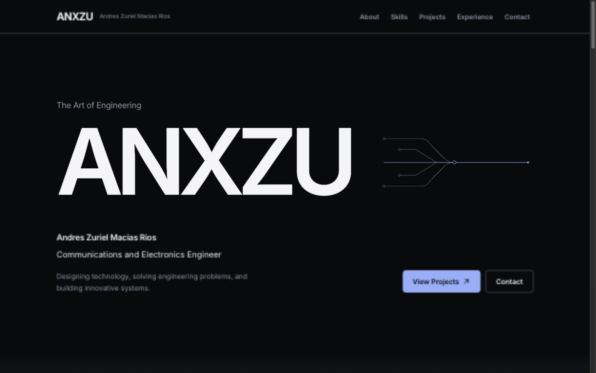
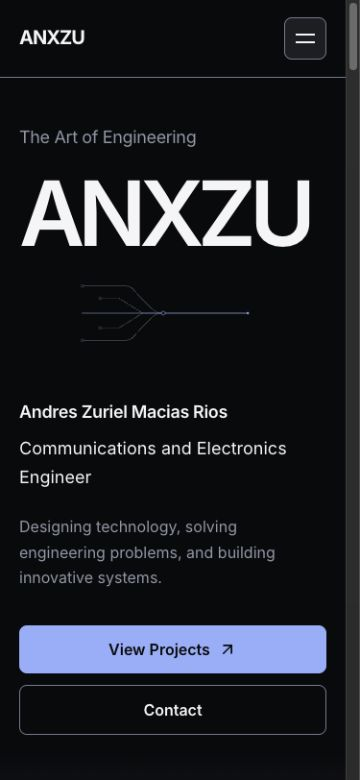
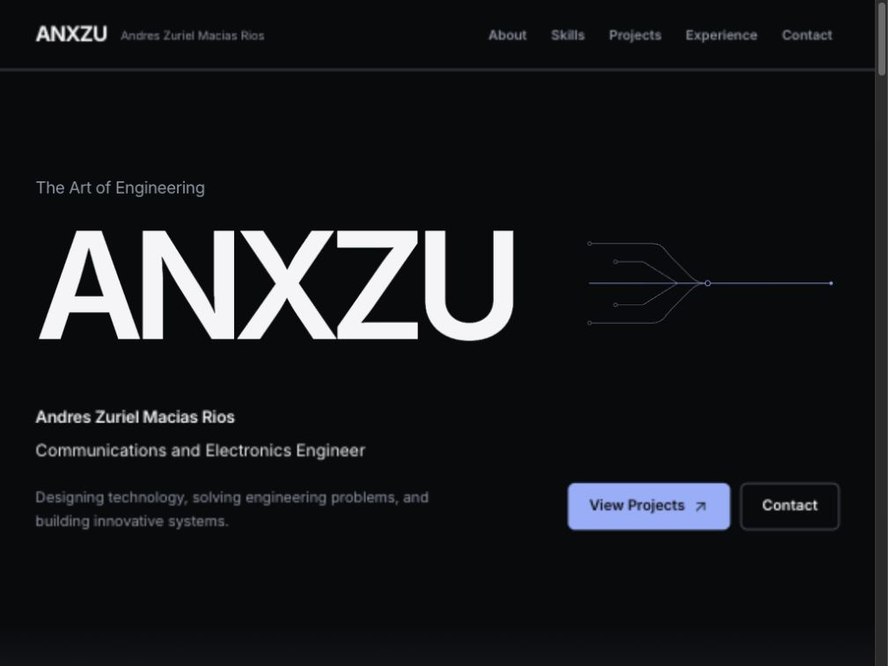

# ANX-003 — Cinematic Hero

Fecha de cierre: 22 de octubre de 2026 · America/Mexico_City.

**Estado: implementado y validado dentro de los límites descritos.** Rama `codex/anx-001-redesign-audit`. Sin publicación ni avance a ANX-004.

## Concepto y alcance

Dirección: ANXZU — The Art of Engineering. Se sustituye el hero centrado en el nombre personal por una composición editorial: marca de gran escala a la izquierda, trazas SVG convergentes a su lado y una base con el nombre completo, profesión, mensaje existente y dos CTA. En móvil la composición se apila sin forzar una altura de pantalla cuando el contenido necesita más espacio.

Se mantienen Inter y la paleta/tokens de ANX-002. El gesto protagonista es la tipografía; el SVG recuerda el recorrido de conexiones y no representa una infraestructura profesional real. Sin partículas, 3D, material de Apple ni una nueva paleta. El nombre completo y la profesión no se sustituyen por una promesa inventada.

Comparación previa a implementar: se descarta ampliar simplemente el nombre personal centrado (repetiría ANX-002). Se elige una marca grande con alineación editorial y trazas contenidas, sin añadir tarjetas, contadores ni etiquetas técnicas ficticias.

Skills: `frontend-design` para jerarquía, restricción visual y composición propia; `ui-ux-pro-max` para movimiento reducido y scroll nativo. La consulta `reduced motion scroll --domain ux` respalda la alternativa estática. Las recomendaciones de presets se evalúan como orientación; no justifican instalar GSAP.

Referencias revisadas: `audit.md`, `roadmap.md` y `design-system.md`. `anx-002-report.md` no existe en el checkout inicial; los resultados de ANX-002 están dentro de `design-system.md`. No se reconstruye ni atribuye un informe inexistente.

Este encargo acota ANX-003 exclusivamente al Hero, aunque el roadmap inicial contemplaba también Conexión. No se modifica About ni ninguna otra escena. ANX-004 no se inicia y no se publica en producción.

## Plan de movimiento

- A: entrada breve de ANXZU, con opacidad alta de partida y desplazamiento corto; contenido visible por defecto.
- B: perfil y CTA con una demora pequeña coordinada; SVG acompaña la misma secuencia una sola vez, sin loop.
- C: la marca y las trazas ceden protagonismo durante scroll nativo; el texto profesional y los CTA no se vuelven transparentes. Sin pinning, bloqueo ni espaciadores artificiales. Preferir timeline CSS; fallback contenido y con cleanup si hace falta.
- Hover/foco: feedback de los tokens existentes más desplazamiento mínimo de icono.
- Reduced motion: estado final estático, sin reproducción de entrada/salida ni listeners innecesarios.

## Implementación final

### Estado A — Introducción

`ANXZU` es el único h1. Inter y el tamaño Display XL existente escalan la marca mediante `clamp()`; no se introduce una fuente ni una escala global nueva. El nombre completo se conserva como presentación personal junto con la profesión y el mensaje originales.

La marca entra durante 650 ms con el easing editorial existente, opacidad de .85 a 1 y desplazamiento de 12 px en escritorio / 6 px en móvil. No hay texto inicialmente invisible, ni una dependencia de IntersectionObserver, clase de montaje o promesa para mostrar la información.

### Estado B — Presentación

Perfil/CTA y SVG comienzan con 200 ms de demora y duran 650 ms. El perfil parte de opacidad .95 y desplazamiento de 8 px; las trazas usan opacity/transform de forma decorativa, sin animar geometría ni mantener un loop. Los CTA están presentes y funcionan desde el render inicial.

El SVG contiene cuatro rutas convergentes, una línea central y terminales. Está marcado como decorativo (`aria-hidden` y `focusable="false"`), sin nombres de servicios, proveedores ni supuesta topología real. No añade pasos a la navegación por teclado.

Los botones conservan los estados de color, foco y tacto de ANX-002. El icono del CTA de proyectos se desplaza 2 px en horizontal y vertical al hover/focus-visible, con el token de 200 ms. No se altera el cursor ni se añade magnetismo.

### Estado C — Transición

El navegador de validación admite `animation-timeline: view()` y `animation-range`. La salida se ejecuta mediante una timeline CSS nombrada en el propio Hero. Durante su salida natural, el masthead se desplaza hasta −16 px (−8 px en móvil); la marca conserva al menos .8 de opacidad y las trazas terminan en .45. El perfil y los CTA no se desvanecen durante scroll.

Una unión estática de 3rem al pie del Hero utiliza el fondo secundario existente para enlazar visualmente con About. No cambia About ni intercepta el scroll. No hay sticky/pinning, pausas, pantallas adicionales ni espaciadores.

En motores sin ambas características, `heroMotion.js` aplica el mismo progreso acotado mediante una variable CSS, un listener pasivo de scroll y resize agrupados con requestAnimationFrame. No introduce estado React por frame. El cleanup cancela el frame pendiente, elimina listeners y retira la variable. La implementación nativa no registra esos listeners.

### Movimiento reducido y fallo de animaciones

Se reutiliza `useReducedMotion` de ANX-002, que escucha cambios de preferencia. En reduced motion el Hero muestra el estado estático final: sin entradas, salida, transformaciones ni animación de icono. No se monta trabajo de fallback; al cambiar la preferencia el cleanup elimina cualquier trabajo previo. Las reglas globales de ANX-002 se mantienen intactas.

Las propiedades base son legibles y visibles con animaciones ausentes. El estado sin timeline nativa dispone de fallback; el estado sin animaciones CSS no exige completar una secuencia para acceder a los CTA. La SPA sigue requiriendo JavaScript para renderizar React, como antes.

## Archivos modificados y preservación

| Archivo | Cambio |
| --- | --- |
| `src/components/sections/hero.jsx` | Composición, SVG decorativo, icono y conexión con reduced motion |
| `src/style/hero.css` | Estilos exclusivos del Hero, entrada, salida, responsive y reduced motion |
| `src/components/sections/heroMotion.js` — nuevo | Fallback de salida para motores sin timeline nativa |
| `tests/hero-motion.test.js` — nuevo | Cuatro regresiones de scheduling, progreso y cleanup |
| `docs/redesign/anx-003-report.md` — nuevo | Este reporte |
| `docs/redesign/reports/anx-003-desktop.jpg` — nuevo | Captura 1440 × 900 |
| `docs/redesign/reports/anx-003-desktop-1024.jpg` — nuevo | Comparación al tamaño de ANX-002, 1024 × 768 |
| `docs/redesign/reports/anx-003-mobile.jpg` — nuevo | Captura 375 × 812 |

Se compararon hashes SHA-256 con el estado inicial de esta fase: solo cambiaron los dos archivos existentes del Hero. Los otros **68 archivos del manifiesto** permanecen idénticos, incluidos las escenas ajenas, navegación, datos, seis diagramas, tokens, assets, documentos previos y dependencias. Los cambios preexistentes del usuario se conservan. No se renombraron IDs ni rutas; `#hero`, `#projects` y `#contact` siguen siendo los destinos originales.

**Dependencias añadidas: ninguna.** CSS y SVG resuelven la secuencia; el fallback de JavaScript evita una biblioteca para un único progreso de scroll. No se instalaron GSAP, ScrollTrigger, Motion, Three.js ni Lenis. El icono procede de React Icons, ya instalado.

## Pruebas ejecutadas

```sh
npm run lint
npm run build
node --test tests/foundations.test.js
node --test tests/foundations.test.js tests/hero-motion.test.js
git diff --check
```

Todos terminaron correctamente. Las cuatro pruebas de foundations se conservan y pasan; las cuatro nuevas comprueban:

1. Reduced motion no agenda trabajo de fallback.
2. Timeline nativa no monta el fallback.
3. Scroll repetido se agrupa en un frame, el progreso se limita a 0–1 y el cleanup cancela trabajo/listeners.
4. Cambiar de reproducción a reduced motion retira la variable y deja de agendar actualizaciones.

Build de producción con Vite 7.3.7: 259 módulos, JS 488,37 kB (151,89 kB gzip), CSS 35,42 kB (6,90 kB gzip). Frente a ANX-002: +2,52 kB JS y +3,66 kB CSS sin gzip; +0,77 y +0,75 kB gzip respectivamente. Imagen y fuente se mantienen. Esto es peso de build, no una medición de carga o FPS.

### Responsive y contenido

Pruebas sobre Vite Preview, sin modificar zoom del navegador. Comparar ancho útil (`clientWidth`) con ancho del documento (`scrollWidth`); la scrollbar ocupa 15 px en este entorno.

| Viewport | Ancho útil / documento | Ancho marca / espacio de identidad | Resultado |
| --- | --- | --- | --- |
| 320 × 812 | 305 / 305 | 257,61 / 265 px | Sin overflow |
| 375 × 812 | 360 / 360 | 301,89 / 320 px | Sin overflow |
| 768 × 900 | 753 / 753 | 420,42 / 439,69 px | Sin overflow |
| 1024 × 900 | 1009 / 1009 | 550,25 / 596,72 px | Sin overflow |
| 1440 × 900 | 1425 / 1425 | 710,98 / 746,66 px | Sin overflow |

También se inspeccionó 1024 × 768 para comparar con la captura anterior. En móvil la altura del Hero depende del contenido: aprox. 822 px a 320 y 833 px a 375 en estas medidas; se permite scroll normal cuando supera el viewport. No se recortan CTA para forzar una sola pantalla.

La home mantiene un h1, un main, el nombre completo y profesión exactos. Las rutas y los IDs de las demás escenas no cambian.

### Movimiento y contraste

- Estilos calculados del navegador: `hero-arrive` 650 ms y demora 0; `hero-connect` / `hero-present` 650 ms y demora 200 ms.
- Salida medida durante scroll nativo: al pasar el Hero de top 0 a −200 px, el masthead pasó de transform 0 a aproximadamente −4,59 px; la opacidad de marca pasó de 1 a .943 y las trazas de .85 a .735. El perfil/CTA permaneció en 1 y About entró a top 700 px. La salida completa se observó en −16 px / .8 / .45, sin desaparecer el contenido crítico por una clase de revelado.
- El cálculo y las pruebas de ANX-002 conservan Pearl/Obsidian 18,19:1, Silver/Obsidian 6,63:1, Ice Blue/Obsidian 8,97:1. Se preservan esos pares y los estilos de foco. La entrada de perfil no baja de .95; la marca usa opacidades altas y la salida no afecta la opacidad del texto secundario profesional. El SVG es decorativo.
- El navegador no expone emulación de media queries en las capacidades conectadas. Se revisaron las reglas CSS de reduced motion y se probó el lifecycle de su fallback con fixtures; **no se cambió ni se simuló la preferencia real del sistema**. Queda pendiente esa comprobación integrada en hardware/navegador con emulación disponible.

### Teclado, CTA y regresiones

- Primer Tab: Skip to content. Enter lleva al main; Tab siguiente llega a View Projects con outline visible y el icono a transform (2, −2).
- View Projects por Enter cambia a `#projects`, enfoca esa sección y deja su comienzo aproximadamente a 104 px del borde superior, bajo el header.
- Contact por Enter cambia a `#contact` y enfoca esa sección.
- Menú móvil abre con Enter; Escape cierra, conserva `aria-expanded="false"`, devuelve foco a Open menu y mantiene objetivo 44 × 44. Su código no se modificó.
- Entrada directa y recarga de ambos proyectos a 375 px: Concurrencia conserva cuatro React Flow y Metodología dos, ambos con un main/h1 y ancho útil/documento de 360/360. Sin errores/warnings en la consola consultada. No se reensayaron todos los controles de cada diagrama; sus archivos son idénticos a ANX-002.

## Evidencia visual y comparación

Las leyendas indican el viewport CSS solicitado. El export del navegador produjo JPEG de 1425 × 891 (escritorio), 1009 × 757 (comparación) y 360 × 780 (móvil); no son archivos con las mismas dimensiones del viewport solicitado.

Captura final de escritorio (1440 × 900):



Captura final móvil (375 × 812):



Comparación al mismo tamaño de 1024 × 768: ANX-002 ponía el nombre personal centrado como título; ANX-003 separa la marca, perfil y acciones y añade un dibujo técnico contenido. Se conserva la información y se elimina la dependencia de que el nombre personal sea la única pieza dominante.

Antes, ANX-002:


Después, ANX-003:



## Resultados, riesgos y límites

El Hero tiene una composición nueva, entrada coordinada, salida progresiva y CTA accesibles; responsive comprobado en los tamaños solicitados, sin desbordamientos observados. No se detectaron regresiones en la revisión de proyectos ni diferencias de archivos ajenos al alcance.

No se midieron Lighthouse, Web Vitals, CLS, FPS ni comportamiento de lector de pantalla. No se garantiza una tasa de 60 FPS por inspección visual. Reduced motion integrado a nivel de sistema y el fallback en un motor antiguo real quedan pendientes; la lógica está cubierta por pruebas, pero no equivale a esa validación visual. Las capturas muestran el estado estable, no certifican la fluidez de toda la secuencia.

En el ajuste final se dejó un margen de aproximadamente 36 px a la marca dentro de su carril a 1440 px. Fuentes de sistema alternativas, zoom alto y anchos físicos/intermedios no se cubren exhaustivamente con esta matriz. Los casos continúan cargándose anticipadamente como en ANX-002; la reducción de bundle queda para su fase. El dominio de producción y sus rewrites no se tocaron.

## Recomendaciones para ANX-004

- Mantener la claridad de la marca y reducir la densidad de la presentación de proyectos, respetando las dos URLs y todo su detalle.
- Derivar visuales de los diagramas reales, sin capturas, demos ni métricas inventadas; no introducir Nodalume sin material adecuado.
- Separar la carga de los casos/React Flow y medir la carga inicial antes de añadir más movimiento.
- Verificar en un entorno con emulación reduced motion y dispositivos reales tanto este Hero como los diagramas; no multiplicar la misma entrada en todas las escenas.
- Conservar About y sus anclas hasta una instrucción específica para rediseñar Conexión. Las recomendaciones no se implementaron en esta entrega.
