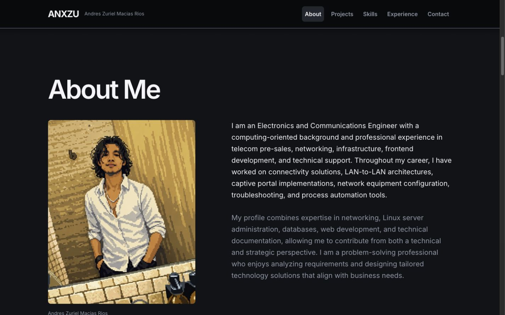
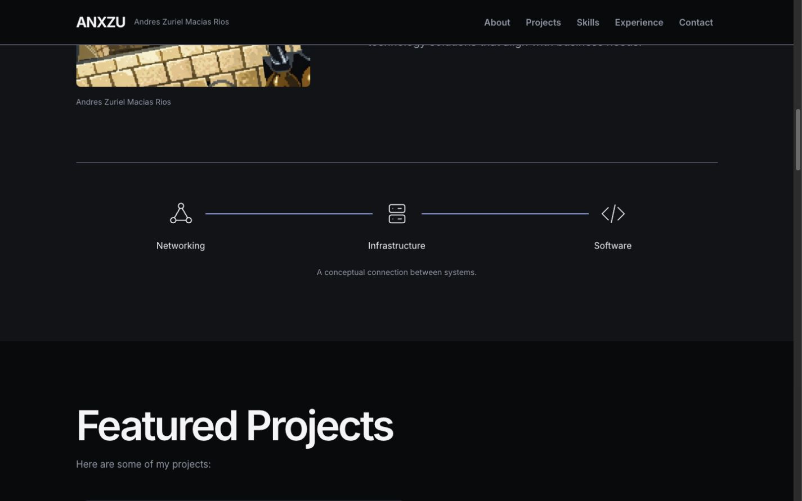
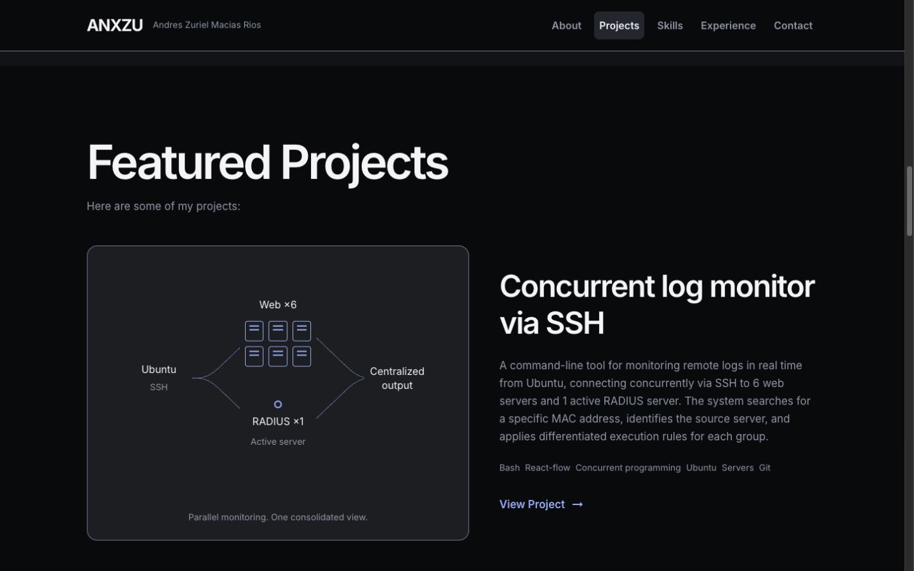
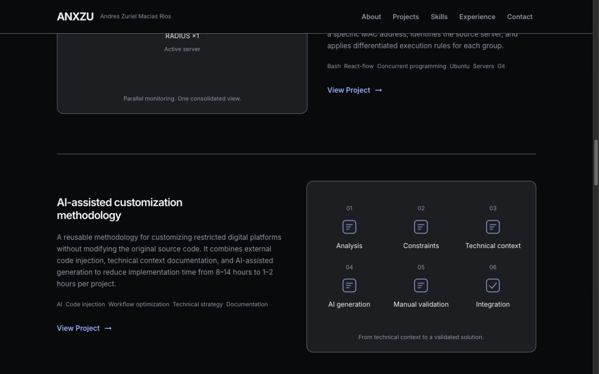
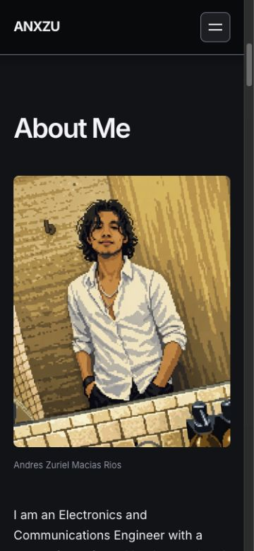
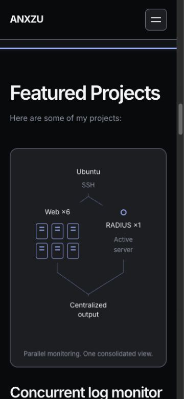

# ANX-004 — Connection & Project Storytelling

Fecha: 22 de octubre de 2026 · America/Mexico_City.

**Estado: implementada para revisión, con las limitaciones de validación indicadas al final.**

## Decisiones previas a la implementación

Se conserva ANX-003 íntegra y se trabaja en `codex/anx-001-redesign-audit`. No se publica ni se inicia ANX-005. La referencia de ANX-002 está en `design-system.md`; el archivo separado `anx-002-report.md` sigue sin existir. Se revisaron auditoría, roadmap, sistema visual, reporte ANX-003 y código actual.

Dirección de `frontend-design`: composición editorial con un retrato real y prosa completa; conexión conceptual, sin topología profesional inventada. Showcase asimétrico: monitor SSH con mayor escala visual por su explicación técnica, metodología con composición complementaria y todo su contenido. No se repite una plantilla de tarjetas ni se fabrican capturas.

Investigación de `ui-ux-pro-max`: `editorial portfolio case study --domain landing` aporta el criterio de visuales protagonistas, neutralidad y rapidez; no se adopta su grid genérico, filtros, badges ni logos sin contenido. `lazy loading suspense --stack react` respalda React.lazy por ruta; `reduced motion scroll --domain ux` respalda alternativas estáticas y scroll nativo.

Plan:

- About: retrato y dos párrafos originales en columnas; SVG conceptual de Networking, Infrastructure y Software, con una única iluminación progresiva por scroll como mejora CSS.
- Proyectos: diagramas ligeros HTML/SVG basados en los flujos existentes. Monitor Ubuntu/SSH → seis web y un RADIUS activo → salida centralizada; metodología con sus seis pasos reales. Todo el copy y competencias permanecen.
- Continuidad: Hero → About → Proyectos → Capacidades, moviendo solo el orden de las dos secciones intermedias, sin rediseñar capacidades/experiencia/contacto.
- Routing: dos imports dinámicos, Suspense estable y accesible, error boundary con recarga o regreso. El foco y los hashes deben resolverse después del montaje asíncrono.
- Retrato: derivados responsive mediante herramientas locales, conservando PNG original. Imagen bajo el Hero con lazy loading; no se añade imagen crítica al primer viewport.
- Sin bibliotecas de animación nuevas. No se toca el funcionamiento interno de los seis React Flow.

## Línea base medida antes de animar

`npm run build -- --manifest`: 259 módulos; JS único 488,37 kB (151,89 kB gzip informado por Vite), CSS 35,42 kB (6,90 kB gzip), PNG 1653,47 kB. No hay separación de rutas todavía. Manifest y tamaños exactos guardados temporalmente para comparación. No son Web Vitals.

## Resultado visual y contenido

About conserva sus dos párrafos íntegros y el retrato original. Un título amplio, el retrato a la izquierda y la biografía a la derecha continúan el lenguaje editorial del Hero. En móvil se apilan y la prosa conserva su tamaño legible y alineación izquierda. La firma al pie del retrato utiliza el nombre real existente.

El SVG de conexión ocupa el cierre de About. Networking, Infrastructure y Software son campos respaldados por el contenido existente; el caption especifica que la relación es conceptual. No representa nodos operados por el propietario ni una topología real. Los iconos y conectores son SVG pequeños; los rótulos son HTML y no se reducen a texto diminuto dentro de un viewBox.

El showcase reemplaza los bloques de imagen textual por diagramas derivados del contenido:

- **Monitor SSH:** seis símbolos de servidor web y un servidor RADIUS activo, conexión desde Ubuntu/SSH y salida centralizada. Es un esquema simplificado del monitoreo real descrito; no una captura de terminal ni una interfaz ficticia. Los labels HTML y conectores SVG cambian a una disposición vertical en móvil.
- **Metodología:** lista ordenada de los seis pasos del diagrama existente: análisis, restricciones, contexto, generación asistida, validación manual e integración. La numeración expresa una secuencia real, no decoración. La composición se invierte en escritorio y se apila en móvil.

Se conservan títulos, descripciones, competencias y enlaces de ambos proyectos, incluida la afirmación de horas preexistente de Metodología, sin amplificarla ni afirmar una verificación independiente de resultados. Los casos completos y sus seis React Flow no se sustituyen por estos esquemas de portada. No se añadió Nodalume ni experiencia cloud.

Proyectos se movió antes de Capacidades y el orden del menú de inicio acompaña esa secuencia. Sus enlaces siguen siendo About, Projects, Skills, Experience y Contact; sus IDs y las secciones de capacidades/experiencia/contacto permanecen. No se implementó su rediseño ANX-005.

## Movimiento e interacciones

- About tiene una sola animación protagonista: iluminación del conector por scroll mediante `view-timeline`. La línea base es siempre visible; el trazo de acento pasa de dashoffset 1 a 0 y opacidad .35 a .9. Los textos y el retrato no esperan un revelado.
- El showcase tiene una entrada discreta únicamente en el visual del primer proyecto: escala .985→1 y opacidad .98→1, conservando contraste de los labels. La metodología permanece estática; no se repite la animación en todas las unidades.
- Flechas de proyecto: 3 px al hover/focus, token de 200 ms. El borde del visual indica foco dentro del artículo; la superficie completa no aparenta ser un enlace.
- No hay loops nuevos, scroll interceptado, pinning, parallax ni biblioteca de animación. Las animaciones de escenas son mejoras CSS en motores compatibles; en otros motores el diagrama y el showcase quedan completos y estáticos.
- `prefers-reduced-motion` deja el conector completo y elimina escala/entrada; las reglas globales existentes cubren las microinteracciones. No se añadieron listeners JS de animación de estas escenas.

En el navegador se observó `connection-illuminate` con el estado final dashoffset 0 y opacidad .9. La preferencia reducida real del sistema no se emuló: se revisaron sus reglas y pasan las pruebas existentes de reduced motion; no se presenta esto como una prueba visual con la preferencia activada.

## Carga diferida, errores y navegación

`App.jsx` declara dos `React.lazy` y conserva React Router. Cada caso tiene su import dinámico. `ProjectRoute.jsx` proporciona un Suspense con header, título real del proyecto, estado `role="status"` y un viewport de altura reservada; no usa animación de skeleton ni deja una pantalla vacía. El status no se encierra en un contenedor `aria-busy` que pueda aplazar su anuncio.

El error boundary ofrece un aviso `role="alert"`, **Reload project** y **Back to projects**. La recarga es deliberadamente completa: React.lazy conserva un import rechazado y simplemente volver a renderizar el mismo objeto lazy no garantiza reintento. El regreso apunta a `/#projects`. No se introducen parámetros de prueba ni rutas adicionales en producción.

`ScrollToTop` ahora espera a que el destino real exista después de Suspense, ignorando el fallback pendiente. Un MutationObserver se desconecta al resolver y se limpia al cambiar de ruta. Para hashes, se comprueba estabilidad de la posición durante tres frames antes del único salto; así los diagramas existentes pueden ajustar su altura móvil sin ocultar el título bajo el header. Se cancelan frames y observadores al desmontar/cambiar de ubicación. Los hashes malformados no provocan un error de decode.

Se detectó y corrigió una carrera en `#highLevel` de Concurrencia: antes de sincronizar layout terminaba a −36 px; después de corregirlo, entrada directa y recarga móvil terminaron a aproximadamente 103,61 px, enfocando el destino. No fue necesario cambiar la lógica interna de los gráficos.

## Comparación de build

Valores en kB decimales, sin gzip, medidos sobre archivos reales. Build final Vite 7.3.7: 266 módulos.

| Recurso | Antes | Después | Tratamiento |
| --- | ---: | ---: | --- |
| JS inicial de portada | 488,37 | 263,88 | −45,97 %; React, Router y UI de portada permanecen |
| CSS inicial | 35,42 | 24,59 | CSS de diagramas/detalles diferido |
| Chunk compartido React Flow | Incluido en inicial | 176,46 | Carga al abrir un caso |
| Chunk Concurrencia | Incluido en inicial | 40,49 | Import dinámico propio |
| Chunk Metodología | Incluido en inicial | 13,69 | Import dinámico propio |
| CSS compartido de detalles/Flow | Incluido en inicial | 17,43 | Carga con los casos |
| Total de JS de todas las rutas | 488,37 | 494,52 | Aumenta 6,15 kB por la nueva UI y separación |
| Total de CSS de todas las rutas | 35,42 | 42,02 | Aumenta por las composiciones y estados de carga |

Gzip informado por Vite para JS inicial: 151,89→85,30 kB. El coste total de todas las rutas no desaparece: se evita descargar React Flow con la portada y se paga cuando se necesita.

`node scripts/check-project-chunks.mjs` realiza un build en memoria e inspecciona IDs de módulos e imports estáticos. Verifica que la clausura inicial no contiene `@xyflow`, d3 de gráficos ni zustand; ambos chunks dinámicos conservan React Flow. El chunk compartido de gráficos aparece únicamente como dependencia de las rutas de proyecto. No se confunde la presencia de sus URLs en el mapa de imports dinámicos con una descarga inicial.

La prueba HTTP local con caché desactivada confirmó: al abrir home se solicitaron el JS/CSS iniciales, el retrato 480 y el icono; el CSS/JS compartido de Flow se solicitó al navegar al caso. Esta observación se obtuvo en el servidor de QA antes del último ajuste de sincronización de foco; la separación final se volvió a comprobar con el script de módulos.

Datos exactos y método de compresión adicional en [anx-004-bundles.json](reports/anx-004-bundles.json). El JSON usa gzip Python nivel 6 para una comparación reproducible propia; puede diferir ligeramente del gzip impreso por Vite y no es una medida de transferencia real.

**No son LCP, INP, CLS, puntuaciones Lighthouse ni una medición de velocidad de conexión.** No se añadieron dependencias.

## Retrato responsive

Se conservó `src/assets/images/anxzu.png`, 1024×1536 y 1.653.473 bytes. Se generaron JPEG mediante `sips` local, calidad 88, sin cambiar el contenido de la foto:

| Variante | Dimensiones | Bytes |
| --- | --- | ---: |
| 480 | 480×720 | 157.315 |
| 768 | 768×1152 | 305.451 |
| 1024 | 1024×1536 | 455.950 |

El derivado más grande pesa un 72,42 % menos que el PNG; la variante menor, un 90,49 % menos. Son archivos con compresión con pérdida: no se afirma equivalencia píxel a píxel. La revisión visual a tamaños de presentación conservó el aspecto del retrato; falta comparación en hardware de alta densidad. El intento de AVIF falló en el encoder local pese a figurar como formato de salida; no se instaló otra herramienta para forzarlo.

`srcSet` y `sizes` permiten elegir variante. Se reservan dimensiones y el marco de recorte; `loading="lazy"` y `decoding="async"` se aplican a este contenido situado después del Hero. El navegador puede anticipar su descarga por proximidad al viewport. No hay una nueva imagen crítica en el primer viewport y el Hero permanece intacto. La suma de las tres variantes no debe interpretarse como descarga obligatoria de una página.

## Archivos de implementación y preservación

Existentes modificados:

- `src/App.jsx`: imports dinámicos y shell de proyectos.
- `src/components/utils/ScrollToTop.jsx`: hashes/foco tras carga y layout asíncronos.
- `src/components/sections/about.jsx` y `src/style/about.css`: composición, retrato responsive y conexión conceptual.
- `src/components/ui/projects_card.jsx` y `src/style/projects.css`: showcase y microinteracciones.
- `src/pages/Home.jsx`, `src/data/navigation.js`: orden narrativo y orden de enlaces coherente.

Nuevos:

- `src/components/ui/ConnectionDiagram.jsx`, `src/components/ui/ProjectVisual.jsx`.
- `src/components/layout/ProjectRoute.jsx`, `src/style/project-route.css`.
- Tres JPEG en `src/assets/images/portrait/`.
- `scripts/check-project-chunks.mjs`.
- Este reporte, capturas y JSON de comparación en `docs/redesign/reports/`.

La comparación SHA-256 contra el comienzo de ANX-004 confirma que el Hero y su CSS/helper, los seis archivos React Flow, tokens/base, datos de proyectos/capacidades/experiencia/contacto, PNG original y archivos de dependencias no cambiaron. Se comprobó además igualdad exacta de los dos párrafos originales de la biografía. Los archivos preexistentes del usuario se preservaron. No se modificaron páginas internas ni sus textos.

## Pruebas y resultados

```sh
npm run lint
npm run build -- --manifest
node --test tests/*.test.js
node scripts/check-project-chunks.mjs
git diff --check
```

Todos pasan. Ocho pruebas existentes pasan; la comprobación de chunks añade aserciones de aislamiento sin instalar otro runner. El script usa la API de Vite ya instalada y no escribe un segundo build a `dist`.

### Responsive

Ancho útil (`clientWidth`) / ancho del documento (`scrollWidth`), scrollbar de 15 px en este entorno. Se validaron los tres destinos en cinco anchos con altura 900 px, además de capturas móviles a 375×812.

| Ancho | Home | Concurrencia | Metodología |
| --- | --- | --- | --- |
| 320 | 305/305 | 305/305 | 305/305 |
| 375 | 360/360 | 360/360 | 360/360 |
| 768 | 753/753 | 753/753 | 753/753 |
| 1024 | 1009/1009 | 1009/1009 | 1009/1009 |
| 1440 | 1425/1425 | 1425/1425 | 1425/1425 |

Sin overflow horizontal en las quince combinaciones. Home tiene cero instancias React Flow; Concurrencia cuatro y Metodología dos. Las variantes móviles del esquema mantienen labels HTML legibles y muestran seis web, un RADIUS activo y salida, sin desplazar el documento horizontalmente.

### Navegación, diagramas y teclado

- Entrada directa y recarga de las rutas originales y hashes profundos; `#highLevel` móvil corregido, y `#solucion` de Metodología enfocado a unos 104 px tras resolver una carga retrasada.
- Hero → View Projects por Enter conserva foco de sección; Tab llega al primer enlace de proyecto con outline sólido y flecha desplazada 3 px.
- Zoom In de Concurrencia por Enter cambia la escala de aproximadamente .2525 a .3030. Los seis diagramas siguen montados y sus archivos no cambiaron; no se ensayó cada control de cada gráfico.
- Regreso mediante la marca del header llega a `/` con foco en `main-content`.
- Menú móvil por Enter y Escape conserva etiqueta dinámica, `aria-expanded="false"` al cerrar y foco en Open menu.
- La consola consultada del sitio normal no mostró errores/warnings. Los errores HTTP/React de la prueba de fallo intencional pertenecen al servidor de QA y se esperan en ese escenario.

### Suspense y recuperación, probados con fallos reales locales

Se utilizó un servidor temporal separado en 127.0.0.1:4174 que sirve el build, sin modificar el código de la aplicación ni sus URLs de producción:

1. Retraso de 8 segundos en el chunk de proyecto: se observó `Loading project…`, header, título y un main reservado de 100svh. Al resolver Concurrencia aparecieron cuatro diagramas y el foco llegó al main.
2. Entrada directa a Metodología con `#solucion` y retraso: primero se observó el fallback; después, dos diagramas y foco/scroll al hash correcto.
3. Respuesta HTTP 503 intencional del chunk: apareció el aviso accesible, botón Reload project, enlace Back to projects y foco en el main de error.
4. Restauración del servidor y activación por Enter de Reload project: Metodología volvió a cargar, conservando `#solucion` y su foco. Se cerró la pestaña de QA al terminar.

El servidor y sus controles viven temporalmente fuera del repositorio; no se incorporaron flags de simulación ni servicios externos al producto. No se midió CLS durante estas transiciones: la altura reservada es una medida de diseño, no un resultado de Web Vitals.

## Capturas

Las dimensiones indicadas son viewports solicitados; el export JPEG puede cubrir solo el área útil del navegador.

Perfil, escritorio (1440×900):



Conexión conceptual y continuidad (1440×900):



Proyecto protagonista (1440×900):



Composición complementaria (1440×900):



Perfil móvil (375×812):



Showcase móvil (375×812, captura con foco de teclado):



Evidencia adicional de [carga lenta](reports/anx-004-loading.jpg) y [error recuperable](reports/anx-004-load-error.jpg).

## Problemas pendientes y límites

No se ejecutó Lighthouse ni se midieron LCP/CLS/INP/FPS. No se probó lector de pantalla ni la preferencia real de reduced motion mediante emulación del sistema; las mejoras nuevas se excluyen con media queries y las pruebas existentes de lógica de movimiento siguen pasando. La ausencia de una simulación visual del sistema se mantiene explícita.

La matriz no sustituye hardware físico, zoom 200/400 %, fuentes alternativas ni todos los anchos intermedios. El retrato conserva compresión JPEG con pérdida; AVIF/WebP pueden reevaluarse cuando haya un encoder disponible y comparación de calidad. El fallback reserva el primer viewport, no la altura completa de todos los detalles largos.

No se tocaron los rewrites de producción. Un despliegue posterior debe conservar assets versionados mientras puedan existir pestañas con HTML antiguo; la acción de recarga ayuda a recuperarse, pero no sustituye esa estrategia de hosting. Los totales de JS/CSS aumentan ligeramente y deben seguir controlándose.

No se detectaron regresiones pendientes en las comprobaciones realizadas. ANX-005 no se implementó.

## Recomendaciones para ANX-005

- Llevar la jerarquía tipográfica a capacidades/experiencia/contacto sin convertir todo en nuevas superficies o repetir revelados.
- Mantener las ocho categorías y cuatro registros originales; no atribuir experiencia cloud ni educación no documentada.
- Diseñar la escena clara con los tokens semánticos ya validados, revisando contraste en estados interactivos.
- Mantener el correo directo accesible hasta una decisión explícita sobre formulario; no simular envíos.
- Completar pruebas con tecnologías de asistencia y reduced motion real, y medir rendimiento en condiciones reproducibles antes de declarar objetivos alcanzados.
