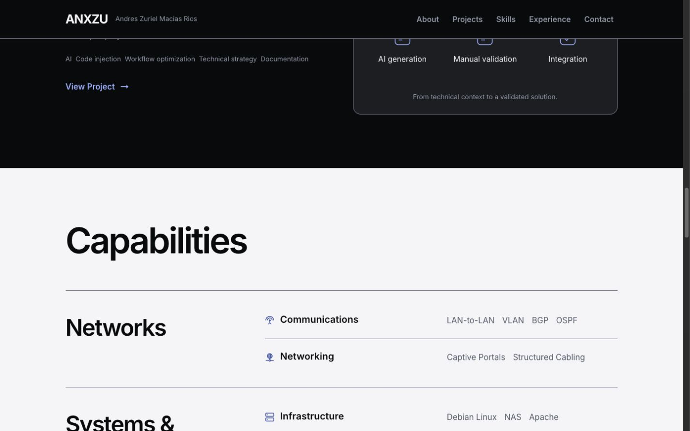
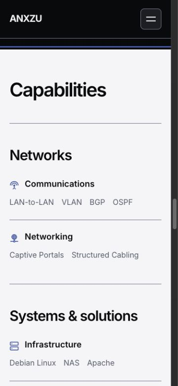
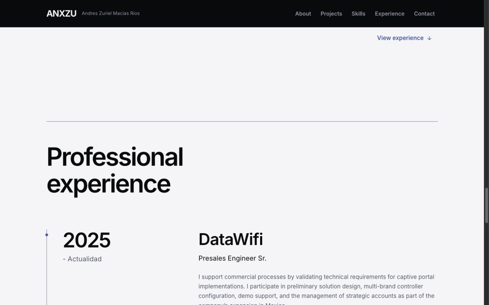
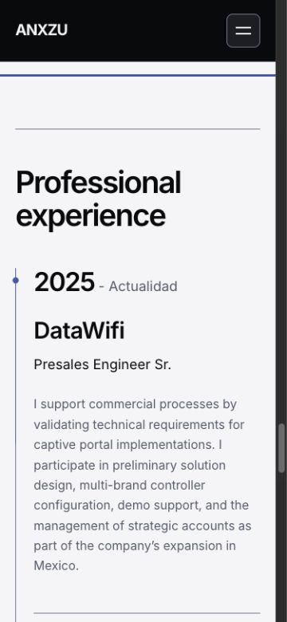
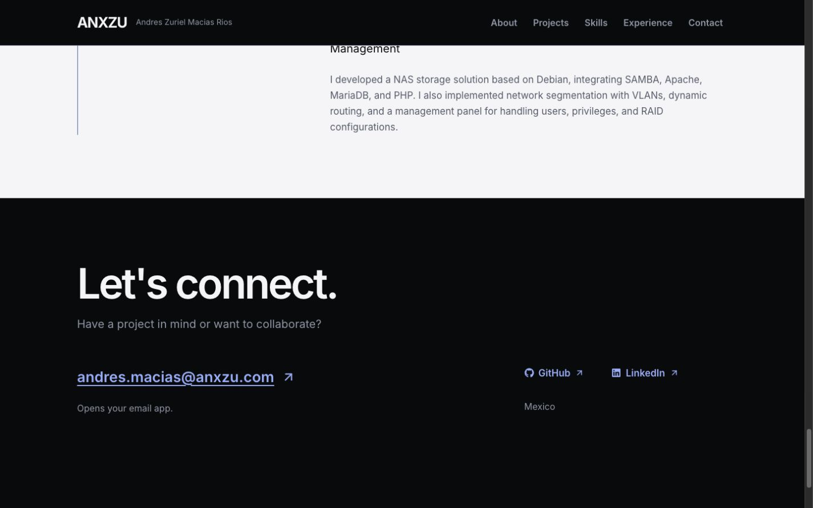
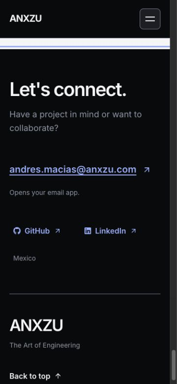
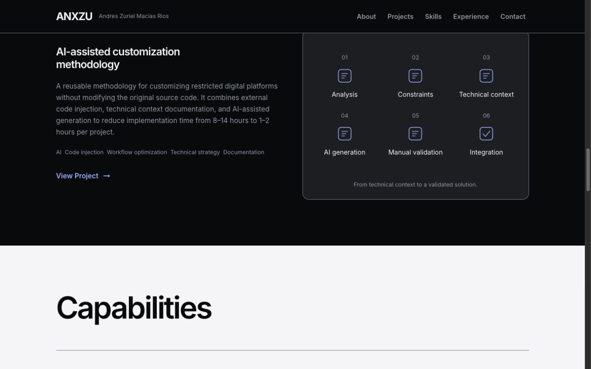
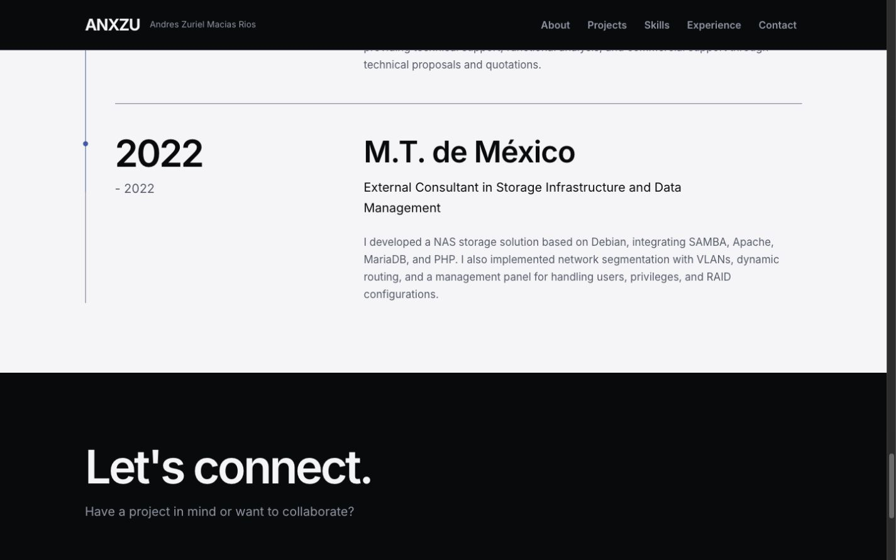

# ANX-005 — Expertise, Experience & Contact

Fecha: 22 de octubre de 2026 · America/Mexico_City.

**Estado: implementada para revisión local, con los límites de validación indicados al final.** Rama `codex/anx-001-redesign-audit`. Sin commits ni publicación; ANX-006 fuera del alcance.

## Dirección antes de implementar

Se revisaron auditoría, roadmap, design-system, reportes ANX-003/004 y código/datos actuales. Se preserva el trabajo previo mediante un manifiesto SHA-256 al comienzo de esta fase.

Se aplican `frontend-design` y `ui-ux-pro-max`. Las búsquedas locales `text contrast light surface --domain ux` y `reduced motion scroll --domain ux` aportan contraste mínimo de texto normal 4,5:1 y alternativa estática sin scroll interceptado. No se adopta una segunda paleta ni una nueva tipografía.

Paleta existente: Obsidian #090A0C, Graphite #1C1E23, Pearl #F5F5F7, Slate #525B6B, azul profundo #2458A6 e Ice Blue #81AFFF. Se consumen exclusivamente sus tokens semánticos. Inter y las escalas fluidas existentes mantienen títulos y prosa alineados a la izquierda.

Composición elegida:

```text
Projects (oscuro, intacto)
Capacidades (Pearl)
  Título amplio
  Familia                  Categoría / tecnologías originales
  Networks                 Communications, Networking
  Systems & solutions      Infrastructure, Cybersecurity, Technical Pre-Sales
  Software                 Web Development, Databases, Platforms & Tools
Experiencia (Pearl, continuidad)
  Fechas protagonistas     Organización / puesto / responsabilidad
  Una línea completa       Cuatro registros, mismo orden
Contacto (Obsidian)
  Let's connect.
  Correo directo           GitHub / LinkedIn / Mexico
  ANXZU                    Regreso al Hero
```

Se descarta repetir ocho tarjetas o alternar los registros de experiencia: las familias expresan relación profesional y las fechas ordenan una única columna de lectura. Las filas informativas no reciben cursor de botón ni foco artificial. La cronología tendrá una única línea de progreso CSS por scroll; texto y línea base permanecerán completos. Las escenas no dependen de revelados. Contacto conserva correo y perfiles reales, sin formulario ni confirmación de envío.

## Resultado y preservación

Capacidades utiliza el tema Pearl mediante `data-theme="light"`. Tres familias organizan las ocho categorías completas: Networks (Communications, Networking), Systems & solutions (Infrastructure, Cybersecurity, Technical Pre-Sales) y Software (Web Development, Databases, Platforms & Tools). Las familias son agrupaciones editoriales, no nuevas acreditaciones. Los iconos originales son decorativos; las tecnologías se expresan como listas HTML, sin ocultarse en acordeones ni depender de hover.

Se reutiliza `Technical_Cards` como fila de lista con h4 y tecnologías; ya no envuelve cada categoría en Surface. Los nombres de familia son h3 bajo el h2 de sección. El enlace **View experience** tiene una función real: avanzar a `#experience`, con foco en el destino. Las filas de contenido no muestran cursor de botón, estados de selección ni tabIndex artificial.

Experiencia continúa sobre Pearl, con un divisor que organiza el mismo capítulo claro. Una lista ordenada conserva los cuatro registros en el orden original. Las fechas tienen presencia tipográfica; organización h3, puesto y responsabilidad forman la columna de lectura. En móvil fecha y contenido se apilan semánticamente sin alternar lados. Se cambia el rótulo de “Experience & Education” a **Professional experience** porque no hay registros de educación. No se modifica ningún empleo ni responsabilidad.

Contacto recupera Obsidian con **Let's connect.**, una frase de presentación derivada del copy original y el correo como CTA subrayado. GitHub y LinkedIn tienen icono y texto visible; los enlaces externos conservan `noopener noreferrer`. Mexico permanece. Una firma ANXZU/The Art of Engineering y **Back to top** cierran el recorrido; este último lleva a `#hero` y enfoca el Hero. El cierre tiene altura mínima de viewport menos header, creciendo libremente en pantallas pequeñas; no es un panel fijado ni bloquea scroll.

El correo se deriva del enlace `mailto` existente en Social. “Opens your email app.” comunica el resultado de abrirlo, sin simular un envío. No se abrió el cliente ni se enviaron mensajes en las pruebas; se validaron el URI, nombre, foco y tamaño del enlace. No hay formulario, endpoint ni backend nuevo.

La comparación DOM contra las fuentes canónicas confirmó igualdad exacta de las ocho listas de tecnologías y de periodo, organización, puesto y descripción de los cuatro registros. Solo cambia el orden de presentación de capacidades. Se conserva **2025 - Actualidad**, además de **2022 - 2022**; su vigencia y redacción pueden revisarse editorialmente después con evidencia. No se afirma una comprobación externa de los empleos.

Un manifiesto SHA-256 de 91 archivos al inicio confirma **8 archivos existentes modificados y 83 intactos**, sin eliminaciones. Hero ANX-003, About/Projects ANX-004, las páginas internas, seis gráficos React Flow, datos, navegación, routing/lazy loading, tokens, fuentes, assets y dependencias permanecen idénticos al comienzo de esta fase. Los cambios preexistentes de fases anteriores y del usuario se conservaron.

## Componentes y archivos

No se crearon componentes de aplicación ni dependencias. Se reutilizan Container, SectionHeading y ActionLink. Se adaptan Technical_Cards y TimelineCard a la estructura semántica final; Surface sigue disponible para sus demás usos.

| Archivo | Cambio en ANX-005 |
| --- | --- |
| `src/components/sections/skills.jsx` | Familias, tema Pearl, heading y enlace a experiencia |
| `src/components/ui/Technical_Cards.jsx` | Fila semántica de capacidad y lista de tecnologías |
| `src/style/skills.css` | Composición editorial, responsive y microinteracción del enlace |
| `src/components/sections/TimelineSection.jsx` | Cronología ordenada, tema claro y heading |
| `src/components/ui/TimelineCard.jsx` | Fecha, organización, puesto y responsabilidad sin tarjetas alternas |
| `src/style/timelineseccion.css` | Layout, divisores y progreso CSS opcional |
| `src/components/sections/contac.jsx` | Correo, perfiles con texto, firma y regreso al Hero |
| `src/style/contac.css` | Cierre oscuro, responsive y feedback de enlaces |

Documentación nueva: este reporte, nueve JPEG y `anx-005-bundles.json`/`anx-005-validation.json` en `docs/redesign/reports/`. Los módulos antiguos de información de contacto/perfiles no consumidos por esta nueva escena permanecen en el repositorio; no se hizo una limpieza ajena al alcance.

## Movimiento y continuidad

- Capacidades no tiene revelados ni animaciones automáticas. El cambio de superficie a Pearl es el gesto principal. View experience cambia de superficie al hover/active y su flecha baja 2 px al hover/focus, usando 200 ms.
- Experiencia tiene una sola animación protagonista: `experience-progress` sobre `::after` de la lista, con timeline nativa `entry 25% exit 80%`, transform scaleY(0→1). La línea base completa y los cuatro registros están siempre visibles. El progreso acompaña el recorrido; no es un indicador de antigüedad ni porcentaje de experiencia.
- Sin soporte de timeline o con reduced motion, la línea de acento queda completa y estática. La regla `prefers-reduced-motion: no-preference` es la única que habilita su reproducción. No hay listeners, observadores, timers ni nuevo estado React que limpiar.
- Contacto conserva superficies opacas, feedback de color y flechas de 2 px en los enlaces; 200 ms con el easing existente. Reduced motion elimina esas transformaciones y las transiciones globales. Se revisó que el override del enlace Pearl tenga la misma especificidad que hover/focus.
- No se repiten animaciones por fila, no hay loops nuevos, pinning, captura de scroll, parallax ni gradientes animados.

El navegador conectado mostró la línea con scaleY aproximadamente **.1237** al comienzo de Experiencia móvil y **1** al llegar al cierre; en una posición intermedia de escritorio, **.8573**. Son estados calculados observados, no mediciones de FPS. El navegador no expone emulación de preferencias de medios: reduced motion se revisó en CSS y se ejecutaron las pruebas de lógica existentes, pero falta una prueba visual con la preferencia real activada. No se atribuye a las pruebas de foundations cobertura automática de todas las nuevas reglas CSS.

## Accesibilidad

Headings revisados: un h1 en cada ruta; las tres escenas usan h2 con `aria-labelledby`, familias h3 y capacidades h4; organizaciones h3 dentro de la lista ordenada de experiencia. Los SVG de estas escenas son decorativos. “Actualidad” mantiene `lang="es"` dentro del contenido inglés; no se cambia la política de idioma global.

Pruebas reales de teclado:

- Menú móvil abre con Enter; Escape cierra, restaura Open menu y deja `aria-expanded="false"`.
- Skills por Enter lleva a `#skills`; Tab siguiente llega a View experience con foco azul profundo de 3 px. Su flecha baja 2 px y el enlace mide 44 px de alto. Enter enfoca Experiencia y la sitúa aproximadamente a 104 px bajo el header.
- Contact por Enter cierra el menú y enfoca `#contact`. Tab recorre correo → GitHub → LinkedIn → Back to top, con outline Ice Blue de 3 px. El correo enfocado muestra la flecha a (2, −2).
- Back to top por Enter lleva a `#hero` y enfoca el Hero. No hay filas informativas intercaladas en la tabulación.
- En móvil a 375 px, correo ~301×49 px, GitHub ~118×44, LinkedIn ~129×44 y regreso ~111×44. En escritorio el correo mide ~387×59 px. Se mantienen separación y tamaños sin depender de hover.

Contraste sRGB calculado sobre los tokens opacos realmente resueltos en el DOM; no es una certificación del sitio completo:

| Tema/estado | Texto primario | Secundario | Acento/foco | Borde |
| --- | ---: | ---: | ---: | ---: |
| Pearl normal | 18,19 | 6,29 | 6,38 | 4,23 |
| Pearl hover | 15,96 | 5,52 | 5,60 | 3,71 |
| Pearl active | 14,21 | 4,91 | 4,99 | 3,30 |
| Obsidian normal | 18,19 | 6,63 | 8,97 | 4,55 |
| Oscuro hover | 13,93 | 5,08 | 6,87 | 3,48 |
| Oscuro active | 12,70 | 4,63 | 6,26 | 3,18 |

Texto ≥4,5:1 y foco/divisores ≥3:1 en esos pares. Las pruebas existentes de tokens también pasan. Los colores hover/active de los enlaces se revisaron en CSS y por sus pares; se observó el foco real por teclado, sin afirmar una emulación sistemática de todos los estados de puntero. Las filas estáticas no tienen estados interactivos inventados.

## Build antes/después

Línea base guardada antes de editar: build final ANX-004. Build final ANX-005: Vite 7.3.7, 262 módulos frente a 266; se retiraron imports de componentes que esta escena dejó de usar, sin borrar sus archivos.

Valores en kB decimales sobre archivos reales, sin gzip:

| Recurso | ANX-004 | ANX-005 | Diferencia |
| --- | ---: | ---: | ---: |
| JS inicial | 263,877 | 265,349 | +1,472 |
| CSS inicial | 24,594 | 30,088 | +5,494 |
| JS compartido React Flow | 176,460 | 176,460 | 0 |
| JS Concurrencia | 40,485 | 40,485 | 0 |
| JS Metodología | 13,694 | 13,694 | 0 |
| CSS de casos/Flow | 17,425 | 17,425 | 0 |
| JS total de todas las rutas | 494,516 | 495,988 | +1,472 |
| CSS total de todas las rutas | 42,019 | 47,513 | +5,494 |

Gzip informado por Vite: JS inicial **85,30→85,57 kB**, CSS inicial **5,35→6,00 kB**. Imágenes/fuentes no cambiaron. No hay paquetes, librerías de animación ni fuentes nuevas. El aumento CSS corresponde a las tres composiciones, breakpoints y estados.

`node scripts/check-project-chunks.mjs` vuelve a pasar: la clausura estática inicial no contiene React Flow, d3 de gráficos ni zustand; las dos páginas conservan imports dinámicos y sus dependencias de gráficos. En portada hay cero instancias React Flow. Los nombres hash de chunks cambian al referenciar el nuevo entry; sus bytes no implican una regresión funcional.

[Datos exactos del build](reports/anx-005-bundles.json). Estos tamaños no son bytes transferidos medidos, Lighthouse, LCP, INP, CLS ni FPS.

## Pruebas ejecutadas

```sh
npm run lint
npm run build -- --manifest
node --test tests/*.test.js
node scripts/check-project-chunks.mjs
git diff --check
```

Todos pasan sobre el código final. Las ocho pruebas existentes pasan; no se añadieron pruebas que repliquen esta implementación visual. Las validaciones de contenido, geometría, foco y navegación se realizaron en el navegador sobre el build servido por Vite Preview en 127.0.0.1:4173.

### Responsive y rutas

Altura de matriz: 900 px. Cada celda indica `clientWidth/scrollWidth` del documento; scrollbar de 15 px en este entorno.

| Ancho solicitado | Home | Concurrencia | Metodología |
| --- | --- | --- | --- |
| 320 | 305/305 | 305/305 | 305/305 |
| 375 | 360/360 | 360/360 | 360/360 |
| 768 | 753/753 | 753/753 | 753/753 |
| 1024 | 1009/1009 | 1009/1009 | 1009/1009 |
| 1440 | 1425/1425 | 1425/1425 | 1425/1425 |

Sin overflow horizontal en las quince combinaciones. Además, ningún descendiente de las tres escenas nuevas quedó fuera de los bordes laterales en los cinco anchos de home. Se inspeccionaron capturas de escritorio 1440×900 y móvil 375×812. La última corrección tras la matriz afecta únicamente a la especificidad de reduced motion; no cambia el layout en la preferencia normal de estas capturas.

- Home conserva ocho capacidades, cuatro registros, todos los IDs de escena, y cero React Flow. Las anclas públicas `#hero`, `#about`, `#projects`, `#skills`, `#experience`, `#contact` existen una vez cada una.
- Concurrencia: entrada desde showcase y recarga de ruta directa, cuatro diagramas en los cinco anchos. Entrada y recarga móvil de `#highLevel`: foco en el destino a unos 103,61 px. Zoom In por Enter cambia escala .252492→.302990.
- Metodología: entrada directa y recarga con `#solucion`, dos diagramas en los cinco anchos; destino enfocado a unos 103,97 px en escritorio. Alias `#introduce` conservado.
- Los tres hashes del menú de cada caso resuelven; Home por Enter vuelve a `/`, enfoca `main-content` y desmonta gráficos.
- Consola consultada sin errores ni warnings del sitio. Un intento de inspección DOM capturó el fallback de carga antes de montar el destino; se esperó al selector visible y se comprobó el estado final, sin modificar la recuperación de ANX-004.
- Estados de carga lenta/error no se volvieron a inyectar: su implementación y routing son idénticos a ANX-004, donde están sus pruebas con retraso/503. Esta fase confirma separación, entrada, recarga y gráficos.

[Resultados estructurados de validación](reports/anx-005-validation.json).

## Evidencia visual

Viewports solicitados: escritorio 1440×900, móvil 375×812. El export útil produce JPEG 1425×891 y 360×780. La captura completa tiene 1425×7396 px.

Capacidades, escritorio:



Capacidades, móvil:



Experiencia, escritorio:



Experiencia, móvil:



Contacto, escritorio:



Contacto, móvil:



Transición Projects → Capabilities:



Transición Experience → Contact:



[Recorrido completo de la portada](reports/anx-005-home-full.jpg).

## Pendientes, límites y riesgos para ANX-006

No se ejecutaron Lighthouse, Web Vitals, perfil de FPS, lector de pantalla ni pruebas en hardware físico. Tampoco se emuló la preferencia real de reduced motion; falta esa comprobación visual y al cambiarla en vivo. No se presenta como aprobada por una prueba de otra capa. Las reglas nuevas son CSS progresivo con línea completa y contenido siempre visible como base.

No se ensayaron zoom 200/400 %, todas las fuentes de fallback ni cada ancho intermedio. El menú, los diagramas y el resto de fases se preservan y se comprobaron de forma representativa; no se ensayó cada control de los seis gráficos. Las recargas funcionaron en Vite Preview, sin verificar rewrites, caché o despliegue de producción.

“Actualidad”, el periodo 2022 - 2022 y las afirmaciones de resultados profesionales siguen requiriendo revisión editorial con su propietario antes de corregir o amplificar datos. Las familias de capacidades se basan en IDs actuales: cualquier futura categoría debe incorporarse explícitamente al agrupamiento y a su matriz de preservación. No hay cloud ni certificaciones inferidas.

Para ANX-006 se recomienda medir rendimiento en un entorno reproducible, revisar tecnologías de asistencia y zoom, probar reduced motion real y los fallbacks CSS en otro motor, además de validar hosting en staging cuando sea autorizado. Son recomendaciones; **ANX-006 no se inició**.

## Estado final de la rama

`codex/anx-001-redesign-audit` permanece con los cambios locales previos de ANX-001–004 y los ocho archivos de implementación de ANX-005, más su documentación/evidencia. No se hicieron commits, push ni publicación. No se modificó el lockfile ni las dependencias durante esta fase. Implementación lista para revisión visual dentro de los límites anteriores; no equivale a una certificación para producción.
