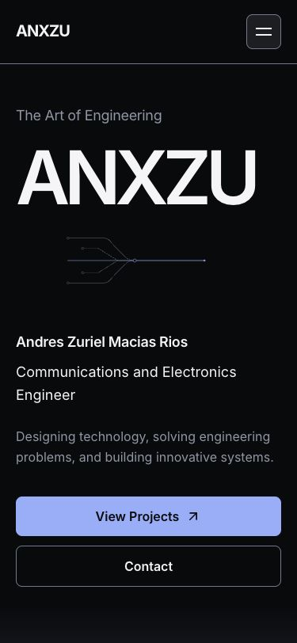
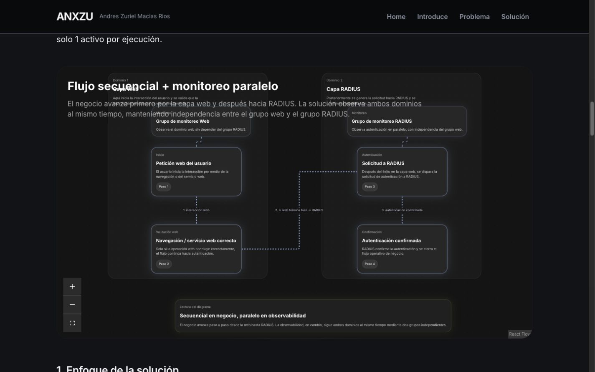
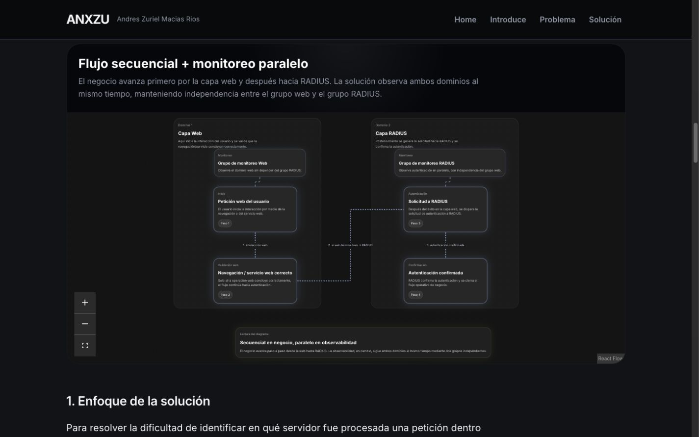
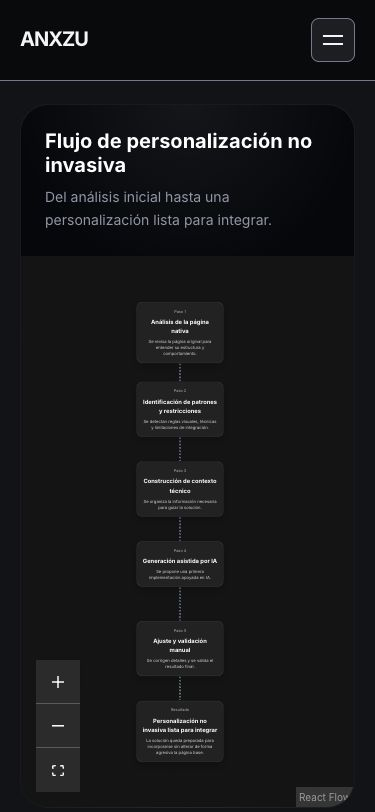

# ANX-006 — Final Experience, Accessibility & Performance Audit

Revisión: 22–23 de octubre de 2026 · America/Mexico_City.

**Estado: auditoría local completada para revisión del propietario, con pendientes explícitos de validación manual.** Rama `codex/anx-001-redesign-audit`. Sin commits, push, despliegue ni nueva fase. La aceptación local no equivale a autorización de publicación ni a conformidad WCAG completa.

## Alcance y dirección

Se revisaron `audit.md`, `roadmap.md`, `design-system.md` y reportes ANX-003, ANX-004 y ANX-005, además de código, efectos, rutas, estilos, metadatos y build. Se aplican `frontend-design` y `ui-ux-pro-max`; las consultas locales de foco no oculto y reduced motion guiaron los casos manuales. Se conserva la composición editorial, Inter, los tokens, React 19, Vite 7 y las dependencias del proyecto.

El recorrido Hero → About/Connection → Projects → Capabilities → Experience → Contact mantiene jerarquía tipográfica, ancho de lectura, gutters y alternancia Obsidian/Pearl. No se rediseñan escenas ni se añaden efectos decorativos. Los refinamientos responden a problemas reproducidos en carga, semántica, foco y diagramas.

## Hallazgos priorizados y correcciones

| Hallazgo | Prioridad | Evidencia | Resultado |
| --- | --- | --- | --- |
| La rueda sobre tres gráficos de Concurrencia cambia el zoom e impide avanzar la página | P1 | ScrollY 2495→2495 y escala .6230→.3782 al bajar .4 pantallas | Rueda nativa; zoom mediante controles/pinch y pan de escritorio conservados |
| Encabezados absolutos cubren nodos de los seis diagramas | P1 | Captura previa y rectángulos de título/lienzo | Caption en flujo normal, con espacio propio; contenido técnico intacto |
| Metodología recorta nodos al abrir en móvil y algunos pasos se superponen | P1 | Primer gráfico: nodos hasta y1003,64 con lienzo hasta y686,63 | Estado móvil correcto desde primer render, reencuadre al cambiar breakpoint, mínimo de zoom .1 y separación vertical entre pasos |
| Tab puede entrar al panel del menú durante sus 300 ms de cierre | P1 | Menú `aria-expanded=false`, visibilidad aún visible y foco en About tras Escape+Tab rápido | Panel cerrado `inert` en móvil; menú de escritorio continúa disponible |
| Alias `#introduce` de Metodología utiliza aria-label prohibido en un span genérico | P1 | Lighthouse/axe: aria-prohibited-attr, Accessibility 96 | Alias sobre el grupo real de introducción, nombrado por su h1; hash conservado |
| Hoja de Google Fonts bloquea render y agrega dependencia externa | P2 | Baseline móvil home: P92, LCP 2683,10 ms; Lighthouse señala stylesheet externa | Mismo Inter Latin local con preload, font-display swap y licencia OFL distribuida |
| Título genérico compartido y ausencia de description/OG; robots devuelve HTML | P2 | HTML previo y Lighthouse SEO 83 home /82 Concurrencia | Metadatos por ruta en React y HTML del build; robots válido y sitemap de las tres URLs |
| Preview sirve el head de home en las URLs de proyecto sin barra final | P2 | Comprobación HTTP sin ejecutar JS | Middleware local resuelve el HTML específico conservando las URLs públicas |
| Flecha de proyectos aún puede desplazarse instantáneamente con reduced motion | P2 | Revisión de especificidad CSS | Override explícito del transform en hover/focus reducido |

Las prioridades indican impacto, no puntuaciones. Lighthouse no detectó el solapamiento visual ni la carrera de foco del menú: un score alto no certifica conformidad WCAG.

## Detalle de implementación

Los seis modelos React Flow conservan nodos, textos, conexiones y controles. Se modifica presentación e interacción, no información técnica. Las conexiones quedan estáticas por defecto. El balanceador ofrece Iniciar/Pausar simulación, con aria-pressed; su intervalo solo se monta tras elección explícita y continúa respetando visibilidad de pestaña, reduced motion y cleanup. Con reduced motion el control indica Movimiento reducido y queda deshabilitado.

Los captions ya no flotan encima de los gráficos. Se conserva la vista general, el zoom deliberado y Fit View. Los dos diagramas de Metodología mantienen sus seis pasos con mayor separación vertical; el encuadre permite verlos completos. La vista general móvil contiene texto pequeño: requiere zoom o lectura del contenido textual; no se afirma lectura cómoda de cada detalle sin ampliar ni una validación táctil en hardware físico.

Navigation reutiliza su único listener de media query, con cleanup, para distinguir escritorio de disclosure móvil. `inert` excluye inmediatamente los enlaces cerrados del foco y del árbol interactivo, mientras CSS completa la salida visual. Cambiar a escritorio vuelve a habilitar la lista. También se restaura el disparador si un enlace queda oculto al pasar a móvil.

Inter local es el mismo WOFF2 Latin de 48.432 bytes observado en el waterfall anterior, servido por Google Fonts v20. Se conserva la familia y pesos 400/600/700; no se agrega otra fuente. La licencia se incluye en `/Inter-OFL.txt`. La optimización elimina la hoja externa bloqueante; no se atribuye todo cambio de métrica a una única causa sin matices de laboratorio.

PageMetadata actualiza título, description, robots, Open Graph y lenguaje al navegar, restaurando los nodos de head en cleanup. El build genera HTML de head por proyecto para lectores que no ejecutan JavaScript; no es prerender del contenido completo. El cuerpo sigue siendo una SPA de cliente. Preview resuelve las tres URLs originales; los hashes y las rutas con barra final permanecen compatibles.

El origen `https://anxzu.com/` respondió HTTPS 200 en lectura pública autorizada. Su JavaScript publicado contiene el nombre, correo, GitHub y ambas rutas existentes. Esa comprobación respalda el dominio usado para canonical, og:url y sitemap. No se verificó el alojamiento del nuevo build ni se modificó producción. No se añadió og:image: su elección y preview social quedan pendientes del propietario.

## Límites de herramientas

El navegador integrado permite DOM, teclado, viewport y JPEG. No expone emulación de media queries, zoom nativo, grabación de vídeo ni perfil continuo de frames. El intento de Chrome/Safari nativos quedó pendiente de permisos de Accesibilidad/Grabación de pantalla y un reintento de Safari terminó por timeout; **Safari no se da por ejecutado ni validado**.

Lighthouse sí se ejecuta con Chrome headless instalado, usando una instalación temporal fuera del proyecto. No se alteraron package.json ni lockfile. No se instalaron librerías de animación, runners ni servicios en el repositorio.

La interrupción de la sesión detuvo Preview. Se reinició el servidor y el propietario restauró la pestaña que había quedado en una página interna de error. No se sorteó la política de acceso a esa página.

El último intento de actualizar la captura de portada fue rechazado por la revisión automática del navegador debido a un límite de uso; la acción no se ejecutó. Se conservan las capturas obtenidas correctamente antes de ese rechazo. No se emplearon rutas alternativas para eludir la revisión. Esto no invalida los resultados registrados antes del bloqueo.

## Auditoría visual y responsive

La inspección de las capturas completas confirma la continuidad editorial del masthead ANXZU, la biografía con retrato, los dos showcases, las tres familias de capacidades, la cronología y el cierre de contacto. Se conservan títulos alineados a la izquierda, lectura acotada, gutters comunes y espacio suficiente entre capítulos. Pearl unifica capacidades y experiencia; Obsidian recupera el cierre sin agregar una escena. No se cambia el Hero ni se rediseña otra sección completa.

La matriz DOM contiene **18 combinaciones: tres rutas × seis anchos**, a 900 px de alto. En cada una hay un solo h1 y un main; los gráficos son 0/4/2 para home/Concurrencia/Metodología. Se inspeccionaron las vistas de portada y gráficos, además de sus rectángulos. Es una validación de viewport de escritorio, no una prueba en seis dispositivos físicos.

| Ancho solicitado | Ancho útil de documento | Home | Concurrencia | Metodología |
| ---: | ---: | --- | --- | --- |
| 320 | 305 | Sin overflow | Sin overflow; 4 gráficos | Sin overflow; 2 gráficos completos |
| 375 | 360 | Sin overflow | Sin overflow; 4 gráficos | Sin overflow; 2 gráficos completos |
| 768 | 753 | Sin overflow | Sin overflow; 4 gráficos | Sin overflow; 2 gráficos completos |
| 1024 | 1009 | Sin overflow | Sin overflow; 4 gráficos | Sin overflow; 2 gráficos completos |
| 1440 | 1425 | Sin overflow | Sin overflow; 4 gráficos | Sin overflow; 2 gráficos completos |
| 1920 | 1905 | Sin overflow | Sin overflow; 4 gráficos | Sin overflow; 2 gráficos completos |

La diferencia de 15 px es la barra vertical del entorno. En Metodología se recargó cada ancho después de corregir el primer encuadre: todos los nodos quedaron dentro del lienzo y la separación mínima entre pasos fue positiva (17,16–47,90 px según ancho). En los seis diagramas el borde inferior del caption coincide con el inicio del lienzo: ya no se superponen.

El retrato carga con alt `Andres Zuriel Macias Rios`, conserva sus variantes y el original. No se agrega lazy loading al primer viewport. En home permanecen ocho categorías de capacidades y cuatro registros de experiencia. Los controles React Flow usan objetivos de 44×44 px; el botón de recarga observado mide 52,39 px de alto. No se simuló un gesto multitáctil real.

## Movimiento y alternativas

| Elemento | Comportamiento revisado | Alternativa y límites |
| --- | --- | --- |
| Hero | Entrada 650 ms, presentación coordinada con retraso 200 ms; desplazamientos cortos y opacidad | Contenido visible desde la base; reduced motion quita animación y transform. No se cambia ANX-003 |
| Salida del Hero | Scroll nativo: a scrollY 500, opacidad 1→.8721 y translateY 0→−10,23 px en escritorio | Timeline nativa cuando existe; fallback RAF pasivo probado por unidad, con cleanup |
| Conexión About | Un trazo SVG progresivo por scroll; sin loop | SVG completo estático si falta timeline o se reduce movimiento. Stroke-dashoffset es la excepción ligera a transform/opacity |
| Proyecto destacado | Escala .985→1 y opacidad .98→1; el segundo proyecto no repite la entrada | Base visible; no animación con reduced motion |
| Experiencia | Un progreso para toda la línea; scaleY observado .1339→.4753 al avanzar 600 px | Línea base y cuatro registros siempre visibles; acento estático sin timeline/reduced motion |
| CTA y menú | Flechas de 2–3 px, feedback de superficie/foco, disclosure 300 ms | Overrides reducidos y panel cerrado inert; navegación por teclado verificada |
| Diagramas | Conexiones sin animación automática; simulación del balanceador por elección explícita | Pausa, pestaña oculta y preferencia reducida detienen intervalos; pruebas de cleanup |

Se comprobó la progresión de estados reales, sin pinning ni bloqueo. No se obtuvo perfil continuo, vídeo o medición de frames: **no se declara 60 FPS**. El navegador integrado informó soporte de timelines; los fallbacks de Hero se cubren con tests, pero el fallback visual completo en Safari queda pendiente.

### Protocolo manual de reduced motion y zoom

Estas comprobaciones quedan **pendientes**, no aprobadas por lectura de CSS o tests:

1. En macOS, registrar la preferencia inicial y activar Ajustes del Sistema → Accesibilidad → Pantalla → Reducir movimiento. En Chrome también puede usarse DevTools → More tools → Rendering → Emulate CSS media feature prefers-reduced-motion: reduce. En Safari usar la preferencia del sistema.
2. Recargar home: ANXZU, profesión y CTA deben ser visibles sin entrada; SVG y línea de experiencia deben estar estáticos. Recorrer todos los hashes y abrir ambos proyectos con teclado.
3. Comprobar que las flechas no se desplazan al hover/focus y que los diagramas siguen ampliándose con sus controles. La simulación debe indicar Movimiento reducido y no avanzar.
4. Desactivar la reducción, iniciar la simulación, volver a activarla **sin recargar** y comprobar que cesan cambios y trazos; cambiar de pestaña y regresar. Comprobar también el Hero al cambiar la preferencia durante la sesión. Restaurar el ajuste inicial al terminar.
5. En Chrome y Safari reales usar zoom de navegador al 200 % y 400 %, sin confundirlo con resize ni zoom del diagrama. Recorrer las tres rutas: foco visible, menú utilizable, texto sin pérdidas y sin scroll horizontal de página. Registrar tamaño de ventana, versión y resultado; restaurar 100 %.

## Accesibilidad y regresión funcional

El recorrido por teclado verificó Skip to content → main, View Projects → `#projects`, primer caso → main del proyecto y regreso → `#projects`. El skip y los CTA mostraron foco de 3 px; los destinos quedaron aproximadamente a 104 px bajo el header, sin quedar ocultos. El menú abre, Escape devuelve foco al disparador y Tab inmediato ya salta al CTA, incluso durante la salida visual. En escritorio la lista vuelve a estar disponible.

También se recorrieron Skills → View experience → Experience y Contact → correo → GitHub → LinkedIn → Back to top. Back to top enfoca `#hero` en y0. Los enlaces externos mantienen nombres y `noopener noreferrer`; se comprobó el URI mailto sin abrir ni enviar correo.

Los seis gráficos respondieron a Zoom In y Fit View mediante Enter, con cambios reales de escala. Iniciar/Pausar simulación cambia aria-pressed y detiene el avance. La rueda sobre Concurrencia pasó de capturar el zoom a desplazar la página: scrollY 2495→2855 con escala .623016 intacta. Los textos de nodos y la explicación HTML siguen disponibles; queda pendiente lector de pantalla real y comprensión de gráficos con tecnología de asistencia.

Entrada directa, recarga y navegación de regreso funcionaron. Se comprobaron destinos profundos `#highLevel`, `#introduce` de Metodología y `#solucion`; este último también tras carga diferida. La revisión DOM de home confirma los seis IDs públicos únicos y todos sus enlaces de hash con destino existente.

Un servidor temporal de QA externo al producto retrasó ocho segundos el chunk de Metodología: fallback con role=status, main de 812 px e idioma inglés; al resolver, aparecen dos gráficos, idioma español y foco en `#solucion` a y103,625. Una respuesta 503 deliberada mostró role=alert, Reload project y Back to projects. Tras restaurar la respuesta normal y activar Reload project con Enter, se recuperaron los dos diagramas y el hash. El servidor de fallos se detuvo. Sus errores de consola son deliberados y no se confunden con errores del sitio normal.

Las rutas normales inspeccionadas no registraron errores ni warnings en consola; Lighthouse final tampoco informó errores de ejecución. Los tests de contraste de tokens oscuros/claros pasan, incluidos estados interactivos. Esto complementa la inspección de foco y la auditoría automática; no sustituye una revisión WCAG con lector de pantalla, zoom y preferencia real.

## Métricas finales y metodología

Lighthouse **13.5.0**, Chrome headless instalado **155.0.0.0**, macOS Darwin 27.0.0 arm64. Se ejecutaron tres procesos nuevos secuenciales por cada ruta y perfil: **18 auditorías** sobre Vite Preview local. No hubo rebuild durante la serie definitiva; sus hashes se contrastaron con [el manifiesto del build](reports/anx-006-build-final.json). Había otras aplicaciones normales en el equipo; no se afirma un laboratorio aislado ni comportamiento de red de producción.

Throttling **simulado** de Lighthouse:

- Móvil: 412×823, DPR 1,75, perfil Moto G Power 2022; RTT 150 ms, throughput 1638,4 kbps y CPU ×4. Configuración: requestLatency 562,5 ms, download 1474,56 kbps y upload 675 kbps. El UA emulado pertenece al perfil predeterminado de Lighthouse, distinto de la versión del ejecutable Chrome.
- Escritorio: 1350×940, DPR 1; RTT 40 ms, throughput 10240 kbps y CPU ×1.

La tabla presenta medianas; el rango de LCP incluye las tres repeticiones. Todos los scores fueron iguales dentro de cada grupo. Los valores y timestamps completos están en [anx-006-metrics.json](reports/anx-006-metrics.json).

| Ruta / perfil | Performance | Accessibility | Best Practices | SEO | LCP mediano (rango), ms | CLS | TBT mediano, ms |
| --- | ---: | ---: | ---: | ---: | ---: | ---: | ---: |
| Home móvil | 99 | 100 | 100 | 100 | 1952 (1877–1958) | 0 | 0 |
| Concurrencia móvil | 97 | 100 | 100 | 100 | 2466 (2427–2474) | 0 | 1,5 |
| Metodología móvil | 97 | 100 | 100 | 100 | 2445 (2436–2447) | 0 | 0 |
| Home escritorio | 100 | 100 | 100 | 100 | 422 (422–425) | 0 | 0 |
| Concurrencia escritorio | 100 | 100 | 100 | 100 | 570 (568–571) | 0 | 0 |
| Metodología escritorio | 100 | 100 | 100 | 100 | 571 (569–573) | 0 | 0 |

Las 18 ejecuciones cumplen los objetivos locales P≥90, A≥95, LCP≤2500 ms y CLS≤.1. Concurrencia móvil tiene poco margen respecto a 2,5 s; debe repetirse en staging con latencia y caché reales. **No hay datos de campo de INP**: no se marca aprobado ni se reemplaza por TBT. Un CLS 0 en esta carga de laboratorio no garantiza cero cambios durante todas las interacciones.

El baseline home móvil fue una ejecución: P92/A100/BP100/SEO83, LCP 2683 ms, CLS0/TBT0. Frente a la mediana final, LCP baja aproximadamente 731 ms (27,2 %), Performance sube 7 puntos y SEO 17. Es una comparación descriptiva entre una muestra inicial y tres finales, sin atribución causal exacta. La hoja externa de fuentes tenía un ahorro estimado por Lighthouse de 1480 ms; esa estimación no es el ahorro real medido. Baseline Concurrencia: P93/A100/BP100/SEO82.

Informes finales legibles de la primera repetición móvil: [home](reports/anx-006-lighthouse/home-mobile-1.html), [Concurrencia](reports/anx-006-lighthouse/concurrencia-mobile-1.html), [Metodología](reports/anx-006-lighthouse/metodologia-mobile-1.html). Las 18 fuentes JSON están en `reports/anx-006-lighthouse/`. Las series candidatas anteriores se retienen en ZIP y **se excluyen** de la aceptación final; `anx-006-intermediate-mixed-build.zip` se etiqueta expresamente porque hubo cambios de build durante esa serie.

## Bundles y recursos

Comparación contra el build ANX-005 guardado al empezar esta fase. Bytes reales sin comprimir; tamaño de bundle no equivale a Core Web Vitals ni a transferencia comprimida de un servidor.

| Recurso | Antes, bytes | Después, bytes | Diferencia |
| --- | ---: | ---: | ---: |
| JS inicial | 265349 | 267884 | +2535 |
| CSS inicial | 30088 | 31148 | +1060 |
| JS Concurrencia diferido | 40485 | 41301 | +816 |
| JS Metodología diferido | 13694 | 13962 | +268 |
| JS compartido React Flow | 176460 | 176460 | 0 |
| CSS diferido React Flow | 17425 | 17425 | 0 |
| JS total generado | 495988 | 499607 | +3619 |
| CSS total generado | 47513 | 48573 | +1060 |

Inter suma 48432 bytes al build local; antes se descargaba externamente, por lo que no son 48432 bytes de tipografía adicional por visita. Licencia: 4377 bytes. Las imágenes y favicon permanecen idénticos. Se agregan dos HTML con metadatos de proyecto, robots y sitemap. No hay dependencias nuevas. La comprobación del manifiesto confirma que home no importa React Flow, d3 ni zustand; los dos chunks dinámicos conservan la dependencia compartida. [Comparación completa](reports/anx-006-bundles.json).

## Estabilidad, contenido y SEO

Se revisaron los efectos del Hero, media query, navegación, metadatos, observer de hashes, resize de gráficos y simulación: los listeners, observers, RAF e intervalos tienen cleanup. No se detectaron duplicaciones en los casos probados; no se presenta como un perfil exhaustivo de memoria. Los imports relativos estáticos y dinámicos literales se resolvieron y compararon por segmentos exactos: **89 imports en 55 archivos, sin errores de capitalización**.

Las tres respuestas HTML contienen título, description y canonical únicos antes de ejecutar JS, en idiomas en/es/es. Canonical y og:url son coherentes con las URLs públicas sin barra final de los casos; también funcionan las variantes con barra. `/robots.txt` devuelve text/plain, `/sitemap.xml` text/xml con exactamente tres URLs y `/Inter-OFL.txt` text/plain. La actualización de head durante navegación restaura home sin duplicar metadatos.

SHA-256 de 105 archivos al empezar: **16 modificados, 89 intactos y ninguna eliminación**. Permanecen intactos datos profesionales, biografía, proyectos, capacidades, experiencia, contacto, Hero, retratos originales/variantes, tokens, dependencias y reportes previos. El AST de los seis diagramas confirma **46 nodos con contenido preservado y todas las conexiones idénticas**, excluyendo únicamente posiciones del cotejo. Se conservan las rutas y hashes; no se incorpora Nodalume.

## Archivos de implementación de ANX-006

| Archivo existente modificado | Motivo |
| --- | --- |
| `index.html` | Preload local, metadatos de portada |
| `vite.config.js` | Plugin de metadatos estáticos y Preview |
| `src/App.jsx` | Metadatos según ubicación |
| `src/index.css` | Import de fuentes locales |
| `src/styles/base.css` | Caption/lienzo y reproducción deliberada de diagramas |
| `src/style/projects.css` | Eliminar transform de flecha con reduced motion |
| `src/components/layout/Navigation.jsx` | Inert durante cierre y sincronización de breakpoint |
| `src/components/layout/ProjectRoute.jsx` | Idioma del fallback y ruta con barra final |
| `src/data/navigation.js` | Normalización de barra final |
| `src/components/sections/introduce_metodologia.jsx` | Semántica del alias público |
| `src/components/ui/graphics/flow_loadbalance.jsx` | Pausa/inicio, scroll y encuadre inicial |
| `src/components/ui/graphics/bussiness_flow.jsx` | Caption, scroll y encuadre inicial |
| `src/components/ui/graphics/highlevel_flow.jsx` | Caption, scroll y encuadre inicial |
| `src/components/ui/graphics/logic_flow.jsx` | Caption, scroll y encuadre inicial |
| `src/components/ui/graphics/metodologia_problem_flow.jsx` | Caption, encuadre y separación vertical |
| `src/components/ui/graphics/metodologia_solution_flow.jsx` | Caption, encuadre y separación vertical |

Archivos nuevos: `src/components/utils/PageMetadata.jsx`, `src/data/pageMetadata.js`, `src/styles/fonts.css`, `src/assets/fonts/inter-latin.woff2`, `scripts/page-head.mjs`, `tests/page-metadata.test.js`, `public/Inter-OFL.txt`, `public/robots.txt` y `public/sitemap.xml`. Se agregan este reporte, el checklist y evidencias. Los cambios del working tree de fases anteriores siguen sin commit; no se atribuye su diff acumulado a ANX-006.

## Pruebas ejecutadas

| Comando | Resultado |
| --- | --- |
| `npm run lint` | Pasa, sin errores ni warnings |
| `npm run build -- --manifest` | Pasa, Vite 7.3.7, 264 módulos |
| `node --test tests/*.test.js` | 13/13 pasan |
| `node scripts/check-project-chunks.mjs` | Pasa; Flow permanece fuera de home |
| `git diff --check` | Pasa |

Se añaden cinco tests para problemas reales de metadatos: unicidad/idiomas, noindex de rutas desconocidas, barra final de navegación, HTML estático idempotente y resolución de Preview. Los ocho tests existentes de tokens, simulación y fallback del Hero permanecen intactos. Evidencia DOM/HTTP/preservación: [anx-006-validation.json](reports/anx-006-validation.json). Los resultados de Lighthouse son adicionales a estas pruebas, no sustitutos.

## Evidencia visual

Las capturas son JPEG del navegador integrado. Los anchos completos de 1425/360 px corresponden a viewports 1440/375 con barra vertical. Las capturas estáticas no demuestran fluidez ni FPS. La captura de viewport de tableta tiene un ancho útil de 747 px; para escritorio se usa la captura completa de 1425 px.

| Evidencia | Escritorio | Móvil |
| --- | --- | --- |
| Home completa | [1425×7396](reports/anx-006-home-desktop.jpg) | [360×9376](reports/anx-006-home-mobile.jpg) |
| Concurrencia completa | [1425×9328](reports/anx-006-concurrencia-desktop.jpg) | [360×11856](reports/anx-006-concurrencia-mobile.jpg) |
| Metodología completa | [1425×5997](reports/anx-006-metodologia-desktop.jpg) | [360×6357](reports/anx-006-metodologia-mobile.jpg) |

Portada móvil:

Caption antes y después, misma composición de escritorio:

Encuadre móvil de Metodología: [antes](reports/anx-006-metodologia-mobile-before-fit.jpg) y [después, página completa](reports/anx-006-metodologia-mobile.jpg). Detalle corregido:

Estados de carga y error: [fallback](reports/anx-006-loading-mobile.jpg), [error controlado](reports/anx-006-chunk-error-mobile.jpg). Son estados transitorios del ensayo, no pantallas inventadas. La recuperación está registrada en el JSON de validación.

## Riesgos y pendientes antes de publicar

No quedan regresiones funcionales P1 conocidas en los casos locales ensayados. Esto no elimina los pendientes siguientes:

| Prioridad | Pendiente | Acción y evidencia requerida |
| --- | --- | --- |
| P2 | Reduced motion real y cambio durante sesión | Ejecutar el protocolo anterior y registrar navegador, preferencia y resultado |
| P2 | Safari real, zoom 200/400 %, lector de pantalla y hardware táctil | Ejecutar las tres rutas; probar menú, hashes y los seis gráficos |
| P2 | Alojamiento real del nuevo build | Staging autorizado: rewrites, DirectorySlash, MIME de fuente/JS/XML, caché y recargas; Preview no certifica el servidor final |
| P2 | LCP móvil de Concurrencia cercano al límite | Repetir mediciones con hosting y dispositivo representativos; no ampliar el JS inicial sin nueva medición |
| P2 | Vigencia editorial de datos profesionales | Propietario debe revisar “2025 - Actualidad”, “2022 - 2022” y la afirmación de reducción de 8–12 a 1–2 horas. Se conservan sin inventar respaldo |
| P2 | URLs desconocidas | El comportamiento previo de ruta no reconocida no ofrece una pantalla 404; ahora recibe noindex al ejecutar React. El fallback HTTP puede seguir devolviendo HTML de home con 200. Definir 404 de servidor y producto antes de ampliar rutas |
| P3 | Preview social completo | Seleccionar una imagen real autorizada para og:image y verificar el resultado con el alojamiento final |
| Sin medición | INP de campo, frames continuos y demostración en vídeo | Recoger datos reales y perfil de scroll cuando estén disponibles; no convertir TBT o screenshots en sustitutos |

La aceptación detallada y los responsables de cierre están en [release-checklist.md](release-checklist.md). La recomendación es resolver estos pendientes y revisar el resultado con el propietario. No se inicia otra fase ni se publica automáticamente.
