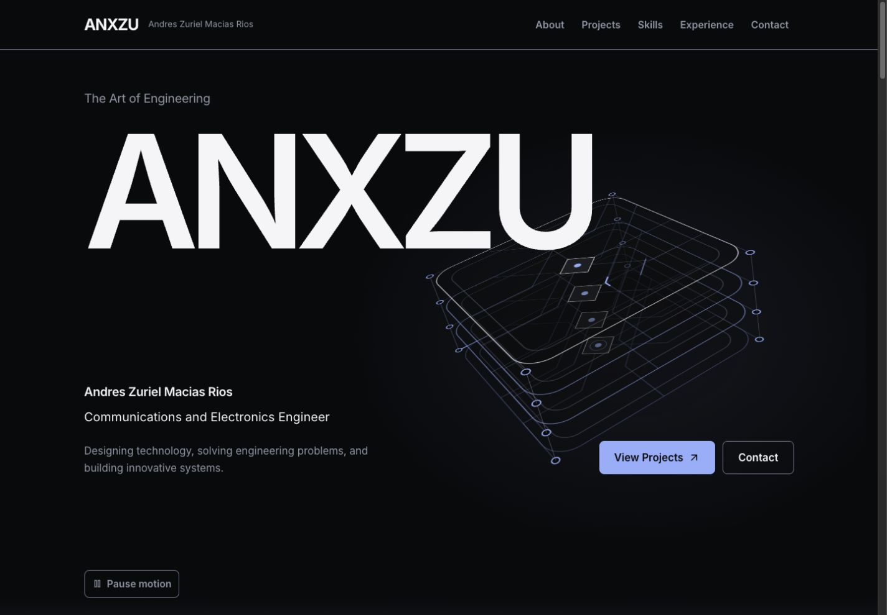
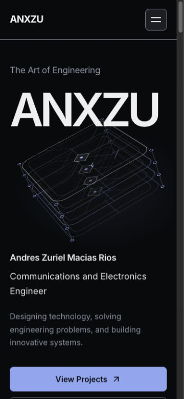

# ANX-007 — Immersive Cinematic Hero

Fecha: 23 de octubre de 2026 · America/Mexico_City.

**Estado: implementada y validada localmente para revisión del propietario, con los límites indicados.** Rama `codex/anx-001-redesign-audit`. Sin commits, push, publicación ni inicio de ANX-008.

## Dirección y prototipo

Se leyeron los reportes ANX-003 y ANX-006, el sistema de diseño y el Hero, sus estilos, fallback y tests. Se aplican `frontend-design` y `ui-ux-pro-max`. La consulta local `pause continuous animation reduced motion` devolvió pautas de reducción de movimiento y moderación; la recomendación genérica de evitar loops decorativos cede ante la petición explícita del propietario. Se concentra el movimiento en una sola escultura con control de pausa. La consulta React `pointer animation cleanup` respalda cleanup de suscripciones.

El concepto es **Confluence**: cuatro planos de conexiones suspendidos, unidos por terminales y un eje central. Una señal atraviesa cada plano. Comunica relación y transferencia entre sistemas; no representa una instalación, topología, resultado ni proyecto real. No se añaden datos personales ni copy profesional.

Plan previo al código:

- Paleta existente: Obsidian #090A0C, Graphite #1C1E23, Pearl #F5F5F7, Silver #8C96A6 e Ice Blue #81AFFF; se consumen los tokens, sin otra paleta.
- Inter conserva sus pesos y escalas. Marca protagonista y prosa alineada a la izquierda.
- Escritorio: ANXZU amplio en primer plano, estructura suspendida a la derecha y perfil/CTA en la base. Móvil: marca, estructura, perfil y CTA en orden vertical natural.
- Profundidad por superposición y perspectiva; iluminación estática muy contenida. Sin partículas, imágenes de aplicaciones ficticias ni materiales copiados.

```text
ANXZU                            planos conectados
                                 señal / profundidad
Nombre y profesión               estructura suspendida
Enfoque profesional              Proyectos / Contacto
Pausa
               transformación → entrada de About
```

Se descartó un globo de puntos con órbitas: sería genérico y no expresaría una relación de ingeniería concreta. Los cuatro planos comparten una gramática de rutas y terminales; los enlaces verticales hacen visible su conexión. No se cambia About para simular la continuidad: la estructura gira y desciende hacia su borde inferior, donde aparecen tres trazas que enlazan visualmente con la escena existente.

Se construyó primero una variante opt-in `/?hero=immersive` mientras `/` mantenía el Hero anterior. Se capturaron ambos a los mismos tamaños y se comprobaron pausa, perspectiva y CTA. El Hero anterior no se editó: `hero.jsx`, `hero.css` y `heroMotion.js` siguen disponibles. El selector admite `?hero=classic` y `?hero=immersive`; el valor predeterminado se cambió después de esa primera comparación, conservando el interruptor de build `VITE_HERO_VARIANT`.

## Técnica elegida

Se elige **SVG + CSS 3D + un controlador pequeño de entrada**, sin dependencias nuevas.

| Alternativa | Evaluación |
| --- | --- |
| SVG y CSS | Resuelve planos, rutas, terminales, perspectiva, señal y composición estática con geometría vectorial ligera. Elegida |
| Canvas 2D | Exigiría redibujar y gestionar resolución/pixel ratio para un número pequeño de elementos que ya resuelve SVG. No aporta una ventaja demostrada |
| Motion o GSAP | La coreografía consiste en un progreso de scroll y una interpolación de cursor; CSS y RAF acotado bastan. No se añade runtime |
| React Three Fiber / Three.js | No hay necesidad de luces físicas, mallas complejas, oclusión volumétrica o cámara libre. Cuatro planos no justifican WebGL ni su coste de carga |

La escultura usa cuatro SVG planos con separación en Z, cuatro uniones y un grupo de continuación. La iluminación es un radial estático derivado del token de acento, sin filtros de blur ni sombras animadas. El transporte, perspectiva y suspensión usan transform. Las trazas SVG quedan estáticas y cuatro relés HTML coordinados usan transform/opacity para representar el paso de señal entre planos. Se eliminó la animación inicial de stroke-dashoffset al detectar un coste elevado de CPU; la comparación se conserva como evidencia.

## Estados e interacción

**A — Ambient Motion.** Un único grupo suspendido oscila suavemente durante 12 s alternos: desplazamiento vertical ±12 px, giro Y ±9° y Z de −4° a 5°. Cuatro relés luminosos de 8 s comparten ciclo con desfase de 2 s; no hay posiciones aleatorias. La entrada tipográfica existente de 650 ms se conserva y nunca bloquea el acceso al contenido.

**B — Interactive Depth.** Solo `(hover: hover) and (pointer: fine)` habilita perspectiva por cursor. Los objetivos se limitan a ±1 y se interpolan con una constante temporal de 110 ms, hasta un máximo de 6° en X y 9° en Y. Un evento de touch no altera la perspectiva. RAF termina cuando el valor se estabiliza; no hay un bucle JavaScript continuo ni render React por frame.

**C — Scroll Transformation.** El scroll permanece nativo. Un listener pasivo agrupa lecturas y escritura en RAF; el progreso se limita a 0–1 durante la salida del Hero. La estructura desplaza hasta −50 px horizontal/130 px vertical, gira 36° y reduce escala hasta .86. La marca solo se desplaza 12 px y conserva al menos .85 de opacidad; perfil y CTA siguen opacos. La escena no usa pinning, sticky ni espaciadores que impongan una introducción.

Pause motion detiene la reproducción y muestra una composición estática completa; Resume motion la vuelve a habilitar. El botón nativo tiene aria-pressed, foco de 3 px y objetivo de 44 px. `prefers-reduced-motion` utiliza el hook existente: cancela listeners/RAF, desactiva entradas, perspectiva y señales, y presenta Motion reduced deshabilitado. No se necesita completar una animación para leer o navegar.

`visibilitychange` suspende CSS y cancela RAF al ocultar la pestaña. IntersectionObserver añade pausa cuando el Hero sale del viewport. La reanudación no duplica trabajo; cleanup cancela frame, observer y todos los listeners y retira las variables locales. La base CSS es una escultura estática completa si faltan las animaciones; la SPA conserva su requisito previo de JavaScript para renderizar React.

## Reversión y comparación

Vista anterior: `http://127.0.0.1:4173/?hero=classic`.

Vista nueva: `http://127.0.0.1:4173/?hero=immersive`.

Reversión de build sin editar escenas: ejecutar `VITE_HERO_VARIANT=classic npm run build`. Esa variable puede fijarse en el entorno de build local; no hace falta instalar ni desinstalar paquetes. La URL explícita permite comparar cualquiera de las dos variantes independientemente del default.

Reversión de integración: cambiar únicamente el import de Hero en `src/pages/Home.jsx` de `../components/sections/HeroVariant.jsx` a `../components/sections/hero.jsx` y reconstruir. Los archivos originales del Hero siguen idénticos; Vite puede excluir los módulos inmersivos al dejarlos sin importar. No usar reset de Git ni descartar el trabajo acumulado de fases anteriores.

## Validación de movimiento y accesibilidad

El navegador integrado permitió inspección real de DOM, teclado, scroll y entradas de cursor mediante clicks de coordenadas. Esos clicks mueven el puntero real antes de activar la superficie; no se inyectaron eventos sintéticos. La perspectiva registró valores interpolados, por ejemplo X .5866 e Y −.3680, con una matriz 3D distinta del estado neutro. Dos observaciones consecutivas del grupo ambiental mostraron matrices diferentes sin cambiar React ni desplazar la página.

Al desplazar 450 px en escritorio, el progreso llegó a .5192: el transporte cambió a una matriz con traslación −25,96/67,50 px y rotación/escala coordinadas. Las trazas inferiores alcanzaron opacidad .2856 y About comenzó en y569,64 dentro del viewport. La captura de transición muestra ambas escenas, sin superponer elementos sobre la biografía ni modificar About.

Pause motion mediante Enter dejó aria-pressed=true, foco de 3 px y los cinco movimientos CSS pausados: suspensión más cuatro relés. Resume motion los reactivó. View Projects llevó foco a `#projects` a unos 104 px bajo el header y la escultura pasó a paused al quedar fuera del viewport. Contact llevó foco a `#contact` a y104,34. El menú móvil conserva apertura, Escape y restauración: Tab inmediato tras cierre llega a View Projects con foco visible. El SVG es decorativo y no añade controles de teclado.

Se comprobó entrada directa y recarga de `/projects/concurrencia#highLevel` y `/projects/metodologia#solucion`: cuatro/dos gráficos, un main y un h1, idioma español y foco en el hash. El regreso por el logo vuelve a `/` con el Hero inmersivo predeterminado y sin cargar React Flow en la portada. Las vistas normales inspeccionadas no registraron errores ni warnings de consola.

### Preferencia reducida y pestaña oculta

Se ejecutó una comprobación adicional de Lighthouse/Chrome con `--force-prefers-reduced-motion` y altura 1200, **separada de la serie comparativa**. El [switch está definido por Chromium](https://chromium.googlesource.com/chromium/src/+/HEAD/ui/gfx/switches.cc). La captura real muestra **Motion reduced**, composición completa, profesión y ambos CTA. Se verificó así el arranque con preferencia reducida en Chrome headless; no se confunde una captura estática con medición de ausencia de frames. Los tests y las reglas CSS cubren la cancelación del controlador y las animaciones.

La alternancia de preferencia durante una sesión queda pendiente de prueba integrada: el navegador controlado no expone emulación de media queries. Para validarla, usar macOS → Accesibilidad → Pantalla → Reducir movimiento o [Chrome DevTools → Rendering → prefers-reduced-motion](https://developer.chrome.com/docs/devtools/rendering/emulate-css), iniciar con no-preference y alternar sin recargar. Deben cesar perspectiva, suspensión y relés; Motion reduced debe quedar deshabilitado; los CTA deben seguir funcionando. Restaurar el ajuste inicial al terminar.

El intento de cambiar a otra pestaña del navegador integrado dejó ambos documentos con visibilityState=visible. **No acredita una prueba real de ocultación**, ni demuestra un fallo del listener. La pausa al salir de viewport sí se observó; hidden/visible, reanudación y cleanup se probaron mediante el controlador con entorno controlado. Falta abrir el sitio en Chrome/Safari con interfaz, cambiar a otra pestaña y comprobar pausa/reanudación real. Los fallos y pendientes de control nativo descritos en ANX-006 no se presentan como navegadores aprobados en ANX-007.

## Responsive

Se probaron seis anchos en **ambas variantes** a 900 px de alto: 12 combinaciones. La marca cabe en su contenedor, hay un solo h1/main y el documento no presenta overflow horizontal. Los seis IDs de escena siguen siendo únicos. Los CTA medidos conservan al menos 44 px de alto y Pause motion mide 44–44,39 px. La escultura tiene un recorte local deliberado; no se oculta overflow de toda la página para disimular un problema de layout.

| Ancho solicitado | Ancho útil / documento, ambas variantes | Hero nuevo, altura aproximada |
| ---: | ---: | ---: |
| 320 | 305 / 305 | 970 |
| 375 | 360 / 360 | 981 |
| 768 | 753 / 753 | 1059 |
| 1024 | 1009 / 1009 | 930 |
| 1440 | 1425 / 1425 | 980 |
| 1920 | 1905 / 1905 | 980 |

En móvil el Hero crece para alojar estructura, perfil, CTA y pausa. Algunos controles quedan bajo el primer viewport y se alcanzan con scroll nativo o Tab; no existe una pantalla de espera ni duración obligatoria. La composición móvil no depende de hover. La simulación de viewport no equivale a probar un dispositivo físico ni un puntero táctil: la exclusión de touch/coarse se cubre por unidad, y la validación de hardware sigue pendiente.

## Bundles y preservación

Referencia de peso: build final real ANX-006 guardado al comenzar. Archivos sin comprimir; no se interpretan bytes como Web Vitals.

| Recurso | ANX-006, bytes | ANX-007, bytes | Diferencia |
| --- | ---: | ---: | ---: |
| JS inicial | 267884 | 273859 | +5975 (+2,23 %) |
| CSS inicial | 31148 | 37015 | +5867 |
| JS compartido React Flow | 176460 | 176460 | 0 |
| CSS diferido React Flow | 17425 | 17425 | 0 |

Vite 7.3.7 transforma 269 módulos frente a 264. El JS inicial informa aproximadamente 87,99 kB gzip y CSS 7,43 kB gzip. Ambos Heroes se incluyen para permitir comparación inmediata; no se añade una solicitud crítica de lazy loading al primer viewport. Los assets originales, Inter y los retratos no cambian. La verificación de chunks mantiene Flow/d3/zustand fuera de home y las dos rutas de proyecto diferidas.

El manifiesto inicial contiene **168 archivos: solo cambia el import de `src/pages/Home.jsx`; los otros 167 permanecen idénticos y no hay eliminaciones**. Esto incluye el Hero anterior completo, reportes previos, sistema de diseño, datos, seis gráficos, todas las otras escenas y dependencias. El componente nuevo conserva literalmente nombre, profesión, enfoque y los dos destinos CTA del Hero anterior.

Evidencia: [build anterior](reports/anx-007-build-before.json), [build final con SHA-256](reports/anx-007-build-final.json), [validación y preservación](reports/anx-007-validation.json).

## Lighthouse y LCP/CLS

Lighthouse 13.5.0 y Chrome headless instalado 155.0.0.0, macOS arm64. Se midió el mismo build estable mediante Vite Preview en `127.0.0.1:4173`: tres procesos nuevos secuenciales por variante y perfil, **12 ejecuciones comparativas**, sin reconstruir durante la serie. Había otras aplicaciones y el navegador integrado abiertos; durante parte de la serie se realizaron comprobaciones de UI. Es un laboratorio local y no un equipo aislado ni una medición de producción.

Móvil: configuración predeterminada simulada 412×823, DPR1,75, RTT150ms, throughput1638,4kbps, CPU×4. Escritorio: 1350×940, DPR1, RTT40ms, throughput10240kbps, CPU×1. Los parámetros completos y timestamps están en [anx-007-metrics.json](reports/anx-007-metrics.json).

| Variante / perfil | P | A | Best Practices | SEO | LCP mediano (rango), ms | CLS | TBT mediano, ms |
| --- | ---: | ---: | ---: | ---: | ---: | ---: | ---: |
| Anterior móvil | 99 | 100 | 100 | 100 | 1952 (1951–1956) | 0 | 0 |
| Inmersivo móvil | 99 | 100 | 100 | 100 | 1958 (1952–1958) | 0 | 0 |
| Anterior escritorio | 100 | 100 | 100 | 100 | 422 (422–422) | 0 | 0 |
| Inmersivo escritorio | 100 | 100 | 100 | 100 | 423 (422–423) | 0 | 0 |

Los scores fueron iguales en las tres repeticiones de cada grupo. Frente al Hero anterior dentro del mismo build, la diferencia de medianas LCP es unos 6 ms móvil y 1,4 ms escritorio: no se interpreta como una regresión significativa con tres muestras locales. La referencia ANX-006 fue P99 móvil/P100 escritorio, LCP1952/422ms y CLS0. Esos resultados se conservan como referencia, sin reescribir los archivos de ANX-006.

Informes legibles de la primera repetición de la variante nueva: [móvil](reports/anx-007-lighthouse/immersive-mobile-1.html) y [escritorio](reports/anx-007-lighthouse/immersive-desktop-1.html). Los doce JSON permanecen junto a ellos.

Se cumplen los objetivos locales de P≥90, A≥95, LCP≤2500ms y CLS≤.1 en las 12 muestras. No hay nuevos datos de campo INP; TBT no lo sustituye. Esta serie evalúa las dos variantes de home, no representa una nueva auditoría Lighthouse de los proyectos. El aumento del bundle compartido y el margen pequeño de Concurrencia móvil señalado en ANX-006 justifican repetir las tres rutas en staging antes de una publicación autorizada.

La comprobación adicional de reduced motion usa otra altura/preferencia y no se mezcla con esta tabla. Un score A100 no equivale a conformidad WCAG completa.

## CPU aproximada y límite de fluidez

Se midió el tiempo acumulado de CPU de un árbol de procesos nuevo de Chrome headless mediante `ps`: 3 s de calentamiento y ocho muestras de aproximadamente 1 s por ejecución. Tres repeticiones alternas por variante, ventana1440×900, sin entrada de cursor ni scroll. Se suman navegador, renderer y auxiliares descendientes. **100 % significa un núcleo**, no toda la CPU del equipo. No se mide consumo de GPU, energía, batería ni temperatura; el comportamiento headless no se extrapola a un móvil físico.

| Versión / variante | Mediana equivalente de un núcleo | Rango |
| --- | ---: | ---: |
| Anterior, comparación final | 1,33 % | 1,21–1,45 % |
| Primer prototipo con trazas SVG animadas | 43,55 % | 36,49–46,80 % |
| Inmersivo optimizado | 17,84 % | 17,60–19,26 % |

El primer prototipo repintaba cuatro trazas por frame mediante stroke-dashoffset. Se sustituyó por trazas estáticas y pequeños relés HTML con transform/opacity, manteniendo la suspensión. La mediana observada baja aproximadamente 59 % frente a ese prototipo. Las dos series son ensayos locales separados, no una atribución causal perfectamente aislada. Se conservan [la serie inicial](reports/anx-007-cpu-prototype.json) y [la comparación optimizada](reports/anx-007-cpu.json).

La nueva escena sigue teniendo un coste ambiental claramente mayor que el Hero anterior; Lighthouse de carga no mide ese coste sostenido. Se ofrece pausa y se detiene trabajo fuera de viewport, con preferencia reducida o al ocultar documento. Se recomienda revisar energía y comportamiento térmico en hardware representativo antes de producción.

El navegador controlado no expone grabación de vídeo, movimiento de cursor continuo ni perfil de frames durante scroll. Se observaron estados progresivos reales y matrices distintas; **no se afirma 60 FPS ni fluidez medida**. No se genera un vídeo artificial a partir de screenshots. La demostración dinámica está disponible en la variante local; una grabación o perfil continuo queda pendiente de herramientas nativas.

## Pruebas y archivos

| Comprobación | Resultado |
| --- | --- |
| `npm run lint` | Pasa, sin warnings |
| `npm run build -- --manifest` | Pasa; hashes del build estables durante Lighthouse |
| `node --test tests/*.test.js` | 17/17 pasan; [salida](reports/anx-007-tests.txt) |
| `node scripts/check-project-chunks.mjs` | Pasa; [salida](reports/anx-007-chunks.txt) |
| `git diff --check` | Pasa |
| Imports relativos y capitalización | 100 imports en 60 archivos, sin errores |
| Navegación / recarga / seis diagramas | Rutas y conteos preservados; entrada a hashes y regreso a home correctos |

Los cuatro tests nuevos cubren problemas concretos del controlador: modo estático sin trabajo, interpolación limitada que deja de pedir frames al estabilizarse, exclusión táctil/scroll agrupado y pausa/reanudación/cleanup de visibilidad e intersección. Los 13 tests anteriores no se modifican.

| Archivo | Papel en ANX-007 |
| --- | --- |
| `src/pages/Home.jsx` | Único archivo preexistente modificado: selecciona el adaptador de Hero |
| `src/components/sections/HeroVariant.jsx` | Comparación por query y reversión por entorno de build |
| `src/components/sections/ImmersiveHero.jsx` | Texto/CTA preservados y control de pausa |
| `src/components/ui/ConnectionSculpture.jsx` | Geometría conceptual vectorial y relés |
| `src/components/sections/immersiveHeroMotion.js` | Interpolación, scroll pasivo, visibilidad e intersección, cleanup |
| `src/style/hero-immersive.css` | Estilos acotados a variante, profundidad, movimiento y composición estática |
| `tests/immersive-hero.test.js` | Cuatro regresiones del controlador |
| `docs/redesign/anx-007-report.md` y `reports/anx-007-*` | Reporte, imágenes y resultados medidos |

No se modifica otra escena. Dependencias añadidas: **ninguna**. Lighthouse y el script de CPU se ejecutan fuera de la aplicación; no cambian package.json ni lockfile.

## Evidencia visual

Comparaciones a los mismos tamaños solicitados: escritorio1440×1000, archivos1425×990; móvil375×812, archivos360×780. La tabla responsive usa medidas DOM, no el tamaño exportado de la imagen. El renderer de captura escala la salida al ancho útil del documento.

| Vista | Hero anterior | Hero inmersivo |
| --- | --- | --- |
| Escritorio | [Anterior](reports/anx-007-classic-desktop.jpg) | [Nuevo](reports/anx-007-immersive-desktop.jpg) |
| Móvil | [Anterior](reports/anx-007-classic-mobile.jpg) | [Nuevo](reports/anx-007-immersive-mobile.jpg) |





Evidencia adicional: [tableta](reports/anx-007-immersive-tablet.jpg), [perspectiva por cursor](reports/anx-007-pointer-desktop.jpg), [transición a About](reports/anx-007-scroll-desktop.jpg), [CTA y pausa móvil](reports/anx-007-mobile-cta.jpg), [pausa con foco](reports/anx-007-paused-mobile.jpg), [reduced motion en Chrome](reports/anx-007-reduced-motion.jpg). La última imagen es la miniatura real exportada por Lighthouse, de500×444; el JSON conserva también la captura completa.

Las imágenes prueban composición y estados, no duración, FPS ni continuidad temporal. La entrada, cursor y scroll requieren revisar el sitio local en movimiento.

## Cierre y pendientes

La variante nueva se deja predeterminada para revisión, con acceso inmediato al Hero anterior y reversión de un import. Se conservan identidad, profesión, CTA, hashes, rutas, navegación, biografía y seis diagramas. No hay regresiones funcionales conocidas de prioridad alta en los casos ensayados.

Pendientes antes de una futura publicación: cambio real de preferencia durante sesión, ocultación en un navegador con interfaz, Safari, dispositivos táctiles y perfil de energía/frames. Continúan los pendientes editoriales y de hosting de ANX-006. No se aprueban por herencia ni se mezclan los resultados de carga con coste de animación sostenida.

La revisión del propietario debe valorar el nuevo impacto y su coste ambiental frente al Hero anterior. **No se publica, no se hacen commits/push y no se inicia ANX-008.**
