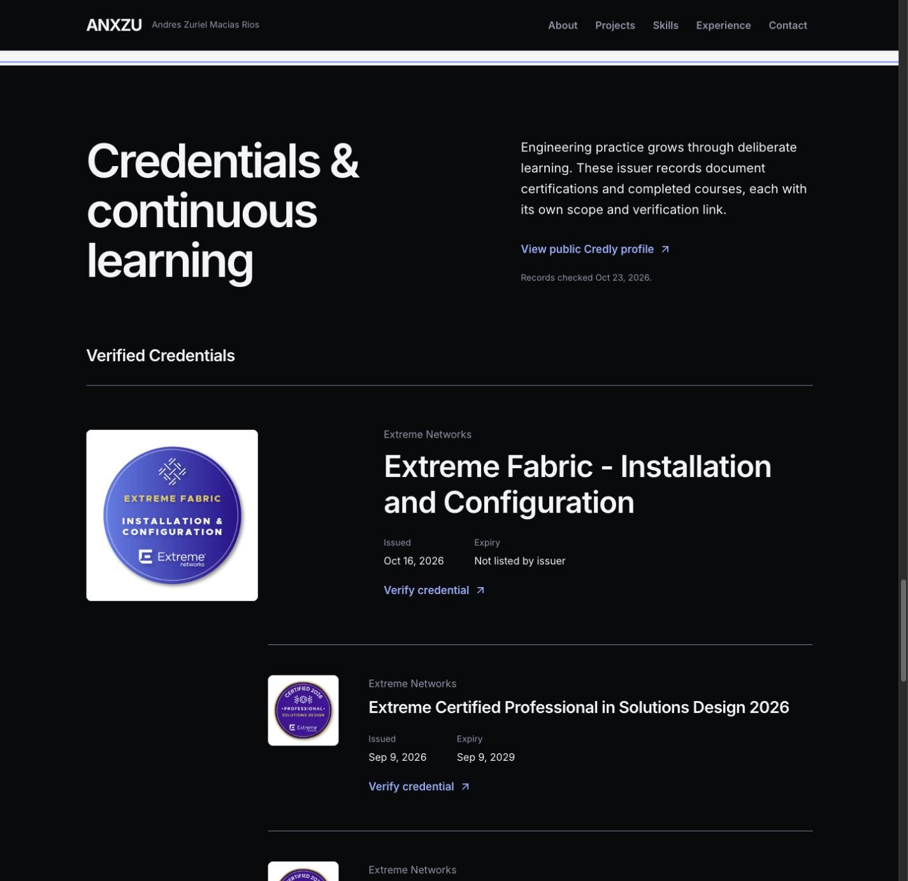
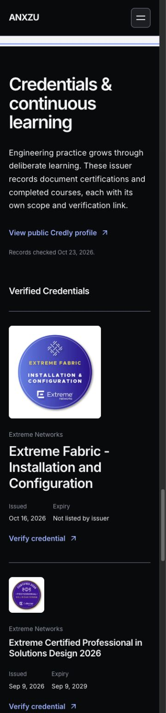

# ANX-009 — Professional Identity, Skills & Credentials

Fecha: 23 de octubre de 2026 · America/Mexico_City.
Estado: implementación y validación local completadas; lista para revisión del propietario. Rama `codex/anx-001-redesign-audit`. Sin publicación, push ni inicio de ANX-010.

## Dirección y contrato

Se aplican frontend-design y ui-ux-pro-max sobre el sistema ANX-002 y las escenas anteriores. Se revisaron auditoría, reportes ANX-003 a ANX-008, datos de capacidades/experiencia, About, proyectos y README. El perfil del propietario define el título y cinco áreas; el repositorio permite distinguir práctica profesional declarada, casos de proyecto y formación pública. No se inventan instituciones, estudios, puestos, resultados ni laboratorios cloud.

Paleta: Obsidian #090A0C, Graphite #1C1E23, Pearl #F5F5F7, Silver #8C96A6 e Ice Blue #81AFFF; alias de azul profundo y Slate en claro. Inter 400/600/700 y tokens existentes. Las imágenes oficiales conservan sus colores de marca; no constituyen una paleta nueva de interfaz.

Composición antes de implementar:

```text
About oscuro: retrato real / profesión, resumen y cinco áreas con contexto
Projects: intacto
Skills Pearl: cinco familias editoriales, ocho categorías originales completas
Experience Pearl: cuatro registros originales intactos
Credentials Obsidian:
  Título editorial y acceso al perfil público
  Verified Credentials: Fabric protagonista; diseño y venta profesionales
  Lista ampliable con las otras credenciales, fechas y enlaces individuales
  Completed Courses: formación introductoria y Python separados de certificación
  Learning in Progress: sin cursos activos inventados
Contact: intacto
```

Se descartan medidores de competencia y una cuadrícula de insignias intercambiables. La jerarquía destaca evidencia relevante; filas y disclosure nativo permiten explorar las 18 sin ocultar su contexto. Hover/focus mueven únicamente la flecha 2 px con tokens y reduced motion estático. No hay revelados, loops, fuentes ni bibliotecas nuevas.

Un manifiesto SHA256 al iniciar protege 254 archivos existentes. Hero inmersivo, seis diagramas, controladores de animación, rutas de proyecto, tokens y datos de cronología quedan fuera de los cambios.

## Perfil profesional propuesto e incorporado

**Communications & Electronics Engineer**. Nombre conservado: **Andres Zuriel Macias Rios**.

> With a background in computing, I connect technical requirements with practical solutions in networking, telecommunications and infrastructure. My professional experience spans technical presales, LAN-to-LAN connectivity, captive portals, network configuration, Linux-based services and databases, React automation, troubleshooting and technical support.

> I bring solution design, implementation and documentation into the same engineering process. My project work explores concurrent SSH monitoring and AI-assisted customization, with explicit constraints and human validation. Cloud is an area of focus alongside my documented infrastructure experience.

Las cinco áreas solicitadas están en About y en las familias de capacidades: Networking & Telecommunications, Cloud & Infrastructure, Software & Automation, Solutions Architecture & Presales y AI-Assisted Engineering. El contexto identifica práctica profesional, proyectos y foco de desarrollo. Cloud se presenta como foco, sin convertirlo en producción AWS ni afirmar que existan laboratorios realizados. El Hero conserva su profesión original “Communications and Electronics Engineer”, semánticamente equivalente, porque está expresamente protegido.

Las ocho categorías y 25 tecnologías del inventario anterior se conservan íntegramente. Los seis pasos y las cifras del caso de metodología permanecen en sus archivos originales; el nuevo resumen no amplifica sus resultados. No se atribuyen los dos casos a un empleador ni se los denomina personales sin evidencia de ese vínculo.

## Inventario A / B / C / D

- **A: datos confirmados en los materiales y publicados localmente.** Las responsabilidades laborales son declaraciones del portafolio existente, no comprobaciones externas de empleo. Se distingue respaldo textual de prueba de implementación.
- **B: datos respaldados, listos para incorporar con su contexto.** Incluye SAMBA/RAID en el registro profesional, Git en proyectos y Node como tooling del repo. No se amplían a experiencia profesional o de backend por inferencia.
- **C: datos pendientes.** Fabricantes sin material, AWS y su contexto, PostgreSQL/Docker/REST, formación académica y cursos activos. No se publican como nuevas capacidades. A/C identifica una capacidad ya declarada que se conserva pero cuyo caso concreto necesita confirmación; B/C, una mención genérica o tooling que no acredita una especialidad más amplia.
- **D: credenciales públicas verificadas contra el perfil y sus páginas individuales.** Acreditan el alcance de aprendizaje indicado por el emisor; no prueban automáticamente experiencia de producción o uso en un puesto.

La siguiente matriz cubre los elementos del brief y los originales. [CSV](reports/anx-009-skills.csv) y [JSON](reports/anx-009-skills.json) conservan las mismas 50 filas para revisión editorial. Es documentación de revisión, no datos pendientes empaquetados en la interfaz.

| Habilidad | Tecnología o herramienta | Contexto de aplicación | Profesional / proyecto / laboratorio / formación | Evidencia disponible | Estado de verificación | Inventario |
| --- | --- | --- | --- | --- | --- | --- |
| Conectividad | LAN-to-LAN | Soluciones de conectividad descritas en biografía; preventa Servnet | Profesional declarada | src/data/skills.js; About anterior; src/data/timelineData.js | Respaldada por declaración existente; sin validación laboral externa | A |
| Segmentación | VLAN | Implementación NAS, M.T. de México | Profesional declarada | src/data/timelineData.js [id4] | Responsabilidad explícita en registro; sin prueba externa | A |
| Routing | BGP | Inventario de capacidades; no hay caso específico del protocolo | Contexto por confirmar | src/data/skills.js | Declarada anteriormente; se conserva sin atribuir producción, empresa o nivel | A/C |
| Routing | OSPF | Inventario de capacidades; no hay caso específico del protocolo | Contexto por confirmar | src/data/skills.js | Declarada anteriormente; se conserva sin atribuir producción, empresa o nivel | A/C |
| Wi-Fi empresarial | Controladores multimarcas; Wireless Networks | Portales cautivos en DataWifi; formación Wireless de Extreme | Profesional general / formación | src/data/timelineData.js [id1]; Credly 70fbf77b-7650-41d5-95cc-c6f1f492cff2 | Contexto de controladores declarado y formación pública; no acredita fabricante en producción | A/D |
| Redes por fabricante | MikroTik | Sin material específico localizado | Pendiente | Sin evidencia en fuentes inspeccionadas | No incorporar como nueva habilidad hasta confirmar contexto y evidencia | C |
| Redes por fabricante | Fortinet | Sin material específico localizado | Pendiente | Sin evidencia en fuentes inspeccionadas | No incorporar como nueva habilidad hasta confirmar contexto y evidencia | C |
| Redes por fabricante | Aruba | Sin material específico localizado | Pendiente | Sin evidencia en fuentes inspeccionadas | No incorporar como nueva habilidad hasta confirmar contexto y evidencia | C |
| Redes por fabricante | Ruckus | Sin material específico localizado | Pendiente | Sin evidencia en fuentes inspeccionadas | No incorporar como nueva habilidad hasta confirmar contexto y evidencia | C |
| Redes por fabricante | Huawei | Sin material específico localizado | Pendiente | Sin evidencia en fuentes inspeccionadas | No incorporar como nueva habilidad hasta confirmar contexto y evidencia | C |
| Redes por fabricante | Extreme Networks | Fabric, switching, SD-WAN, control, gestión y preventa | Formación / credenciales | 18 páginas públicas; 17 insignias Extreme Networks | Credenciales públicas verificadas; no se infiere despliegue profesional | D |
| Redes por fabricante | Cisco networking / CCNA | La insignia Cisco localizada corresponde a Python | Pendiente | Python Essentials 1 no es CCNA | Sin credencial CCNA ni evidencia de redes Cisco; no incorporar esa afirmación | C |
| Autenticación y observabilidad | RADIUS | Caso de monitoreo: 2 disponibles, 1 activo; grupo independiente de Web | Proyecto documentado | src/data/projects.js; /projects/concurrencia | Caso publicado, no se dispone del script ni de vínculo laboral verificable | A |
| Acceso Wi-Fi | Portales cautivos | Requisitos, diseño preliminar y controladores DataWifi | Profesional declarada | src/data/timelineData.js [id1]; src/data/skills.js | Responsabilidad explícita en registro, sin validación laboral externa | A |
| Infraestructura física | Structured Cabling | Capacidad previamente declarada | Contexto por confirmar | src/data/skills.js | Se conserva inventario; proyecto y alcance por confirmar | A/C |
| Cloud | AWS VPC | Sin laboratorio, curso, configuración o despliegue documentado | Pendiente | No hay materiales AWS en repo ni en las 18 insignias públicas | No publicar como capacidad ni experiencia de producción; confirmar si laboratorio o formación | C |
| Cloud | AWS EC2 | Sin laboratorio, curso, configuración o despliegue documentado | Pendiente | No hay materiales AWS en repo ni en las 18 insignias públicas | No publicar como capacidad ni experiencia de producción; confirmar si laboratorio o formación | C |
| Cloud | AWS IAM | Sin laboratorio, curso, configuración o despliegue documentado | Pendiente | No hay materiales AWS en repo ni en las 18 insignias públicas | No publicar como capacidad ni experiencia de producción; confirmar si laboratorio o formación | C |
| Cloud | AWS S3 | Sin laboratorio, curso, configuración o despliegue documentado | Pendiente | No hay materiales AWS en repo ni en las 18 insignias públicas | No publicar como capacidad ni experiencia de producción; confirmar si laboratorio o formación | C |
| Cloud | AWS NAT Gateway | Sin laboratorio, curso, configuración o despliegue documentado | Pendiente | No hay materiales AWS en repo ni en las 18 insignias públicas | No publicar como capacidad ni experiencia de producción; confirmar si laboratorio o formación | C |
| Cloud | Cloud networking | Sin laboratorio, curso, configuración o despliegue documentado | Pendiente | No hay materiales AWS en repo ni en las 18 insignias públicas | No publicar como capacidad ni experiencia de producción; confirmar si laboratorio o formación | C |
| Cloud | Cloud network security | Sin laboratorio, curso, configuración o despliegue documentado | Pendiente | No hay materiales AWS en repo ni en las 18 insignias públicas | No publicar como capacidad ni experiencia de producción; confirmar si laboratorio o formación | C |
| Frontend y automatización | React | Automatización interna End To End y este portafolio | Profesional declarada / proyecto | src/data/timelineData.js [id3]; src/**/*.jsx; package.json | Uso observable en repo y función laboral declarada | A |
| Desarrollo web | JavaScript | Interfaz del portafolio; capacidad existente | Proyecto / inventario | src/data/skills.js; src/**/*.js,jsx | Uso observable; no se asigna a un empleador por inferencia | A |
| Runtime y tooling | Node.js | Scripts de build/QA en Node; no hay servicio backend documentado | Proyecto tooling; backend pendiente | scripts/*.mjs; package.json | Herramienta de entorno observable; no se añade dominio de backend como capacidad | B/C |
| Automatización de consola | Bash / SSH / Ubuntu | Monitoreo concurrente de logs por MAC | Proyecto documentado | src/data/projects.js; /projects/concurrencia | Caso publicado; código de implementación del monitor no disponible | A |
| Programación | Python | Python Essentials 1, emitido por Cisco el 2023-04-26 | Formación | https://www.credly.com/badges/fb4349ee-b599-4ae1-88a8-902a545f063a | Formación pública completada; no acredita uso profesional ni CCNA | D |
| Backend web | PHP | Solución NAS Debian, gestión de usuarios y datos | Profesional declarada | src/data/timelineData.js [id4]; src/data/skills.js | Explícito en registro profesional; no verificado externamente | A |
| Datos | SQL / MariaDB / PHP Integration | Solución NAS y consultas declaradas | Profesional declarada | src/data/timelineData.js [id4]; src/data/skills.js | MariaDB explícito; consultas e integración ya declaradas | A |
| Software | PostgreSQL | Sin aplicación concreta documentada | Pendiente | Sin evidencia específica en fuentes inspeccionadas | No incorporar automáticamente | C |
| Software | Docker | Sin aplicación concreta documentada | Pendiente | Sin evidencia específica en fuentes inspeccionadas | No incorporar automáticamente | C |
| Software | APIs REST | Sin aplicación concreta documentada | Pendiente | Sin evidencia específica en fuentes inspeccionadas | No incorporar automáticamente | C |
| Control de versiones | Git | Repositorio actual y competencia del caso SSH | Proyecto | src/data/projects.js; repositorio Git | Evidencia de proyecto, no experiencia laboral específica | A/B |
| Infraestructura y servicios | Debian Linux / NAS / SAMBA / Apache / RAID | Solución de almacenamiento M.T. de México | Profesional declarada | src/data/timelineData.js [id4]; src/data/skills.js | Registro profesional explícito; SAMBA y RAID listos para ampliar inventario sin inferir cloud | A/B |
| Seguridad y soporte | Perimeter Security / Troubleshooting / Technical Support | Propuestas de ciberseguridad, soporte y diagnóstico | Profesional declarada | src/data/timelineData.js; src/data/skills.js | Áreas generales respaldadas; no implica certificación o fabricante | A |
| Plataformas | WordPress / Shopify / Salesforce | Inventario anterior; sin proyecto nominal asociado | Contexto por confirmar | src/data/skills.js | Conservadas; sin nueva atribución de empleo o alcance | A/C |
| Preventa | RFP Support | Capacidad previamente declarada | Profesional declarada, contexto específico pendiente | src/data/skills.js | Se conserva declaración; confirmar entregable, empresa y alcance | A/C |
| Preventa | SOW | Capacidad previamente declarada | Profesional declarada, contexto específico pendiente | src/data/skills.js | Se conserva declaración; confirmar entregable, empresa y alcance | A/C |
| Preventa | Site Surveys | Capacidad previamente declarada | Profesional declarada, contexto específico pendiente | src/data/skills.js | Se conserva declaración; confirmar entregable, empresa y alcance | A/C |
| Arquitectura y preventa | Levantamientos | Requirements gathering en Servnet | Profesional declarada | src/data/timelineData.js | Responsabilidades explícitas; sin métricas nuevas ni validación externa | A |
| Arquitectura y preventa | Dimensionamiento | Sizing of special projects en Servnet | Profesional declarada | src/data/timelineData.js | Responsabilidades explícitas; sin métricas nuevas ni validación externa | A |
| Arquitectura y preventa | Propuestas | Servnet y End To End | Profesional declarada | src/data/timelineData.js | Responsabilidades explícitas; sin métricas nuevas ni validación externa | A |
| Arquitectura y preventa | Diseño técnico | Preliminary solution design DataWifi; architectures Servnet | Profesional declarada | src/data/timelineData.js | Responsabilidades explícitas; sin métricas nuevas ni validación externa | A |
| AI-Assisted Engineering | Análisis de restricciones | Personalización no invasiva de plataformas | Proyecto documentado | src/components/sections/introduce_metodologia.jsx; /projects/metodologia | Metodología descrita; no se infiere empleo, producto de IA propio ni nuevas métricas | A/B |
| AI-Assisted Engineering | Contexto técnico | Personalización no invasiva de plataformas | Proyecto documentado | src/components/sections/introduce_metodologia.jsx; /projects/metodologia | Metodología descrita; no se infiere empleo, producto de IA propio ni nuevas métricas | A/B |
| AI-Assisted Engineering | Generación asistida por IA | Personalización no invasiva de plataformas | Proyecto documentado | src/components/sections/introduce_metodologia.jsx; /projects/metodologia | Metodología descrita; no se infiere empleo, producto de IA propio ni nuevas métricas | A/B |
| AI-Assisted Engineering | Validación humana | Personalización no invasiva de plataformas | Proyecto documentado | src/components/sections/introduce_metodologia.jsx; /projects/metodologia | Metodología descrita; no se infiere empleo, producto de IA propio ni nuevas métricas | A/B |
| Formación académica | Programa / institución / fechas / título documental | Profesión confirmada por el propietario; sin registro académico individual | Pendiente | Brief ANX-009; no diploma ni institución en repo | No inventar institución, grado, fechas o laboratorio | C |
| Formación activa | Curso o laboratorio en progreso | Ningún curso activo documentado | Pendiente | Sin registro de matrícula, programa activo o alcance de laboratorio | learningInProgress vacío; no inferir de cursos completados | C |
| Otras capacidades del README | C/C++ / ensamblado / Arduino / instrumentación | Enumeración general; no implementación específica inspeccionada | Contexto por confirmar | README.md [Características] | No se eliminan del README; no se amplían automáticamente en la interfaz | B/C |

## Credly: fuentes y clasificación

El buscador no pudo abrir el perfil ni devolvió resultados; se consultó a través del navegador público, sin cuenta ni claves. Se rechazaron cookies opcionales. Se leyeron las 18 páginas individuales accesibles desde [el perfil del propietario](https://www.credly.com/users/andres-zuriel-macias-rios). Cada una enlaza al mismo usuario. Se verificaron nombre, emisor, emisión, vencimiento mostrado y URL de la imagen oficial. El diálogo Verify se comprobó adicionalmente en las primeras tres; no se afirma haber ejecutado ese diálogo en las otras quince.

Se encontraron **16 registros con atributo Certification** y **dos de formación completada**. Extreme Platform ONE Introduction – Solutions Design no muestra ese atributo y sus Earning Criteria describen curso y evaluación; se clasifica conservadoramente como curso. La variante Solutions Selling sí muestra Certification y se mantiene como la clasifica el emisor, con su nombre introductorio exacto. Python Essentials 1 tiene atributo Learning y queda en Completed Courses; no se presenta como CCNA, certificación profesional Python ni experiencia laboral.

Tres registros muestran vencimiento en septiembre de 2029. No hay credenciales vencidas en la revisión del 23-10-2026. Para las otras quince, **“Not listed by issuer”** significa que la página pública no muestra fecha, no que sean perpetuas. El componente conserva un registro vencido con la fecha y el estado Expired cuando la fecha indicada ya pasó; no lo elimina ni lo trata como vigente. Esa frontera se cubre por un test, sin añadir una credencial ficticia para demostrarla.

| Nombre exacto | Emisor | Emisión | Vencimiento mostrado | Verificación individual | Imagen oficial |
| --- | --- | --- | --- | --- | --- |
| Extreme Fabric - Installation and Configuration | Extreme Networks | 2026-10-16 | No se muestra | [Verificar](https://www.credly.com/badges/c8c68512-e2cc-4e49-80bd-3f2197afb2bf) | [Original](https://images.credly.com/size/340x340/images/3e18fcd5-b7a7-4990-8a50-5a686f63af2a/blob) |
| Extreme Platform ONE Introduction – Solutions Design | Extreme Networks | 2026-09-14 | No se muestra | [Verificar](https://www.credly.com/badges/df473e2c-6a24-475a-8b94-49b17985c053) | [Original](https://images.credly.com/size/340x340/images/a11c281d-cc11-4671-84c7-c4e648690cf6/blob) |
| Extreme Platform ONE Introduction – Solutions Selling | Extreme Networks | 2026-09-11 | 2029-09-11 | [Verificar](https://www.credly.com/badges/fc048a96-ef41-48c4-9943-16269ab6085c) | [Original](https://images.credly.com/size/340x340/images/73b8b932-c3d0-4f17-84f8-f93e4b6db16b/blob) |
| Extreme Certified Professional in Solutions Design 2026 | Extreme Networks | 2026-09-09 | 2029-09-09 | [Verificar](https://www.credly.com/badges/b536a83a-c05d-49f8-9290-ae87cc042b9e) | [Original](https://images.credly.com/size/340x340/images/997fbdef-2d8c-485f-901c-3c3bc59a44ed/blob) |
| Extreme Certified Professional in Solutions Selling 2026 | Extreme Networks | 2026-09-02 | 2029-09-02 | [Verificar](https://www.credly.com/badges/c6d728e5-93bf-4e18-9699-75f50775ab14) | [Original](https://images.credly.com/size/340x340/images/5f3a5317-c110-4ce7-9ce6-a6a6c2cf4f1c/blob) |
| Extreme Certified Associate in ExtremeCloud SD-WAN | Extreme Networks | 2026-09-01 | No se muestra | [Verificar](https://www.credly.com/badges/f15f1dee-8498-4e20-942f-7833f0486abe) | [Original](https://images.credly.com/size/340x340/images/6d3336e7-b53e-42fe-b271-c253f124e4fc/image.png) |
| Extreme Certified Associate in Network Security Basics | Extreme Networks | 2026-09-01 | No se muestra | [Verificar](https://www.credly.com/badges/a68c18c9-8f5b-4e80-9fc0-f7eefd4f5f6d) | [Original](https://images.credly.com/size/340x340/images/9e8278d5-70de-4a0c-bd8d-7c9570f3e0f2/blob) |
| Extreme Certified Associate in Solutions Selling 2026 | Extreme Networks | 2026-09-01 | No se muestra | [Verificar](https://www.credly.com/badges/b331b024-6ee7-4b66-b904-a1a0c9f90309) | [Original](https://images.credly.com/size/340x340/images/70b1feb1-944c-4b90-a9ae-3ae5e7a34129/blob) |
| Extreme Certified Associate in ExtremeCloud IQ - Site Engine | Extreme Networks | 2026-08-28 | No se muestra | [Verificar](https://www.credly.com/badges/f9b4484a-3cad-4609-9856-f8c7cf66fc72) | [Original](https://images.credly.com/size/340x340/images/732398e7-09e2-448e-becb-102f5cafb005/image.png) |
| Extreme Certified Associate in ExtremeControl | Extreme Networks | 2026-08-28 | No se muestra | [Verificar](https://www.credly.com/badges/359ec1bd-5afd-4e86-ac6b-0516a337e8ec) | [Original](https://images.credly.com/size/340x340/images/42fc8813-c2a7-481e-9413-18d585be70e4/image.png) |
| Extreme Certified Associate in Extreme Switching | Extreme Networks | 2026-08-28 | No se muestra | [Verificar](https://www.credly.com/badges/72a5814e-c56b-4e7c-b590-7fdda6b29453) | [Original](https://images.credly.com/size/340x340/images/6a254938-f828-421e-83bc-de83dddfdb80/image.png) |
| Extreme Certified Associate in Extreme Fabric Connect | Extreme Networks | 2026-08-25 | No se muestra | [Verificar](https://www.credly.com/badges/06a8654d-f93b-412e-bae7-59156fb14189) | [Original](https://images.credly.com/size/340x340/images/db918c75-e3fd-44dc-9e7e-d384674b79a5/image.png) |
| Extreme Certified Associate in ExtremeCloud IQ | Extreme Networks | 2026-08-24 | No se muestra | [Verificar](https://www.credly.com/badges/a6f95950-f997-4619-93bd-12ef2e803049) | [Original](https://images.credly.com/size/340x340/images/93d50eba-4652-4248-b0bf-291066ce0321/image.png) |
| Extreme Networks Associate - Building Scalable and Mission Critical Networks | Extreme Networks | 2026-08-21 | No se muestra | [Verificar](https://www.credly.com/badges/c2d24c7f-a905-4b9d-ae44-f174b20c1fd1) | [Original](https://images.credly.com/size/340x340/images/5cdb2a98-b4a6-4021-ac0a-8df1e68b16b8/image.png) |
| Extreme Networks Associate - Advance Your Career | Extreme Networks | 2026-08-18 | No se muestra | [Verificar](https://www.credly.com/badges/df1a5877-1721-47db-a196-ea4e17f3a745) | [Original](https://images.credly.com/size/340x340/images/004d9bf4-3913-4db7-81cd-36f852c48a42/image.png) |
| Extreme Networks Associate - Building Secure and Robust Wireless Networks | Extreme Networks | 2026-08-17 | No se muestra | [Verificar](https://www.credly.com/badges/70fbf77b-7650-41d5-95cc-c6f1f492cff2) | [Original](https://images.credly.com/size/340x340/images/0aa3caca-0f17-4c7f-abc2-17d97e46702e/image.png) |
| Extreme Networks Associate - Introduction to Future Networking | Extreme Networks | 2026-08-13 | No se muestra | [Verificar](https://www.credly.com/badges/9713e1b5-af12-4bff-b04c-f82e4aca6387) | [Original](https://images.credly.com/size/340x340/images/fb191fd6-a7ec-41ac-a830-3ee262623762/image.png) |
| Python Essentials 1 | Cisco | 2023-04-26 | No se muestra | [Verificar](https://www.credly.com/badges/fb4349ee-b599-4ae1-88a8-902a545f063a) | [Original](https://images.credly.com/size/340x340/images/68c0b94d-f6ac-40b1-a0e0-921439eb092e/image.png) |

[Metadatos e imágenes con SHA256](reports/anx-009-credly-sources.json) y [captura del perfil público](reports/anx-009-credly-profile.jpg). Las imágenes son los archivos oficiales, sin redibujar, recolorear, recortar ni generar sustitutos. Se sirven localmente; la interfaz no necesita cargar widgets, cookies o recursos de Credly. Cada enlace de verificación abre el registro público en otra pestaña, con noopener/noreferrer y nombre accesible que comunica el destino.

## Formación y fechas pendientes

No se encontró institución, programa académico, diploma ni periodo de estudios. El título profesional indicado por el propietario se conserva; no se inventa una institución que lo emita. `education` y `learningInProgress` quedan vacíos. Learning in Progress informa que no hay cursos/laboratorios listados, sin afirmar que se haya dejado de estudiar ni transformar un curso completado en matrícula activa.

No hay evidencia específica de AWS VPC/EC2/IAM/S3/NAT Gateway ni de un entorno AWS en producción o laboratorio. ExtremeCloud es un producto de Extreme Networks, no formación AWS. Cisco emite Python Essentials 1; no acredita CCNA. El soporte multimarcas de DataWifi no identifica por sí solo MikroTik, Fortinet, Aruba, Ruckus, Cisco networking o Huawei.

Se revisaron y conservaron las fechas de `timelineData.js`: **2025 - Actualidad**, **2023 - 2025**, **2022 - 2023**, **2022 - 2022**. “Actualidad” requiere confirmación de vigencia; 2022 - 2022 necesita meses si se desea precisar duración. La consultoría de 2022 puede coincidir con el registro 2022–2023: la granularidad por año no demuestra una contradicción. No se corrige un periodo ni se calcula antigüedad acumulada sin evidencia adicional.

## Implementación visual y archivos

About conserva retrato, fuentes responsive y diagrama conceptual; se actualiza solo el resumen y se añaden las cinco áreas con su contexto. Capabilities mantiene Pearl y las ocho listas originales, agrupadas ahora en cinco áreas; AI enlaza a la metodología real y la experiencia cloud se delimita. View experience conserva su hash y View credentials añade acceso al nuevo `#credentials`, sin ampliar el header ni cambiar sus hashes públicos.

Credentials continúa después de experiencia en Obsidian y enlaza con Contact. Fabric es el foco visual principal; las dos credenciales profesionales de diseño y venta forman filas complementarias. Trece certificaciones adicionales están en un disclosure HTML nativo, operable con Enter/Espacio y con foco visible. Los cursos quedan separados. No hay tarjetas intercambiables, porcentajes de competencia, insignias inventadas ni información disponible únicamente con hover.

El único desplazamiento nuevo es la flecha de enlaces, 2 px y duración hover del token. Reduced motion lo anula; texto e imágenes siempre están presentes. No hay observers, RAF, intervalos o animaciones de entrada nuevos. Todos los assets de insignia llevan dimensiones, marco cuadrado, decoding async y loading lazy al estar fuera del primer viewport; el fallback de imagen conserva el nombre, emisor, fechas y enlace.

| Archivo | Cambio |
| --- | --- |
| `src/data/professionalProfile.js` | Título, resumen, cinco focos, familias y educación sin registros inventados |
| `src/data/credentials.js` | 18 registros, imágenes locales y URLs oficiales, tipos, fechas y formación activa vacía |
| `src/components/sections/about.jsx` | Perfil desde módulo, áreas y contexto; retrato/conexión conservados |
| `src/components/sections/skills.jsx` | Cinco familias, ocho categorías intactas y acceso al caso AI / credenciales |
| `src/style/about.css`, `src/style/skills.css` | Jerarquía y layout responsive acotados a esas escenas |
| `src/components/sections/Credentials.jsx` | Escena editorial, disclosure y separación de tipos |
| `src/components/ui/CredentialEntry.jsx` | Imagen, datos semánticos, verificación y estado de expiración |
| `src/style/credentials.css` | Composición, foco, hover y reduced motion acotados |
| `src/components/layout/Navigation.jsx` | Nombre accesible del logo alineado con el texto visible; sin cambio visual, de destino o lógica |
| `src/pages/Home.jsx` | Inserta Credentials después de experiencia; import del Hero intacto |
| `src/utils/credentialStatus.js`, `tests/credentials.test.js` | Fecha estable UTC y distinción entre expiración no indicada y vencida |
| `src/assets/images/credentials/` | 18 originales oficiales con procedencia documentada |
| Este reporte y `reports/anx-009-*` | Matriz, fuentes, capturas y resultados |

No cambian datos de habilidades originales ni cronología; tampoco Hero, rutas/casos, seis React Flow, animaciones, destinos/lógica de navegación, contacto, tokens, fuente, configuración, metadatos o dependencias. El único ajuste del header permite obtener el nombre accesible directamente del texto visible: se elimina la etiqueta redundante y se retiran los aria-hidden de sus dos fragmentos. Mantiene nombre, apariencia, destino y comportamiento del logo. Los únicos archivos existentes modificados se enumeran con hashes al cierre de validación.

## Validación y preservación

| Comprobación | Resultado |
| --- | --- |
| `npm run lint` | Pasa, sin warnings; [salida](reports/anx-009-lint.txt) |
| `npm run build` | Pasa; [salida](reports/anx-009-build.txt) |
| `node --test tests/*.test.js` | **27/27 pasan**, incluidos los 26 anteriores; [salida](reports/anx-009-tests.txt) |
| `node scripts/check-project-chunks.mjs` | Pasa: Home sigue excluyendo React Flow/d3/zustand; [salida](reports/anx-009-chunks.txt) |
| `git diff --check` | Pasa |
| Imports y capitalización | 160 imports relativos en 73 archivos, sin errores; [salida](reports/anx-009-imports.txt) |
| Contenido original | Ocho categorías, 25 tecnologías y cuatro empleos coinciden exactamente con las fuentes anteriores en el DOM |
| Credenciales renderizadas | Los 18 nombres, emisores, fechas y URLs coinciden con sus páginas individuales capturadas |
| Alcance SHA256 | De 254 archivos existentes, **248 intactos y seis modificados**, todos enumerados arriba |

El test nuevo protege una distinción editorial importante: fecha de expiración ausente no equivale a vigencia perpetua, la fecha límite se conserva durante su día y después se muestra Expired. La fecha visible se formatea en UTC para evitar desplazamientos por zona horaria. No se introducen credenciales de muestra en los datos públicos.

Los archivos de los dos Hero, adaptador, escultura, controladores, CSS de animación, seis gráficos, lógica de reproducción, rutas y texto de proyectos conservan sus hashes iniciales. También quedan intactos `skills.js`, `timelineData.js`, retratos, tokens, fuentes y dependencias. [Preservación de datos](reports/anx-009-preservation.json) y [registro completo](reports/anx-009-validation.json).

Se probaron 320, 375, 768, 1024, 1440 y 1920 px, con el disclosure cerrado y abierto: clientWidth y scrollWidth iguales, un main y un h1, títulos sin overflow, IDs sin duplicados y enlaces/summary de al menos 44 px. El DOM conserva 18 registros; no se confunde la existencia de cajas de layout de un details cerrado con visibilidad o acceso por teclado.

Teclado: Enter y Espacio abren/cierran la lista nativa. Tab desde summary cerrado pasa al primer curso y omite las trece entradas ocultas; abierto pasa a la primera credencial adicional. El foco de 3 px permanece visible bajo el header. View credentials lleva el hash y foco a `#credentials`. En móvil, Enter abre menú y Escape lo cierra restaurando el disparador. El regreso desde Metodología a Home se comprobó a través del menú móvil.

La primera auditoría detectó nombres accesibles de Verify que no incluían el texto visible completo; se corrigieron a “Verify credential: nombre…”. En escritorio se detectó además el problema preexistente del logo: su nombre ahora deriva del texto visible y pasa la comprobación label-content-name-mismatch. Estos hallazgos no reducían el score ponderado A100, por lo que se revisaron también los resultados individuales. Las auditorías finales de móvil, escritorio y reduced motion pasan tanto esa regla como color-contrast.

Contraste sRGB calculado con colores resueltos del DOM: texto principal Credentials/Obsidian **18,19:1**; emisor y fecha de revisión **6,63:1**; enlace Ice Blue **8,97:1**; contexto de habilidades sobre Pearl **6,29:1** y secundario de About **6,22:1**. No se aplica reducción de opacidad a información esencial. Las insignias oficiales conservan sus materiales; la información legible se repite como texto HTML.

Se abrieron y recargaron las seis figuras a 375 px. Concurrencia mantiene cuatro y Metodología dos; cada objetivo avanza de etapa y sus señales corren mientras las figuras fuera de vista permanecen detenidas, sin overflow. Al regresar a Home, el Hero inmersivo pasa por reproducción→pausa→reanudación correctamente. No se modifican ni se pretende repetir toda la auditoría de frames/CPU de ANX-007/008. Consola sin errores ni warnings en los casos inspeccionados.

Reduced motion se comprueba con Chrome real al arrancar en `#credentials`: composición completa, sin revelar contenido mediante animación. La única microinteracción añadida tiene un override de transform explícito. No hay nuevo trabajo por frame o intervalos que limpiar. El cambio de preferencia en vivo, Safari y lector de pantalla físico continúan fuera de esta validación automatizada/local.

## Carga, assets y Lighthouse

Bytes reales sin comprimir frente al build ANX-008. No se confunden con transferencia de hosting ni con Web Vitals.

| Asset | ANX-008 | ANX-009 | Diferencia |
| --- | ---: | ---: | ---: |
| JS inicial | 273875 | 288564 | +14689 |
| CSS inicial | 36746 | 42567 | +5821 |
| React Flow compartido | 180584 | 180584 | +0 |
| CSS de gráficos | 18568 | 18568 | +0 |
| Concurrencia | 42236 | 42236 | +0 |
| Metodología | 14793 | 14793 | +0 |

[Comparación](reports/anx-009-bundles.json) y [build final con SHA256](reports/anx-009-build-final.json). Los hashes de los chunks de proyecto cambian al referenciar el entry nuevo, pero sus tamaños y fuentes de implementación se mantienen. Ninguna biblioteca nueva.

Las 18 imágenes oficiales suman **3.654.858 bytes**. Se conservaron los originales exactos; el endpoint solicitado a 340 px puede devolver imágenes mayores y hay originales de hasta 2048×2048. Esto aumenta los assets totales del build y el coste al explorar todas las credenciales; no son 3,65 MB del bundle JavaScript ni de carga inicial. Las auditorías normales de Home registran **cero solicitudes de imágenes de insignias** en el primer viewport. En el probe que entra directamente a Credentials se solicitan cinco, correspondientes a las figuras próximas. Todas reservan espacio y cargan diferidas. Conviene valorar una futura optimización fiel de esos originales antes de publicar; no se regeneran logos ni se oculta este coste.

Lighthouse13.5.0, Chrome155 instalado, build final estable. **Una muestra por perfil normal**, no medianas; un probe reducido separado. No son datos de campo, INP, FPS ni consumo de CPU.

| Perfil | Performance | Accessibility | Best Practices | SEO | LCP, ms | CLS | TBT, ms |
| --- | ---: | ---: | ---: | ---: | ---: | ---: | ---: |
| home-mobile | 99 | 100 | 100 | 100 | 2027 | 0 | 14 |
| home-desktop | 100 | 100 | 100 | 100 | 422 | 0 | 0 |

[Resumen y timestamps](reports/anx-009-metrics.json), [móvil](reports/anx-009-home-mobile.json), [escritorio](reports/anx-009-home-desktop.json) y [probe reducido](reports/anx-009-reduced-credentials.json). Este último obtiene P100/A100/BP100/SEO100 pero no se compara su LCP a hashes con las rutas superiores. Las muestras normales cumplen los objetivos locales anteriores de LCP≤2500 ms y CLS≤.1. A100 no certifica conformidad WCAG completa ni los resultados locales garantizan hosting/dispositivos físicos.

## Evidencia visual

Capturas finales reales: escritorio solicitado1440×1400, exportado1425×1385; móvil solicitado375×1600, exportado360×1536. Se utiliza una altura mayor para mostrar el artículo y su metadato completo, sin alterar la composición responsive. La exportación usa el ancho útil del documento. Las imágenes no se retocan.

| Escena | Escritorio | Móvil |
| --- | --- | --- |
| Perfil | [Ver](reports/anx-009-about-desktop.jpg) | [Ver](reports/anx-009-about-mobile.jpg) |
| Capacidades | [Ver](reports/anx-009-skills-desktop.jpg) | [Ver](reports/anx-009-skills-mobile.jpg) |
| Credenciales | [Ver](reports/anx-009-credentials-desktop.jpg) | [Ver](reports/anx-009-credentials-mobile.jpg) |
| Cursos completados y formación activa | [Ver](reports/anx-009-completed-courses-desktop.jpg) | [Ver](reports/anx-009-completed-courses-mobile.jpg) |

[Lista ampliada con foco](reports/anx-009-expanded-desktop.jpg), [preferencia reducida real](reports/anx-009-reduced-credentials.jpg) y [fuente pública](reports/anx-009-credly-profile.jpg). La imagen reducida es la miniatura real de Lighthouse, no una composición generada.





## Limitaciones y entrega

Los pendientes C quedan en la matriz para confirmación del propietario: estudios/institución/fechas, AWS con distinción laboratorio/producción, fabricantes sin material, backend Node, PostgreSQL, Docker, REST y contextos concretos de las declaraciones anteriores. No se publican capacidades nuevas por deducción de herramientas de build o formación general. Se mantiene toda la información anterior que requiere conservación.

Las credenciales son una captura documental al 23-10-2026, sin sincronización privada ni peticiones periódicas. Deben revisarse de nuevo antes de una publicación futura, especialmente estado/revocación o cambios de fecha del emisor. No se promete vigencia perpetua de registros sin vencimiento mostrado. La verificación de empleo actual y meses de 2022 sigue pendiente; las fechas originales no se alteraron.

Las pruebas no incluyen dispositivos físicos, Safari, lector de pantalla, cambio del sistema de reduced motion durante la sesión ni nueva medición sostenida de CPU/energía. El fallback de imagen está implementado; no se simuló una caída del servidor local. La optimización adicional de los originales PNG y la verificación de hosting siguen pendientes de una publicación autorizada. No hay regresiones funcionales conocidas en los casos ensayados.

**ANX-009 se detiene para revisión del propietario. Sin publicación, commit, push ni inicio de ANX-010.**
