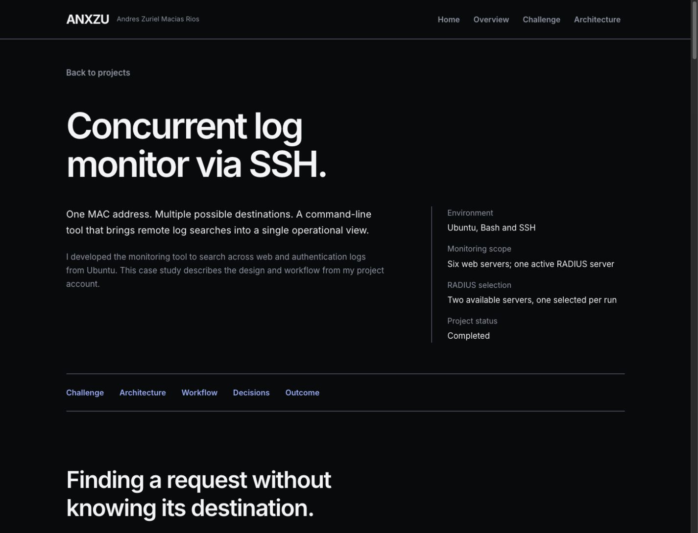
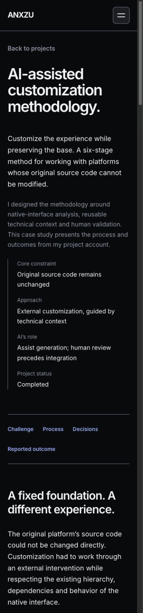

# ANX-010 — Engineering Case Studies & Technical Storytelling

23 de octubre de 2026 · Rama `codex/anx-001-redesign-audit`.

## Decisiones previas a la implementación

Se revisaron los reportes ANX-001–009, sistema de diseño, roadmap, README, datos profesionales, páginas y seis diagramas. `design-system.md` contiene ANX-002; no existe otro reporte separado. Se aplican frontend-design y ui-ux-pro-max. La consulta local `case study anchor navigation --domain ux` devuelve navegación por anclas, foco visible y compensación del header: se conservan el scroll nativo y la lógica existente, sin adoptar smooth scroll global ni otra cabecera fija.

Primero se redactaron los dos casos internos completos y el registro `professional-evidence.md`. Se archivaron las fuentes previas antes de reescribirlas en `reports/anx-010-source-inventory.json`. El propietario confirma proyectos terminados; el repositorio contiene sus declaraciones y diagramas, pero no scripts de los proyectos, resultados de pruebas ni metodología de medición de horas. No se convierten los tests del portafolio en pruebas del monitor o de la metodología.

Plan visual: Inter 400/600/700, Obsidian #090A0C, Graphite #1C1E23, Pearl #F5F5F7, Silver #8C96A6, Ice Blue #81AFFF y alias existentes. Títulos/editorial a la izquierda, prosa de lectura acotada, brief técnico junto al intro, arquitectura a ancho completo y decisiones en filas. Solo los pasos reales llevan numeración. El segundo caso relaciona el recorrido vertical con sus seis etapas, sin repetir una tarjeta por párrafo. No se añaden imágenes de terminal ni interfaces ficticias.

```text
Regreso a proyectos
Título del caso                   Contexto / contribución
Resumen                           Alcance técnico
Índice de secciones
Desafío → diagramas originales y lectura contextual
Arquitectura / proceso como pieza central
Decisiones → implementación documentada → resultado declarado
Capacidades con contexto / lectura de diseño → siguiente caso
```

Revisión del plan: se descarta una sucesión de tarjetas y un KPI de ahorro. El objeto visual son las arquitecturas existentes; la cifra de horas solo comunica un resultado autodeclarado, con limitación explícita. No se agregan revelados, loops ni listeners nuevos. Los seis diagramas y los Heroes/Credly quedan protegidos por hashes iniciales. No se cambia el perfil ANX-009 ni se atribuyen los casos a un empleo.

## Estado y alcance final

**Implementación y validación local completadas para revisión del propietario.** Sin commits, push, publicación ni ANX-011. Se conservan los cambios anteriores del árbol de trabajo. La entrega mejora la documentación pública con afirmaciones sustentadas; no certifica las implementaciones de los proyectos.

### Información respaldada y decisiones editoriales

| Tema | Fuente y tratamiento |
| --- | --- |
| Proyectos terminados | Confirmación explícita del propietario en ANX-010. Se muestra Completed, sin inferir producción, cliente o empleo. |
| Contribución individual | El texto anterior dice “desarrollé” el monitor y “diseñé” la metodología. Se usa primera persona para esas acciones generales. No se afirma autoría exclusiva ni construcción de la infraestructura observada. |
| Monitor | Prosa anterior, datos y cuatro diagramas: Ubuntu/Bash/SSH, MAC, seis Web, dos RADIUS disponibles/uno activo, configuración externa, salida centralizada e independencia de supervisión. Se presenta como cuenta del proyecto, sin llamarla verificación externa. |
| Concurrencia y negocio | Se distingue preparación secuencial, observación concurrente y avance Web→RADIUS condicionado al éxito Web. La política limita búsquedas Web; no apaga servidores ni detiene RADIUS. No se inventa failover automático. |
| Balanceador | Sus tres destinos dibujados son una simplificación preexistente. El texto aclara el inventario real documentado de seis Web. La animación no se presenta como tráfico real. |
| Metodología | Se conservan Analysis → Constraints → Technical Context → AI-Assisted Generation → Manual Validation → Integration. El segundo gráfico refina el mismo método, no agrega otros seis pasos. El resultado gráfico es integración preparada; no prueba de despliegue. |
| Horas | 8–14→1–2 horas/proyecto, tal como declara `projects.js`. En el caso aparece self-reported / not a controlled benchmark. No porcentaje, garantía ni atribución causal verificada. |
| Aprendizajes | Se redactan como lecturas de diseño derivadas de las relaciones documentadas. No se inventan anécdotas, incidentes o experimentos en primera persona. |
| Implementación y pruebas faltantes | Los marcadores E-CON y E-MET viven exclusivamente en los borradores internos. No hay sección pública de pruebas vacía, TODO ni contenido provisional. La interfaz explica el alcance documentado y distingue dibujos de registros de ejecución. |
| Tecnologías | Bash/Ubuntu/SSH y análisis/contexto/revisión humana tienen contexto de proyecto. React Flow corresponde al portafolio, no al monitor Bash. Los paths NGINX/FreeRADIUS no prueban producto, versión o administración. No se publica ninguna habilidad pendiente nueva. |

Fuentes anteriores con hashes y texto completo: [inventario archivado](reports/anx-010-source-inventory.json). Las dos páginas actuales ya contienen la nueva redacción; el archivo permite revisar qué existía antes. El reporte ANX-006 contiene una mención accidental a “8–12” en sus pendientes: la fuente canónica `projects.js`, la auditoría y ANX-009 dicen **8–14**, y esa es la cifra conservada. No se reescriben reportes históricos.

### Borradores y evidencia necesaria

- [Caso SSH, secciones A–K](case-study-concurrencia.md): incluye mapa de los cuatro diagramas, decisiones, capacidades, implementación documentada y solicitudes específicas de evidencia para pruebas, resultados y retrospectiva.
- [Caso de metodología](case-study-metodologia.md): desafío, enfoque, seis etapas, implementación, validación, resultados y aprendizajes, con los límites de cada afirmación.
- [Registro profesional adicional](professional-evidence.md): experiencia declarada, proyectos completados, laboratorios no acreditados por el material disponible, formación pública revisada en ANX-009 y tecnologías pendientes. No modifica los datos profesionales.

Para ampliar con profundidad hacen falta: script/revisión y configuración saneados del monitor; un ejemplo real autorizado de personalización y su contexto; registros de validación ejecutada; metodología y muestra de tiempos; contribuciones/collaboración, integración/despliegue y vínculo profesional cuando corresponda. Las listas de casos sugeridos en los borradores son solicitudes de evidencia, no pruebas que se afirmen realizadas.

## Presentación implementada

Los casos tienen título editorial propio, resumen, contribución y brief técnico, índice de anclas, desafío, figuras originales con lectura contextual, decisiones en filas, alcance de implementación, resultado declarado y cierre de navegación entre proyectos. El monitor da espacio completo a arquitectura y flujo; Metodología coloca la explicación de seis pasos junto al gráfico de solución en escritorio y la apila en móvil. No se generan capturas de aplicaciones, scripts o resultados.

Se reutilizan Container mediante su clase y ActionLink con foco a destino. Las nuevas primitivas CaseIntro, CaseSection, CaseFigure, CaseDecisions y CaseClosing comparten estructura sin forzar idéntico contenido entre ambos casos. No hay nuevos estados React, observers, timers, RAF, revelados ni loops. La única microinteracción propia es la flecha de cierre de 2 px con el token hover; reduced motion elimina su transformación.

Los textos, main, metadatos HTML estáticos y head React se alinean en inglés. El header de proyectos usa Overview/Challenge/Architecture o Process sobre los hashes originales. Los seis gráficos conservan su español y se envuelven en `lang="es"`, sin traducir ni tocar contenido interno. Home conserva sus enlaces y configuración.

El CSS nuevo queda limitado a `.case-*`, excepto las condiciones de viewport/reduced motion que contienen esos mismos selectores. No se alteran `.diagram-*`, `.react-flow*`, tokens ni CSS global. La hoja antigua `introduce.css` permanece disponible pero ya no se importa en las dos presentaciones nuevas.

## Archivos y preservación

| Archivo existente modificado en ANX-010 | Cambio |
| --- | --- |
| `src/components/sections/introduce.jsx` | Caso SSH en inglés con cuatro gráficos originales y narrativa por responsabilidades |
| `src/components/sections/introduce_metodologia.jsx` | Caso de metodología, seis pasos, dos gráficos y comparación cualificada |
| `src/pages/projects/Concurrencia.jsx` | main en inglés |
| `src/pages/projects/Metodologia.jsx` | main en inglés |
| `src/data/navigation.js` | Etiquetas inglesas específicas de proyectos; mismos destinos y navegación Home intacta |
| `src/data/pageMetadata.js` | Título, descripción, lenguaje/locale de los dos casos; rutas y canonical intactos |
| `tests/page-metadata.test.js` | Expectativa de idioma de los casos pasa de es a en, conforme al nuevo contenido; conserva las aserciones restantes |

Nuevos: `src/components/ui/CaseStudy.jsx`, `src/style/case-study.css`, los cuatro documentos solicitados y evidencias `reports/anx-010-*`. **Dependencias añadidas: ninguna.** package.json y lockfile no cambian.

El manifiesto inicial abarca 305 archivos: **298 idénticos, siete modificados y ninguna eliminación**. Los seis componentes gráficos, sus modelos/posiciones/encuadre, edge personalizado, controles, reproducción, helpers, hooks y CSS mantienen sus SHA256. También permanecen intactos los dos Hero, adaptador/escultura/controladores, Home, Credly/datos/imágenes, perfil/capacidades/cronología, resto de escenas, tokens, fuentes y assets. [Manifiesto y comparación](reports/anx-010-preservation.json). No se atribuye el diff acumulado de ANX-001–009 a esta fase.

## Pruebas y resultados

| Comando | Resultado |
| --- | --- |
| `npm run lint` | Pasa, sin warnings; [salida](reports/anx-010-lint.txt) |
| `npm run build -- --manifest` | Pasa, 300 módulos; [salida](reports/anx-010-build.txt) |
| `node --test tests/*.test.js` | **27/27 pasan**; [salida](reports/anx-010-tests.txt) |
| `node scripts/check-project-chunks.mjs` | Pasa; Flow/d3/zustand fuera de Home y ambos casos diferidos; [salida](reports/anx-010-chunks.txt) |
| `git diff --check` | Pasa; [salida](reports/anx-010-diff.txt) |

Se ejecuta el build con manifest adicional para medir bytes sin cambiar el script de npm. Los tests existentes comprueban, entre otros, contraste de tokens, comportamiento de controladores, pausa/visibilidad/reduced motion/cleanup, secuencias de diagramas, Hero y metadatos. **Son pruebas del portafolio; no del monitor Bash ni de las personalizaciones originales.** No se añaden tests que simplemente repitan el nuevo copy.

### Rutas, responsive y accesibilidad

Inspección DOM y visual sobre Vite Preview, navegador integrado, cinco anchos por caso, altura 900 px. La barra vertical ocupa 15 px en este entorno.

| Ancho solicitado | Concurrencia: client/scroll | Metodología: client/scroll |
| ---: | ---: | ---: |
| 320 | 305/305 | 305/305 |
| 375 | 360/360 | 360/360 |
| 768 | 753/753 | 753/753 |
| 1024 | 1009/1009 | 1009/1009 |
| 1440 | 1425/1425 | 1425/1425 |

Las diez combinaciones conservan un h1/main, cuatro/dos React Flow, cero IDs duplicados, hashes internos con destino, gráficos con scope español y ausencia de marcadores editoriales. No hay overflow horizontal de documento. Se revisaron capturas completas de ambas páginas y vistas focalizadas de proceso, arquitectura y resultado.

Se abrieron y recargaron `#introduce`, `#problema`, `#solucion`, `#highLevel`, `#flowSystem` de Concurrencia, y `#metodologia`, alias `#introduce`, `#problema`, `#solucion` de Metodología. El foco llega a cada ID; los capítulos quedan a unos104px bajo el header. Los intros completos quedan en y0 con padding de cabecera; el alias de Metodología queda a y104. Las seis anclas de diagramas también se abrieron durante los ensayos de reproducción.

Teclado: Skip to content llega a main con foco3px; Tab siguiente llega a Back to projects con foco3px. Menú móvil abre con Enter, Escape restaura Open menu y deja expanded=false. El índice Reported outcome enfoca `#outcome` a y104. El cierre del segundo caso abre el monitor, enfoca main y monta cuatro gráficos. Back to projects vuelve a `/#projects`, enfoca proyectos y deja cero gráficos montados. Hero inmersivo y Credentials siguen presentes en Home. No se alteró su código ni su animación.

Las auditorías pasan color-contrast, heading-order, html-has-lang y label-content-name-mismatch, además de los presupuestos de contraste de tokens probados por Node. Los estilos nuevos usan esos pares opacos sin bajar opacidad del texto. Esto no equivale a conformidad WCAG completa ni reemplaza lector de pantalla.

Se observó el fallback real Loading project durante una navegación; se conserva [su captura](reports/anx-010-loading-mobile.jpg), seguida de la resolución normal y navegación al resultado. No se forzó un retraso ni se reinyectó un error503: Suspense/error boundary son idénticos a ANX-006. Entrada directa, recarga y separación de chunks sí se comprobaron en esta fase. Consola del navegador sin warnings/errores en las rutas normales inspeccionadas; las dos auditorías normales pasan errors-in-console.

### Seis diagramas y movimiento

En móvil375px se verificó reproducción real por cambio de etapa, no solo screenshots:

| Diagrama | Cambio observado |
| --- | --- |
| Balanceador | `lb-ws2`→`lb-ws3`, conservando `client-lb` |
| Negocio | `e1`→`e2`, con `m1/m2` independientes |
| Lógica | `mac-ssh`→`ssh-web` + `ssh-radius` |
| Alto nivel | `user-terminal`→`terminal-orchestrator` + `config-orchestrator` |
| Metodología problema | `a-b`→`b-c` |
| Metodología solución | `a-b`→`b-c` |

Cada figura fue la única reproduciéndose en su vista. Pausar con Enter deja data-playing=false, aria-pressed=true y señales CSS en paused; reanudar vuelve a true. Zoom In cambia realmente la escala en los seis; Fit View recupera la vista general. La pausa manual del segundo gráfico se conserva al visitar Outcome y volver con navegación atrás. En Outcome los dos gráficos permanecen detenidos.

El encuadre denso móvil conserva sus límites anteriores: el overview de arquitectura requiere ampliar para leer nodos; el texto HTML explica la estructura sin depender del zoom o la animación. No se promete legibilidad de cada label a escala general ni gestos de dispositivo físico. En Metodología el gráfico se presenta junto a la explicación en escritorio, manteniendo opciones/modelo originales; el contenedor se apila en móvil. No se modifica su funcionamiento interno.

Arranque reducido: dos auditorías Chrome con `--force-prefers-reduced-motion`, altura1200 y hashes de figura muestran **Movimiento reducido** y composición completa estática; Accessibility100. Capturas reales: [SSH](reports/anx-010-reduced-concurrencia.jpg), [Metodología](reports/anx-010-reduced-metodologia.jpg). Son probes separados de las mediciones normales. El cambio de preferencia durante sesión y la ocultación real de pestaña siguen pendientes de navegador nativo; las pruebas del controlador cubren esos estados, pero el panel IAB no acredita un hidden real. No se añade trabajo de animación nuevo ni se altera el cleanup existente.

[Registro estructurado de comprobaciones](reports/anx-010-validation.json).

## Bundles y rendimiento

Comparación con el build ANX-009 guardado antes de editar. Bytes reales sin comprimir; no son transferencia de hosting ni Core Web Vitals.

| Recurso | Antes | Después | Diferencia |
| --- | ---: | ---: | ---: |
| JS inicial | 288564 | 288593 | +29 |
| CSS inicial | 42567 | 42567 | 0 |
| JS compartido de casos/Flow | 180584 | 182432 | +1848 |
| CSS compartido de casos/Flow | 18568 | 21769 | +3201 |
| Concurrencia diferido | 42236 | 41107 | −1129 |
| Metodología diferido | 14793 | 16489 | +1696 |
| Total JS todas las rutas | 526177 | 528621 | +2444 |
| Total CSS todas las rutas | 61135 | 64336 | +3201 |

El chunk antes llamado `style` pasa a `CaseStudy` por la unidad compartida; contiene React Flow más los helpers de presentación. El incremento de bytes no significa cambios en los gráficos. El CSS nuevo se carga con los proyectos; Home conserva exactamente su CSS y su clausura estática no contiene Flow/d3/zustand. El pequeño cambio inicial corresponde a navegación/metadatos/referencias de chunks. No hay nuevos assets de aplicación, fuentes ni librerías.

[Comparación exacta](reports/anx-010-bundles.json), [baseline](reports/anx-010-build-before.json), [build final con hashes](reports/anx-010-build-final.json). El JSON incluye gzip nivel9 local de los archivos finales, distinto del gzip informado por Vite; ninguno es una transferencia real medida.

Lighthouse13.5.0 / Chrome155 headless instalado, Vite Preview local. Una muestra móvil normal por ruta, procesos nuevos secuenciales, build estable; no son medianas. Perfil simulado Moto G Power412×823, DPR1,75, RTT150ms, throughput1638,4kbps y CPU×4. Otras aplicaciones estaban abiertas; no se afirma entorno aislado ni dispositivo móvil físico.

| Caso móvil | Performance | Accessibility | Best Practices | SEO | LCP ms | CLS | TBT ms |
| --- | ---: | ---: | ---: | ---: | ---: | ---: | ---: |
| Concurrencia | 97 | 100 | 100 | 100 | 2433 | 0 | 5,5 |
| Metodología | 97 | 100 | 100 | 100 | 2468 | 0 | 0 |

[Métricas/configuración/timestamps](reports/anx-010-metrics.json), [SSH](reports/anx-010-concurrencia-mobile.json), [Metodología](reports/anx-010-metodologia-mobile.json). Las reglas individuales citadas arriba pasan; runtimeError ausente. Los probes reducidos obtienen P97/A100, pero sus hashes/altura/preferencia difieren y no se mezclan con esta tabla.

La referencia histórica ANX-006 era P97 móvil y LCP mediano2466/2445ms para los casos, antes del movimiento ANX-008 y de esta fase. La comparación no aísla el efecto del nuevo contenido: una muestra actual frente a tres históricas, con código/entorno distintos, no prueba mejora o regresión causal. No se repite Lighthouse de escritorio ni Home en ANX-010; no se atribuyen sus resultados anteriores al nuevo build. Los dos casos mantienen poco margen frente a2,5s en laboratorio. No se midieron INP de campo, CPU sostenida o FPS; TBT y tamaño de bundle no sustituyen esas mediciones.

## Evidencia visual

Capturas reales sin retocar. Introducción: viewports solicitados1440×1100 y375×1600; archivos1425×1089 y360×1536 por la barra y escala de exportación. Las capturas completas son1425×9669/7567 y360×12026/9232. La captura de arquitectura usa1440/375×1250. La demostración de etapas se registra en JSON; imágenes estáticas no certifican fluidez.

| Caso | Escritorio | Móvil | Página completa |
| --- | --- | --- | --- |
| Concurrent Log Monitor | [Portada](reports/anx-010-concurrencia-desktop.jpg) | [Portada](reports/anx-010-concurrencia-mobile.jpg) | [Escritorio](reports/anx-010-concurrencia-desktop-full.jpg) / [móvil](reports/anx-010-concurrencia-mobile-full.jpg) |
| AI-Assisted Customization | [Portada](reports/anx-010-metodologia-desktop.jpg) | [Portada](reports/anx-010-metodologia-mobile.jpg) | [Escritorio](reports/anx-010-metodologia-desktop-full.jpg) / [móvil](reports/anx-010-metodologia-mobile-full.jpg) |





Detalles: [arquitectura escritorio](reports/anx-010-architecture-desktop.jpg), [arquitectura móvil](reports/anx-010-architecture-mobile.jpg), [proceso y explicación](reports/anx-010-metodologia-process-desktop.jpg), [resultado con contexto visible](reports/anx-010-metodologia-outcome-mobile.jpg). La captura de proceso900px muestra el comienzo; la página completa permite revisar los seis pasos.

## Limitaciones, riesgos y revisión antes de publicar

No hay artefactos ejecutables/pruebas originales de los proyectos ni medición metodológica de tiempos. Se resolvió la presentación con lo sustentado, manteniendo las secciones profundas no verificadas en los borradores. El propietario debe revisar voz, contribuciones, contexto profesional, integración y los materiales que permitan ampliar cada relato sin revelar información confidencial. No se inventaron comandos, código, algoritmos, datos o clientes para completar apartados.

Los datos profesionales y Credly quedan intactos; este trabajo no revalida credenciales ni empleo. La portada todavía conserva su descripción histórica de reducción de horas en `projects.js`; la cualificación detallada se incorpora en el caso de estudio autorizado. Conviene revisar esa frase de portada en un cambio de contenido posterior autorizado para extender el mismo contexto sin alterar aquí las escenas protegidas. No se presenta la frase heredada como medición nueva.

Continúan pendientes Safari, lector de pantalla, zoom nativo200/400%, hardware táctil, cambio en vivo de reduced motion, pestaña realmente oculta y hosting/staging autorizado. No hay nueva medición de frames/energía ni vídeo; no se afirma60FPS. La SPA requiere JS para contenido, como antes; metadatos estáticos no son prerender completo. Los tests y screenshots locales no certifican producción.

No se detectaron regresiones funcionales en los casos ensayados. Se entrega para revisión con evidencia y faltantes explícitos. **No se publica, no se hace commit/push y no se inicia ANX-011.**
