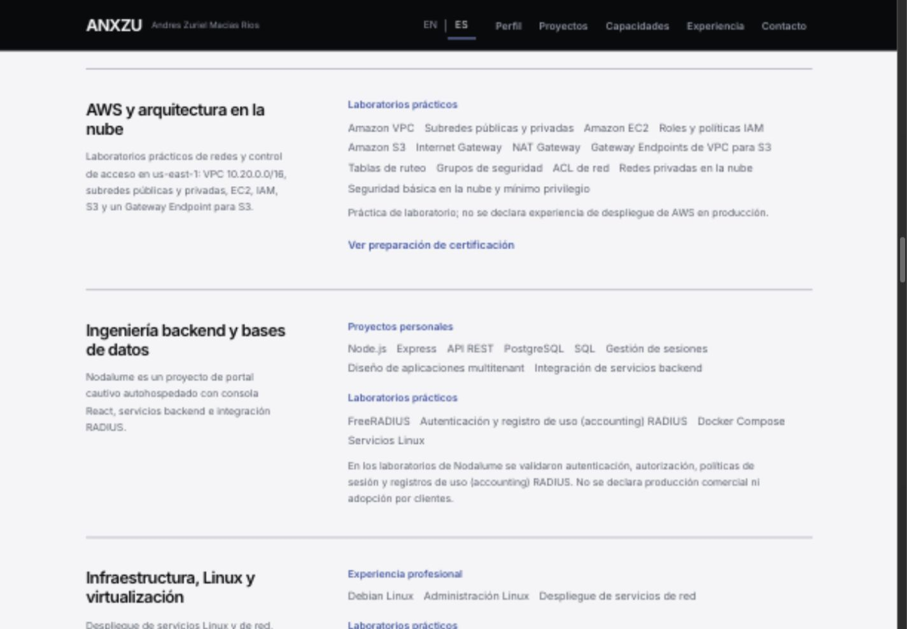
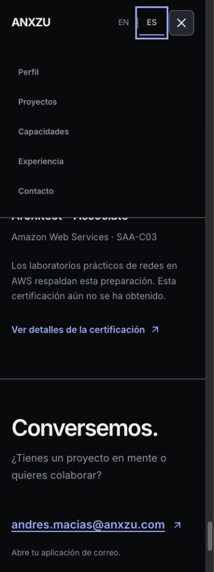

# ANX-012.1 — Bilingual QA, Performance & Release Readiness

Fecha: **24 de octubre de 2026**. Rama: **`codex/anx-012-professional-i18n`**, desde ANX-012 terminada (`0c28be3`). Comparador: v1.0.0 / `5e388c925ec2a705bb1a019711452c72aa51c1ea`.

## Recomendación

**GO para integración técnica en main, después de revisión del propietario, con una observación P2 de LCP móvil que debe quedar visible en la decisión.** La suite, la integridad de contenido/modelos, la navegación bilingüe y las comprobaciones de accesibilidad pasan. Performance móvil tiene medianas 95–99 y escritorio 100, con Accessibility 100 y CLS 0 en los ensayos.

Esto **no afirma una mejora de LCP frente a v1.0.0**: los casos bilingües superan 2,5 s en el perfil móvil simulado. No se considera satisfecho un objetivo estricto de LCP ≤2,5 s para esos casos. La integración recomendada acepta ese pendiente documentado; una política de lanzamiento que exija ese umbral requerirá resolverlo antes del despliegue.

Se consultó `origin/main` el 24 de octubre: sigue en `5e388c925ec2a705bb1a019711452c72aa51c1ea` y es ancestro de la rama; [comprobación de base](reports/anx-012-1/git-readiness.json). No se hizo merge, push, tag, Release ni cambio de producción. No se inició otra fase.

## Hallazgos y correcciones

| Hallazgo | Acción / resultado |
| --- | --- |
| Diccionarios con frases originales repetidas como clave y valor | Se guarda cada traducción una vez y se deriva el valor del idioma de origen mediante `defineMessages`. Sin carga asíncrona de idioma ni librería nueva |
| Confusión potencial entre detener búsquedas web y detener servidores | La traducción ES especifica **“detener las demás búsquedas web, sin afectar RADIUS”**; el modelo y las reglas originales permanecen intactos |
| Traducción literal “multiinquilino” | **“Diseño de aplicaciones multitenant”**, manteniendo el significado técnico |
| Accounting RADIUS sin explicación en ES | **“registro de uso (accounting) RADIUS”**, conservando el término del protocolo |
| “Ruta de negocio continua” podía sugerir continuidad temporal | **“recorrido de negocio, dibujado con línea continua”**, distinguiendo el estilo de trazo y la condición de éxito web |
| Redacción inglesa del papel de la IA | **“Assists generation; human review precedes integration”** |
| Nombre de producto escrito “React-flow” en showcase | Se normaliza a **React Flow**, sin añadir otra tecnología |
| LCP móvil de los casos aumenta frente a v1.0.0 | Se registra con medianas/rangos; no se presenta la disminución de bytes como mejora de Web Vitals |

Se aplicaron `frontend-design` y `ui-ux-pro-max` para revisar legibilidad, lenguaje y foco sin cambiar composición, paleta, tipografía, retrato ni movimiento. La consulta de UX sobre foco no oculto respaldó revisar el menú existente, sus offsets y la restauración del disparador, sin añadir controles nuevos.

## Revisión lingüística y editorial

Se revisaron las frases de ambos idiomas y el contenido renderizado de las tres rutas, desplegando las tecnologías adicionales y las 18 credenciales. Se conservaron [extracciones reales EN/ES](evidence/anx-012-1/home-es-text.txt) de Home y ambos casos para distinguir texto efectivamente presentado de claves presentes en el catálogo.

La revisión incluye Hero, About, conexión, seis áreas profesionales, inventario anterior, experiencia, credenciales, preparación AWS, contacto/footer, índices, lecturas de figuras, decisiones, resultados y textos de los seis diagramas. Se comprobaron también controles accesibles, menú móvil, errores/carga mediante las pruebas React existentes y enlaces internos de regreso. Las correcciones de diccionario están registradas en [editorial-changes.json](reports/anx-012-1/editorial-changes.json); la normalización React Flow está en `src/data/projects.js`.

- Las seis áreas siguen diferenciando experiencia profesional, proyectos, laboratorios y formación. Fortinet/Cisco/Aruba/Ruckus/Huawei mantienen el alcance confirmado por el propietario; no se atribuyen a otro puesto o periodo.
- AWS SAA-C03 sigue **In preparation / En preparación**, fuera de las credenciales obtenidas, con aviso expreso y sin badge de logro, fecha, puntuación o porcentaje nuevo.
- Las **18 credenciales** mantienen metadatos, imágenes y URLs de ANX-011/012. No se simula una nueva verificación pública ni se cambia la fecha de consulta previa.
- Nodalume continúa como proyecto/laboratorio confirmado por el propietario; no se inspeccionó de nuevo un repositorio remoto ni se añaden clientes o producción comercial.
- Se preservan fechas profesionales, nombre completo, ocho categorías / 25 tecnologías anteriores y nombres oficiales de productos/credenciales. Los términos técnicos frontend/backend, multitenant y accounting no representan mezclas accidentales de interfaces.

La atribución interna **“React Flow attribution”** sigue siendo una excepción inglesa de la biblioteca, sin API de traducción. Las etiquetas y descripciones configurables sí están localizadas. Los nombres oficiales de credenciales permanecen en inglés con `lang="en"`.

## Investigación y optimización de bundles

[Inventario de módulos antes](reports/anx-012-1/modules-before.json), [después](reports/anx-012-1/modules-after.json) y [duplicación de mensajes](reports/anx-012-1/dictionary-duplication.json).

Antes, 236 de las 238 entradas del diccionario EN compartido repetían exactamente la clave como valor. En proyectos se repetían 140 valores EN y 143 ES. Las dos copias compartidas representaban 44.654 bytes de `renderedLength` de Rollup; las dos de proyectos, 75.312. Esas atribuciones de módulo son diagnósticas, anteriores al empaquetado final, y no equivalen a bytes transferidos ni deben sumarse a los minificados de la tabla.

No se encontró solapamiento de claves entre catálogos común/proyectos ni dos instalaciones de una librería i18n. La causa principal era **contenido textual duplicado**, no una copia de React Flow en Home. La nueva estructura mantiene:

- `locales/common.js` y `projects.js`: traducciones agrupadas explícitamente por su idioma de origen, con correcciones ES puntuales.
- `catalog.js`: deriva ambos objetos, rechaza fuentes ambiguas y permite corregir una frase canónica sin cambiar el modelo del diagrama.
- Los cuatro módulos EN/ES anteriores siguen exportando el mismo contrato. Contextos, selector, fallback y sincronía de alternancia permanecen iguales.

La prueba de equivalencia previa a la revisión editorial confirmó que la deduplicación mantenía **las 1.044 entradas de idioma**. Las correcciones posteriores son las enumeradas arriba. Los catálogos conservan 238/284 claves y paridad de claves/placeholders, comprobadas por la suite.

### Bytes generados

| Recurso | v1.0.0 | ANX-012 | ANX-012.1 | Diferencia vs ANX-012 |
| --- | ---: | ---: | ---: | ---: |
| initial JS | 288,593 | 342,060 | 321,620 | -20,440 (-5.98%) |
| initial CSS | 42,567 | 44,625 | 44,625 | 0 (0%) |
| Concurrencia | 41,107 | 43,058 | 43,058 | 0 (0%) |
| Metodologia | 16,489 | 17,362 | 17,363 | 1 (0.01%) |
| shared case JS | 182,432 | 257,199 | 221,176 | -36,023 (-14.01%) |
| shared case CSS | 21,769 | 21,769 | 21,769 | 0 (0%) |

El JS inicial se reduce **20.440 bytes (5,98%)** y el compartido de proyectos **36.023 bytes (14,01%)** respecto de ANX-012. Gzip nivel 9 local: inicial **103.100 → 101.618 bytes**; compartido **79.527 → 72.741 bytes**. El ahorro comprimido es menor que el ahorro sin comprimir porque las repeticiones ya se comprimen bien.

[Comparación exacta, archivos y hashes](reports/anx-012-1/bundles.json). El CSS no cambia en esta fase. Se mantiene React Flow/d3/zustand y los mensajes de proyectos fuera de la carga inicial; ambas rutas siguen diferidas. El compartido todavía incluye motor/gráficos y traducciones de ambos casos. Separar más esa carga requeriría medir otra estrategia de descarga y validar hashes, fallbacks y encuadre: no se añadió esa complejidad sin una prueba adicional.

## Lighthouse: método comparable

Se completaron **36 navegaciones válidas**: tres por ruta × móvil/escritorio × v1.0.0/candidato. Cada pareja alterna el orden entre versiones en la segunda repetición. Procesos seriales, Chrome fresco por invocación, almacenamiento restablecido por Lighthouse, misma máquina, navegador y parámetros; movimiento normal. No se hicieron builds ni QA interactivo durante esta serie.

- Lighthouse **13.5.0**, Headless Chrome **155.0.0.0**, Apple M4 Pro, Node **24.19.0**. [Entorno y configuración completa](reports/anx-012-1/environment.json).
- Móvil predeterminado: 412×823, DPR 1,75; simulación de red/CPU de Lighthouse (RTT 150 ms, throughput 1638,4 Kbps, multiplicador CPU 4). Escritorio usa `--preset=desktop` con sus valores capturados en el JSON.
- v1.0.0 se extrajo con `git archive` a un directorio temporal, sin modificar ramas, y usa un lockfile idéntico. Dos Preview locales estables en 4180/4173, mismas rutas públicas y origen de red loopback.
- Las 18 mediciones candidatas referencian el mismo entry final y el rebuild posterior conserva ese hash: [build estable](reports/anx-012-1/stable-build.json). No se mezclaron builds intermedios.
- Comparación **EN con EN**, el idioma predeterminado existente en v1.0.0. ES se validó funcional/visualmente, pero no tiene una serie Lighthouse independiente. No se atribuyen a ES valores medidos solo en EN.
- El ahorro de bytes se compara con ANX-012; Lighthouse compara v1.0.0 con el **resultado bilingüe completo**. No aísla causalmente la deduplicación ni demuestra que esta por sí sola mejoró LCP.

### Medianas, tres pasadas por celda

| Perfil / ruta | Performance v1 → final | Accessibility v1 → final | LCP v1 → final (ms) | CLS v1 → final | TBT v1 → final (ms) |
| --- | ---: | ---: | ---: | ---: | ---: |
| mobile / home | 99 → 99 | 100 → 100 | 2029 → 2102 | 0 → 0 | 0 → 0 |
| mobile / concurrencia | 97 → 96 | 100 → 100 | 2479 → 2636 | 0 → 0 | 6 → 0 |
| mobile / metodologia | 97 → 95 | 100 → 100 | 2427 → 2726 | 0 → 0 | 0 → 0 |
| desktop / home | 100 → 100 | 100 → 100 | 423 → 442 | 0 → 0 | 0 → 0 |
| desktop / concurrencia | 100 → 100 | 100 → 100 | 570 → 570 | 0 → 0 | 0 → 0 |
| desktop / metodologia | 100 → 100 | 100 → 100 | 569 → 571 | 0 → 0 | 0 → 0 |

LCP móvil final, rangos de las tres pasadas: Home **2.102–2.102 ms**, Concurrencia **2.576–2.773 ms**, Metodología **2.725–2.767 ms** (valores redondeados). Las medianas aumentan aproximadamente **73 / 157 / 299 ms** frente a v1.0.0. Concurrencia y Metodología quedan por encima de 2,5 s en la simulación móvil. Se registra como **P2**, sin ocultar la regresión con el ahorro de bundle. TBT mediano final 0 ms no implica INP ni una mejora significativa de CPU; hay variación entre repeticiones.

Los diagnósticos señalan texto de la introducción como LCP en los casos y una cadena de carga que aún espera el chunk compartido. No se presenta como un problema de una imagen crítica ni se cambia la arquitectura de gráficos durante esta QA. Es un candidato para un experimento posterior de carga de casos, con medición propia.

[Resumen con mínimos/máximos](reports/anx-012-1/lighthouse/summary.json), [36 resultados y configuraciones](reports/anx-012-1/lighthouse/runs.json). Los reportes LHR completos se conservan comprimidos en esa carpeta (`*.json.gz`); pueden abrirse tras `gzip -dc archivo.json.gz`. No se descartaron pasadas por puntuación ni hubo warnings/runtime errors registrados.

Reproducción: iniciar ambos builds estables y ejecutar `ANX_LH_CLI=/ruta/lighthouse/cli/index.js CHROME_PATH=/ruta/Chrome node scripts/lighthouse-readiness.mjs /tmp/anx-readiness-rerun`. El runner no instala Lighthouse ni modifica la aplicación. Usar un directorio nuevo conserva la evidencia histórica.

## Validación funcional y accesible

| Comprobación | Evidencia / resultado |
| --- | --- |
| 320, 375, 768, 1024, 1440 y 1920 px; tres rutas, EN/ES | [36 combinaciones](evidence/anx-012-1/responsive-matrix.json), sin overflow inesperado; botones EN/ES ≥44×44 px |
| Pausa y zoom de los seis diagramas | [Estado antes/después](evidence/anx-012-1/six-graphs-pause-zoom-scroll.json): autoplay al entrar, pausa conservada, mismo zoom, conexiones activas y hash tras EN→ES; delta del frame visible 0 px en los seis |
| Zoom y Fit View | Accionados por teclado en los seis gráficos, sin reset por idioma |
| Pausa del Hero | [Estado real](evidence/anx-012-1/navigation-hero-persistence-console.json): `data-static=true` y pausa conservados al alternar idiomas |
| Menú móvil y foco | Enter abre, Tab llega a Perfil, etiquetas cambian en menú abierto; Escape cierra y restaura el disparador |
| Regreso y persistencia | Enlace real vuelve a `/#projects` con foco en proyectos y ES; recarga de ruta profunda mantiene idioma, ruta y hash |
| Consola | Sin errores ni advertencias en la sesión inspeccionada |
| Reduced motion real | [Auditoría suplementaria](reports/anx-012-1/motion-check/results.json): preferencia real de Chrome headless, Hero estático y seis gráficos sin reproducción, controles deshabilitados, señales con `animationName=none` |
| Integridad de contenido/modelos | 46 nodos / 37 edges del modelo; 18 credenciales, datos profesionales e inventario anterior intactos según las pruebas de preservación |

La comprobación de reduced motion emplea una extensión de auditoría Lighthouse que **solo lee** la preferencia y el DOM en un perfil aislado con `--force-prefers-reduced-motion`. No cambia ajustes del sistema del propietario. Las dos rutas se abrieron con hashes de diagramas para comprobar el estado estático en la escena. El código/configuración y la evidencia se conservan en `reports/anx-012-1/motion-check/` (gatherer, audit, config y resultados); estas puntuaciones binarias no son Performance ni certificación de accesibilidad.

**Precisión del conteo visual:** hay 37 edges en los modelos originales y 36 paths dibujados. La referencia opcional `policy-detect` sale de una nota sin handle de salida y no se dibuja como transferencia. Se confirmó el mismo resultado en [v1.0.0](reports/anx-012-1/motion-check/baseline-reference.json); no es una pérdida introducida por i18n. La nota y su explicación siguen visibles y la referencia nunca entra en las secuencias animadas. No se añadió un handle ni se inventó una transferencia para forzar un número visual.

El contraste sigue usando los tokens existentes, con pruebas automatizadas claras/oscuras y revisión visual. Lighthouse Accessibility 100 y el árbol accesible no equivalen a una auditoría WCAG completa; no se realizó una sesión con lector de pantalla físico ni se certificó hardware táctil/Safari.

Commit local de implementación y runner: `c3f1769` — `perf: deduplicate bilingual catalogs and refine technical copy`.

## Comandos finales

| Comando | Resultado |
| --- | --- |
| `npm ci` | Correcto, lockfile/dependencias sin cambios |
| `npm run lint` | Correcto |
| `npm run build -- --manifest` | Correcto; mismo entry que las mediciones candidatas |
| `node --test tests/*.test.js` | **36/36**: las 35 anteriores y una nueva prueba del contrato de catálogos compactos |
| `node scripts/check-project-chunks.mjs` | Correcto, React Flow fuera de Home |
| `git diff --check` | Correcto |

[Instalación](reports/anx-012-1/npm-ci.txt), [lint](reports/anx-012-1/lint.txt), [build](reports/anx-012-1/build.txt), [tests](reports/anx-012-1/tests.txt), [chunks](reports/anx-012-1/chunks.txt). Se mantuvieron las pruebas de visibilidad, limpieza de timers/listeners, reduced motion, metadatos, fallback en memoria, rutas, fechas y modelos sin reemplazarlas por snapshots de redacción.

## Evidencia visual

23 capturas reales, no maquetas. La matriz solicitada reserva 15 px para scrollbar en este navegador (375 solicitados → 360 de documento). Se revisaron vistas de portada, casos, capacidades corregidas, AWS y menú.

| Vista | EN | ES |
| --- | --- | --- |
| Home escritorio | [EN](evidence/anx-012-1/home-en-1440.png) | [ES](evidence/anx-012-1/home-es-1440.png) |
| Home móvil | [EN](evidence/anx-012-1/home-en-375.png) | [ES](evidence/anx-012-1/home-es-375.png) |
| Concurrencia escritorio | [EN](evidence/anx-012-1/concurrencia-en-1440.png) | [ES](evidence/anx-012-1/concurrencia-es-1440.png) |
| Concurrencia móvil | [EN](evidence/anx-012-1/concurrencia-en-375.png) | [ES](evidence/anx-012-1/concurrencia-es-375.png) |
| Metodología escritorio | [EN](evidence/anx-012-1/metodologia-en-1440.png) | [ES](evidence/anx-012-1/metodologia-es-1440.png) |
| Metodología móvil | [EN](evidence/anx-012-1/metodologia-en-375.png) | [ES](evidence/anx-012-1/metodologia-es-375.png) |
| AWS móvil | [EN](evidence/anx-012-1/aws-en-375.png) | [ES](evidence/anx-012-1/aws-es-375.png) |
| Menú móvil | [EN](evidence/anx-012-1/menu-en-375.png) | [ES](evidence/anx-012-1/menu-es-375.png) |
| Capacidades backend corregidas | Nombres de tecnologías conservados | [ES escritorio](evidence/anx-012-1/backend-es-1440.png) |

También se inspeccionaron las seis escenas completas en ES a 1440 px de ancho y 1440 px de alto, sin superposición nueva de textos: [balanceador](evidence/anx-012-1/diagram-loadbalance-es-1440.png), [negocio](evidence/anx-012-1/diagram-business-es-1440.png), [lógica](evidence/anx-012-1/diagram-logic-es-1440.png), [arquitectura](evidence/anx-012-1/diagram-highlevel-es-1440.png), [problema](evidence/anx-012-1/diagram-methodology-problem-es-1440.png) y [solución](evidence/anx-012-1/diagram-methodology-solution-es-1440.png).

## Límites y siguiente decisión

La recomendación GO se limita a la integración revisada. El pendiente de LCP móvil de los casos debe acompañar esa revisión, junto con la necesidad de validar el hosting real, caché/compresión y dispositivos representativos antes de concluir rendimiento de producción. Los números son mediciones de laboratorio sobre Preview y simulación, no Web Vitals de campo, INP, CPU sostenida ni FPS. La carga habitual del equipo no estuvo aislada térmicamente; tres pasadas y orden alterno reducen sesgo sin eliminarlo.

ES tiene QA textual, geométrica y funcional, pero la serie Lighthouse comparativa es EN. El ensayo de reduced motion es EN en Chrome y no incluye cambio en caliente del ajuste del sistema. El foco/scroll se conservaron en las escenas ensayadas; no se garantiza idéntico reflow en cada párrafo de ambos idiomas. Se mantiene la limitación de SEO estático EN y la atribución inglesa interna de React Flow.

Archivos de aplicación modificados: cuatro exports de locale, nuevos `catalog.js`, `locales/common.js` y `locales/projects.js`; redacción del papel de IA en `introduce_metodologia.jsx` y nombre React Flow en `data/projects.js`. Se actualiza la allowlist de nombres y se agrega una prueba del catálogo. El runner Lighthouse, este reporte y sus evidencias documentan la fase. **Sin cambios a modelos, posiciones, controladores, estilos, rutas, dependencias ni datos de credenciales.**
