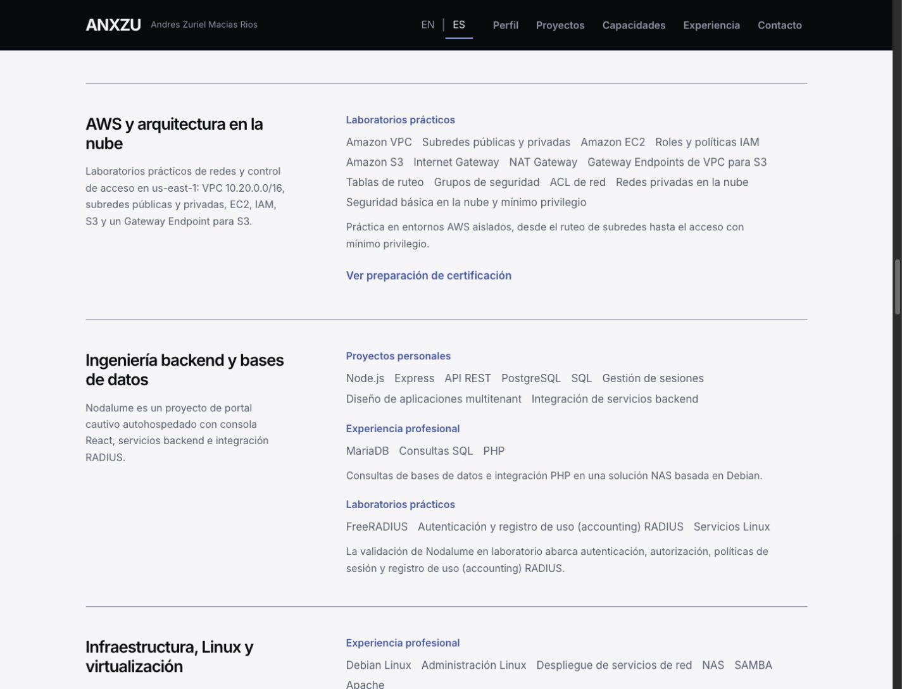
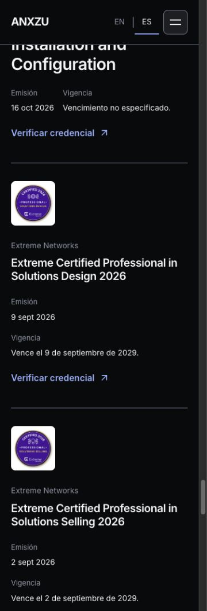

# ANX-012.2 — Case Study Performance & Editorial Refinement

Fecha: 24 de octubre de 2026. Rama: `codex/anx-012-professional-i18n`. Baseline inmediato: **ANX-012.1 / `68e9d40`**. Sin rediseño, dependencias nuevas, merge, push, tag, Release ni despliegue.

**GO técnico para la revisión de integración de v1.1.0.** Las tres rutas cumplen LCP móvil mediano ≤2500 ms en EN y en la muestra ES. Se conserva la experiencia funcional y el contenido verificado. La aprobación/integración corresponde al propietario; esta fase no publica ni modifica main.

Resumen: **39/39 pruebas**, aislamiento de chunks correcto, **45 mediciones de rendimiento** sobre builds estables, **7 navegaciones de reduced motion** y comprobaciones reales de teclado/idioma en los seis gráficos. Los límites de laboratorio/hosting se detallan al final.

## Contenido y capacidades

Se elimina el disclosure **Additional technologies & previous capabilities / Tecnologías adicionales y capacidades anteriores** y la explicación al visitante sobre conservar un inventario anterior. No se añade una sección de reemplazo. Sus imports de datos/tarjetas, reglas CSS exclusivas y mensajes exclusivos se retiran de la presentación pública.

La revisión cubrió las **8 categorías y 25 entradas originales** antes de retirarlas. [Trazabilidad completa e inventario interno](anx-012-2-internal-inventory.md): incluye disposición, contexto y sustento de cada tecnología. `src/data/skills.js` permanece intacto; la suite comprueba su hash.

| Integración | Área / contexto |
| --- | --- |
| PHP, MariaDB, SQL Queries e integración PHP | Backend / experiencia profesional en la solución NAS descrita en el historial |
| NAS, Apache y SAMBA | Infraestructura / la misma experiencia profesional; SAMBA ya figuraba explícitamente en el historial |
| Bash, normalizado desde BASH | Software / proyecto del monitor SSH |
| Technical Support | Arquitectura y preventa / experiencia profesional documentada |
| VLAN, BGP, Captive Portals, React, JavaScript, Debian Linux, SOW y Site Surveys | Se conservan en las áreas/contextos actuales |
| RFP Support, Troubleshooting y PHP Integration | Integrados con RFP Analysis, diagnóstico contextual e integración PHP; sin entradas genéricas duplicadas |

Node.js permanece en backend/proyectos y Docker Compose en infraestructura/laboratorios, eliminando sus repeticiones entre áreas. Los seis grupos siguen distinguiendo trabajo profesional, proyectos, laboratorios, credenciales y formación. No cambian empleos, fechas ni alcance de fabricantes confirmado por el propietario.

Siete nombres se conservan solo como inventario interno: **LAN-to-LAN, OSPF, Structured Cabling, Perimeter Security, WordPress, Shopify y Salesforce**. No se afirma que sean incorrectos: falta contexto específico de aplicación para esta presentación resumida o resultan menos relevantes. No se borran de la fuente histórica.

Se reescriben cuatro notas de capacidades que sonaban a revisión interna: formación Extreme respaldada por credenciales; práctica AWS en entornos aislados; validación RADIUS de Nodalume en laboratorio; máquinas virtuales/controladoras de prueba. Se mantiene el contexto explícito sin publicar negativas sobre tecnologías o producción no solicitadas. La nota de resultados de Metodología ahora habla en primera persona de rangos auto-reportados, conservando su límite: no son un benchmark controlado ni una garantía.

`frontend-design` orientó el texto hacia clientes/reclutadores. `ui-ux-pro-max`, consultada sobre carga y desplazamiento de contenido, respaldó conservar geometría, foco y estados accesibles. Se mantienen Inter, tokens, composición y movimiento existentes.

## Vigencia de credenciales

| Condición | EN | ES |
| --- | --- | --- |
| Fecha pública futura o del día actual | Expires September 9, 2029. | Vence el 9 de septiembre de 2029. |
| Sin fecha pública | No expiration date specified. | Vencimiento no especificado. |
| Confirmación expresa del emisor de que no vence | Does not expire. | Sin fecha de vencimiento. |
| Fecha pasada | Expired. + fecha original | Vencida. + fecha original |

Las fechas se formatean con `Intl.DateTimeFormat`, idioma de interfaz, formato largo para vencimiento y zona UTC para evitar cambios de día. Se conserva `<time dateTime>` en fechas conocidas y cada enlace de verificación individual.

`credentialStatus` solo admite el estado no vencible con `nonExpiringEvidence`: confirmación explícita, URL HTTPS y declaración del emisor. Una fecha explícita siempre tiene prioridad. **Ninguna de las 18 credenciales actuales recibe una política vitalicia nueva**; los ejemplos de no vencimiento en tests son fixtures sintéticos, no credenciales publicadas.

La suite conserva byte por byte los metadatos normalizados de las **18 insignias**, incluyendo fechas, nombres oficiales, imágenes y enlaces. No se presenta una nueva consulta pública de Credly: sigue la comprobación documentada del 23 de octubre. AWS SAA-C03 sigue como **preparación**, separado de logros y sin insignia, fecha de examen o porcentaje inventados.

Se corrige además el nombre accesible del enlace AWS: ahora contiene íntegramente el texto visible, seguido del aviso de nueva pestaña en EN/ES. Lighthouse detectó la diferencia previa aunque ese audit tenía peso cero en la puntuación Accessibility.

## Diagnóstico y experimento de carga

Antes, las páginas se cargaban con `React.lazy`, pero su contenido editorial importaba los gráficos de forma estática. La introducción esperaba al compartido **CaseStudy de 221.176 bytes**, que incluía React Flow y sus dependencias. La deduplicación i18n previa había reducido bytes, sin separar esta dependencia de montaje.

La [comparación del waterfall y LCP](reports/anx-012-2/lcp-diagnosis.json) conserva una pasada final de cada versión. En Concurrencia, el elemento LCP sigue siendo el mismo párrafo `.case-lead`, con las mismas dimensiones. El render delay **observado sin la simulación** es aproximadamente 350/346 ms; no se atribuye toda la mejora del LCP simulado a ejecución de JS. El cambio elimina recursos de la cadena necesaria para presentar ese texto bajo la simulación de red/CPU: el compartido editorial pasa a unos 42 KB y el motor de gráficos queda separado.

Inter permanece local, precargada, con `font-display: swap`; no se recorta tipografía, introducción ni superficie del elemento LCP para modificar el indicador. El catálogo común sigue en la aplicación y el catálogo de proyectos en los casos diferidos, sin otra librería i18n. El CSS técnico de React Flow permanece en el runtime diferido; las reglas pequeñas del toolbar/fallback acompañan al contenido editorial.

Implementación:

- **Seis imports dinámicos** de componentes originales, definidos fuera del render; React Router y sus tres rutas se conservan.
- `CaseFigure` monta cada gráfico al aproximarse a **400 px del viewport**. No hay temporizador de espera ni lógica que detecte Lighthouse. Un enlace directo al ID del diagrama carga inmediatamente ese gráfico, aunque aún esté lejos del viewport.
- Una vez activado, el gráfico permanece montado. Cambiar idioma o hash no reemplaza el modelo, el estado de pausa o el zoom.
- El fallback reserva altura por gráfico y breakpoint, incluyendo el mínimo móvil de 44 rem ya existente y el toolbar localizado. El contenedor usa `flow-root` para incluir sus márgenes; no se modifica el encuadre original.
- Suspense queda dentro de la figura, de modo que título, introducción, índice y explicación HTML están disponibles mientras carga el motor. Las figuras muestran un estado accesible y, ante fallo, una recuperación mediante recarga que conserva URL/hash y preferencia persistida.
- Los IDs pendientes se marcan con `data-route-pending`. El controlador existente espera el destino real y un layout estable antes de enfocar/desplazar. El observer de proximidad se desconecta al activar y en cleanup; el fallback sin IntersectionObserver se cancela si desmonta.

La activación por proximidad puede solicitar un gráfico en pantallas altas antes de que sea totalmente visible. Esto no vuelve a hacerlo una dependencia estática de la introducción. La suspensión de reproducción fuera de pantalla/pestaña continúa a cargo del controlador original.

Se conservan por separado las exploraciones en `reports/anx-012-2/lighthouse-preflight/` y `lighthouse-intermediate/`. Se interrumpieron para corregir el nombre accesible AWS y completar la retención de carga profunda/estructura Suspense; **no se incorporan a las medianas finales**. No se descartó ninguna pasada de la serie final por puntuación.

## Bundles y medición comparable

| Recurso | ANX-012.1 nuevo build (bytes) | ANX-012.2 (bytes) | Diferencia |
| --- | ---: | ---: | ---: |
| Entry JS | 321,620 | 316,193 | -5,427 (-1.69%) |
| CSS inicial | 44,625 | 44,204 | -421 (-0.94%) |
| Cierre estático JS Concurrencia | 585,854 | 369,511 | -216,343 (-36.93%) |
| Cierre estático JS Metodología | 560,159 | 367,134 | -193,025 (-34.46%) |
| Cierre estático CSS de cada caso | 66,394 | 50,840 | -15,554 (-23.43%) |

El compartido editorial final mide **41.968 bytes** (gzip 13.857); el runtime diferido, **181.485** (gzip 59.685), más seis entradas de diagramas de 4.725–11.108 bytes. Gzip del cierre estático de Concurrencia: **184.234 → 117.095 bytes**; Metodología: **179.059 → 116.383 bytes**. El entry baja de 101.618 a 99.520 bytes gzip.

La suma de todos los chunks JS es **603.217 → 602.943 bytes**: el cambio principal es **cuándo son necesarios**, no una eliminación masiva del código que permite usar los diagramas. El CSS de gráficos diferido conserva 15.851 bytes; el editorial usa 6.636 bytes. [Inventario exacto, gzip y hashes](reports/anx-012-2/bundles.json). Reproducir con `node scripts/measure-case-bundles.mjs /ruta/baseline/dist /tmp/bundles.json`.

Los tamaños son bytes generados y gzip nivel 9 local de Node, no tamaños de transferencia ni Web Vitals. El cierre estático incluye el entry de aplicación y los imports necesarios para presentar el caso. Los chunks dinámicos de gráficos siguen existiendo y se pagan cuando se utilizan.

La verificación de chunks ahora exige tanto la ausencia de React Flow/d3/zustand en Home y en el cierre editorial de ambas rutas, como la existencia de **cuatro y dos entradas dinámicas** que conservan el motor. No se elimina la comprobación de integridad para obtener un resultado favorable.

### Lighthouse final

Baseline y candidato se construyeron con el mismo lockfile/dependencias y se sirven con Preview en loopback, puertos 4180/4173. El baseline se extrajo con `git archive 68e9d40` a un directorio temporal, sin cambiar la rama de trabajo.

**36 navegaciones EN**: tres por ruta/perfil/versión, orden alternado en la segunda repetición, ejecuciones seriales y Chrome fresco por invocación. **9 navegaciones adicionales ES**: tres por ruta móvil del candidato, con preferencia pública `anxzu.language=es` en un perfil desechable y un audit que confirma el idioma efectivamente renderizado. El código de preparación está fuera de la aplicación; no altera el perfil del usuario ni añade rutas especiales.

Lighthouse 13.5.0, Chrome 155.0.0.0, Node 24.19.0, Apple M4 Pro. Mismo perfil de ANX-012.1: móvil simulado 412×823, DPR 1,75, RTT 150 ms, throughput 1638,4 Kbps y CPU ×4; escritorio con preset desktop. No se ejecutaron builds ni QA interactiva durante las series finales. Ajustes completos, timestamps, warnings y reportes LHR comprimidos se guardan con cada resultado.

| Perfil / ruta | Performance baseline → final | Accessibility | LCP baseline → final (ms) | CLS | TBT baseline → final (ms) |
| --- | ---: | ---: | ---: | ---: | ---: |
| mobile / home | 99 → 99 | 100 → 100 | 2108 → 2027 | 0 → 0 | 1 → 1 |
| mobile / concurrencia | 95 → 98 | 100 → 100 | 2767 → 2277 | 0 → 0 | 0 → 0 |
| mobile / metodologia | 95 → 98 | 100 → 100 | 2754 → 2277 | 0 → 0 | 0 → 0 |
| desktop / home | 100 → 100 | 100 → 100 | 443 → 442 | 0 → 0 | 0 → 0 |
| desktop / concurrencia | 100 → 100 | 100 → 100 | 570 → 491 | 0 → 0 | 0 → 0 |
| desktop / metodologia | 100 → 100 | 100 → 100 | 570 → 489 | 0 → 0 | 0 → 0 |

**Muestra ES móvil, tres pasadas por ruta:**

| Ruta | Performance / Accessibility | LCP mediano (ms) | Rango LCP (ms) | CLS / TBT mediano |
| --- | ---: | ---: | ---: | ---: |
| home | 99 / 100 | 2027 | 2027–2028 | 0 / 0 ms |
| concurrencia | 98 / 100 | 2277 | 2275–2284 | 0 / 0 ms |
| metodologia | 98 / 100 | 2275 | 2275–2282 | 0 / 0 ms |

Rangos EN móviles finales: home **2027–2033 ms**; concurrencia **2277–2284 ms**; metodologia **2276–2277 ms**. Todos quedan por debajo de 2500 ms. TBT máximo de la muestra ES Home: 22 ms; no se elimina esa pasada. No se afirma una mejora de INP o CPU sostenida.

No hubo warnings ni runtime errors en las 45 pasadas finales. Los audits de accesibilidad fallidos del candidato están vacíos. El baseline conserva el hallazgo del nombre accesible AWS en Home, de peso cero: su puntuación 100 no significaba ausencia de ese problema.

[Serie EN y rangos](reports/anx-012-2/lighthouse/summary.json), [36 mediciones EN y configuración](reports/anx-012-2/lighthouse/runs.json), [serie ES](reports/anx-012-2/lighthouse-es/runs.json), [estabilidad de assets](reports/anx-012-2/stable-build.json). El enlace EN contiene 36 resultados y el de ES los otros nueve; no se mezclan idiomas o perfiles al calcular medianas.

Los valores v1.0.0 de **2029 / 2479 / 2427 ms** y ANX-012.1 de **2102 / 2636 / 2726 ms**, citados en el brief, son **históricos**. La tabla de esta fase compara mediciones nuevas contra ANX-012.1, para evaluar el cambio inmediato. No simula una nueva medición de v1.0.0.

Reproducción: iniciar ambos Preview estables y ejecutar `ANX_LH_CLI=/ruta/lighthouse/cli/index.js CHROME_PATH=/ruta/Chrome node scripts/lighthouse-readiness.mjs /tmp/nueva-serie`. Para ES: añadir `ANX_LH_ROOT=/ruta/lighthouse`, `ANX_LH_CONFIG=docs/redesign/reports/anx-012-2/spanish-check/config.mjs`, `ANX_LH_PROFILES=mobile`, `ANX_LH_VERSIONS=candidate`, con otra carpeta de salida. El runner permite configurar repeticiones sin cambiar los perfiles predeterminados.

## Validaciones y evidencia

| Comprobación | Resultado / evidencia |
| --- | --- |
| `npm ci` | Correcto; [log](reports/anx-012-2/npm-ci.txt), sin cambios de dependencias |
| `npm run lint` | Correcto; [log](reports/anx-012-2/lint.txt) |
| `npm run build -- --manifest` | Correcto; [log](reports/anx-012-2/build.txt), entry idéntico al medido |
| `node --test tests/*.test.js` | **39/39**; [log](reports/anx-012-2/tests.txt) |
| `node scripts/check-project-chunks.mjs` | Correcto; [log](reports/anx-012-2/chunks.txt), seis gráficos diferidos y sin motor en los cierres editoriales/Home |
| `git diff --check` | Correcto |
| 320, 375, 768, 1024, 1440, 1920 px, tres rutas EN/ES | [36 vistas](evidence/anx-012-2/responsive-matrix.json), sin overflow, controles de idioma ≥44 px |
| Mismos seis anchos, seis gráficos EN/ES | [72 vistas adicionales](evidence/anx-012-2/six-graphs-responsive.json), sin overflow; Zoom/Fit View ≥44 px |
| Autoplay, pausa, zoom retenido al cambiar idioma, Fit View y reanudación | [Escritorio](evidence/anx-012-2/six-graphs-functional-final.json) y [móvil](evidence/anx-012-2/six-graphs-functional-mobile.json), seis gráficos y aserciones reales |
| Foco y recarga profunda, regreso, Hero y menú | [Estados reales](evidence/anx-012-2/navigation-hero-menu.json): ES persistido, regreso a `/#projects` con foco; Escape restaura disparador; pausa del Hero conservada |
| Geometría de carga | [8 comparaciones](evidence/anx-012-2/deferred-geometry.json), EN/ES a 375/1440, **delta de altura 0 px** entre placeholder y gráfico |
| Reduced motion real | [7 navegaciones](reports/anx-012-2/motion-check/results.json): Hero estático y cada gráfico sin reproducción, controles deshabilitados; Accessibility 100 |
| Consola | [Sin errores ni warnings](evidence/anx-012-2/console.json) en la sesión inspeccionada |
| Datos/modelos y contexto | 18 Credly, AWS en preparación, 46 nodos / 37 edges de modelos y controladores originales conservados |

Las nuevas pruebas cubren los cuatro estados de vigencia con y sin evidencia, fechas/localización y prioridad de metadatos; render real EN/ES de los cuatro estados y fallbacks; ausencia del inventario público; tecnologías relevantes/contexto y ausencia de duplicados; hashes directos/escapes malformados; render editorial sin nodos React Flow. Se conservan las pruebas previas de timers, visibilidad/pestaña, reduced motion, modelos, metadatos y persistencia.

La [receta CUA](reports/anx-012-2/browser-qa.mjs) ejecuta controles públicos por Enter/Space y comprueba pausa/zoom/idioma en los seis gráficos. La preferencia manual de pausa se reinicia mediante recarga al comienzo de cada escenario de autoplay, evitando confundir una pausa conservada con un fallo. `node scripts/check-bilingual-evidence.mjs` [valida las observaciones](reports/anx-012-2/browser-assertions.json) y rechaza evidencia con entry distinto al build; es una comprobación de registros reales, no un sustituto de repetir la navegación. El runner de reduced motion está en `reports/anx-012-2/motion-check/run.mjs`.

### Evidencia visual

**29 capturas reales** del build final. Se inspeccionaron texto, foco, fechas, geometría y seis escenas. La matriz reserva 15 px de scrollbar: 375 solicitados corresponden a 360 px de documento en este navegador.

| Vista | Escritorio | Móvil |
| --- | --- | --- |
| Home EN / ES | [EN](evidence/anx-012-2/home-en-1440.png) / [ES](evidence/anx-012-2/home-es-1440.png) | [EN](evidence/anx-012-2/home-en-375.png) / [ES](evidence/anx-012-2/home-es-375.png) |
| Concurrencia EN / ES | [EN](evidence/anx-012-2/concurrencia-en-1440.png) / [ES](evidence/anx-012-2/concurrencia-es-1440.png) | [EN](evidence/anx-012-2/concurrencia-en-375.png) / [ES](evidence/anx-012-2/concurrencia-es-375.png) |
| Metodología EN / ES | [EN](evidence/anx-012-2/metodologia-en-1440.png) / [ES](evidence/anx-012-2/metodologia-es-1440.png) | [EN](evidence/anx-012-2/metodologia-en-375.png) / [ES](evidence/anx-012-2/metodologia-es-375.png) |
| Capacidades redistribuidas | [EN](evidence/anx-012-2/backend-en-1440.png) / [ES](evidence/anx-012-2/backend-es-1440.png) | [EN](evidence/anx-012-2/backend-en-375.png) / [ES](evidence/anx-012-2/backend-es-375.png) |
| Vigencia Credly | [EN](evidence/anx-012-2/credentials-en-1440.png) / [ES](evidence/anx-012-2/credentials-es-1440.png) | [EN](evidence/anx-012-2/credentials-en-375.png) / [ES](evidence/anx-012-2/credentials-es-375.png) |
| Gráficos / teclado | [Balanceador](evidence/anx-012-2/diagram-loadbalance-es-1440.png), [negocio](evidence/anx-012-2/diagram-business-es-1440.png), [lógica](evidence/anx-012-2/diagram-logic-es-1440.png), [arquitectura](evidence/anx-012-2/diagram-highlevel-es-1440.png), [problema](evidence/anx-012-2/diagram-methodology-problem-es-1440.png), [solución](evidence/anx-012-2/diagram-methodology-solution-es-1440.png) | [Balanceador](evidence/anx-012-2/diagram-loadbalance-es-375.png), [solución](evidence/anx-012-2/diagram-methodology-solution-es-375.png), [menú](evidence/anx-012-2/menu-es-375.png) |

## Archivos principales

- Presentación editorial: `src/components/sections/skills.jsx`, `src/data/capabilities.js`, `src/style/skills.css`.
- Vigencia y accesibilidad AWS: `CredentialEntry.jsx`, `credentialStatus.js`, `Credentials.jsx`.
- Carga editorial y figuras: `introduce.jsx`, `introduce_metodologia.jsx`, `CaseStudy.jsx`, `case-study.css`, nuevo `utils/diagramLoading.js`.
- Traducciones: `locales/common.js`, `locales/projects.js`; se retiran mensajes exclusivos obsoletos y se cubren todos los nuevos estados.
- Validación: pruebas de credenciales/i18n, nombre invariante SAMBA, extractor que excluye explícitamente el inventario interno sin uso público, verificador de chunks, runner Lighthouse configurable, medidor de bundles y receta de QA de navegador.
- Este reporte, inventario interno y carpetas de evidencia/reportes ANX-012.2.

**Sin cambios a Hero, sus controladores, modelos/componentes de gráficos, posiciones, handles, fechas profesionales, datos de credenciales, rutas, paquete o lockfile.** Las únicas modificaciones de los casos son sus imports/figuras diferidos y la nota editorial de resultados auto-reportados.

## Riesgos y límites

Los números son laboratorio local con simulación Lighthouse, no Web Vitals de campo, INP, FPS, energía ni rendimiento garantizado en hosting/dispositivo real. Tres pasadas y orden alternado reducen sesgo sin aislar temperatura o carga del equipo. El ensayo ES cubre móvil; no se atribuye a ES una serie desktop inexistente.

Accessibility 100 evalúa el DOM de esa navegación; un gráfico aún diferido requiere su comprobación específica. El chequeo separado de seis gráficos, teclado y reduced motion complementa esa puntuación, sin constituir certificación WCAG ni prueba con lector de pantalla físico, Safari o hardware táctil. La atribución interna de React Flow conserva su nombre oficial inglés.

Una red lenta puede mostrar el fallback antes de completar un diagrama y un fallo de chunk requiere recargar, sin bloquear la lectura del caso. Los estados de error se prueban renderizando componentes reales en ambos idiomas; no se simula una interrupción real de CDN. El mínimo móvil y encuadre de los gráficos son los originales.

Los 37 edges del modelo corresponden a 36 paths dibujados: `policy-detect` sigue siendo la referencia opcional de una nota sin handle de salida, ya documentada en ANX-012.1/v1.0.0. No se añade una transferencia para forzar otro conteo.

La salida de `npm ci` incluye el aviso de políticas de scripts de instalación pendientes de esbuild/fsevents; instalación y build terminaron correctamente. No se amplían permisos de scripts ni se agregan paquetes para silenciarlo.

## Git y entrega

Implementación y pruebas: **`d665369`** — `perf: defer case study diagrams and refine professional content`. Reportes, evidencias y herramientas de validación se entregan en un segundo commit local de documentación. La rama permanece en `codex/anx-012-professional-i18n`; no se realiza ninguna operación sobre main ni se inicia ANX-013.
