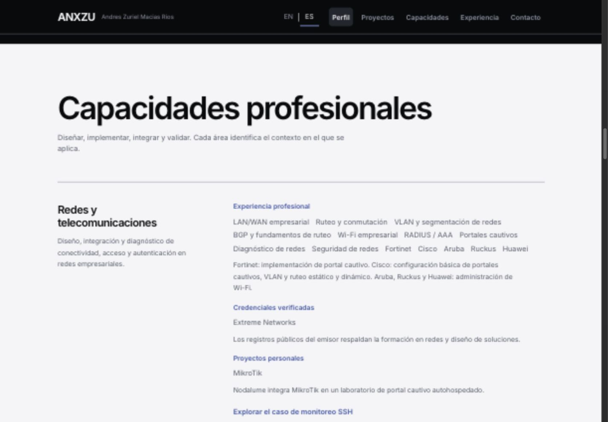
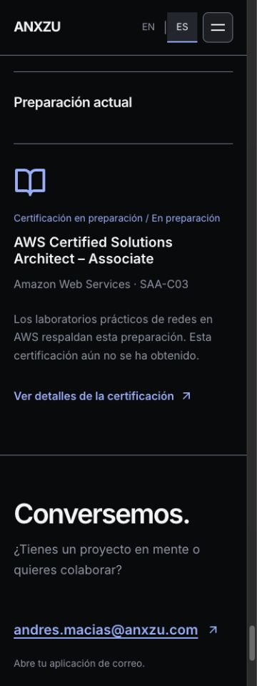

# ANX-012 — Professional Capabilities, AWS Learning & Full Bilingual Experience

Implementada para revisión del propietario el **23 de octubre de 2026**, en `codex/anx-012-professional-i18n`, desde `origin/main` / `v1.0.0` (`5e388c925ec2a705bb1a019711452c72aa51c1ea`). Sin push, merge a main, tag, Release, despliegue ni inicio de ANX-013.

## Resultado y decisiones visuales

El perfil ahora explica la capacidad de diseñar, implementar, integrar y validar soluciones, conectando experiencia profesional con Nodalume, ANXZU y laboratorios AWS. Las capacidades se presentan en **seis áreas editoriales**, con contexto visible de experiencia, proyectos, laboratorios y credenciales. El inventario anterior de ocho categorías / 25 tecnologías sigue accesible mediante un disclosure, sin porcentajes ni niveles inventados.

Se aplicaron `frontend-design` y `ui-ux-pro-max` manteniendo la dirección existente: Inter, Obsidian, Pearl e Ice Blue; prosa alineada a la izquierda, jerarquía por tipografía/espacio y filas que separan área y evidencia. La búsqueda de UX sobre selector/teclado respaldó botones nativos y navegación de foco predecible. No se generó una paleta nueva ni una cuadrícula repetitiva de tarjetas.

La respuesta del propietario delimita Fortinet a portal cautivo; Cisco a configuración básica de portales cautivos, VLAN y ruteo estático/dinámico; Aruba, Ruckus y Huawei a administración Wi-Fi. No se infieren empleadores, fechas ni certificaciones a partir de esa respuesta. Extreme se presenta con evidencia de formación y MikroTik con el laboratorio Nodalume.

AWS Certified Solutions Architect – Associate (SAA-C03) aparece en **Currently Preparing / Preparación actual**, con símbolo de estudio y estado **In preparation / En preparación**, fuera de las 18 credenciales obtenidas de Credly. No tiene badge de logro, fecha de examen, puntuación ni avance inventado. El texto indica expresamente que aún no se ha obtenido. El nombre y código coinciden con la [guía oficial AWS](https://docs.aws.amazon.com/aws-certification/latest/solutions-architect-associate-03/solutions-architect-associate-03.html); la preparación personal y los laboratorios proceden del brief del propietario.

[Perfil completo EN/ES, matriz por tecnología, procedencia y pendientes](anx-012-skills-evidence.md).

## Experiencia bilingüe

EN es el idioma predeterminado y ES está disponible en el header de escritorio y móvil. El selector conserva la preferencia, responde a Enter/Espacio, no recarga la página y mantiene ruta/hash. La compensación de scroll intenta mantener la escena visible cuando cambia la longitud del texto.

Se traducen Home, ambos casos de estudio, contenidos y controles de los seis diagramas, estados de carga/error, enlaces de verificación, descripciones accesibles y metadatos dinámicos. Se conservan nombres oficiales, marcas, comandos e identificadores técnicos. Los diccionarios de proyectos permanecen en los chunks diferidos.

[Arquitectura, cobertura, metadatos y limitaciones](anx-012-i18n-audit.md). El catálogo contiene 238 claves compartidas y 284 de proyectos, con paridad EN/ES y fallback explícito. No se instalan dependencias.

## Preservación y animaciones

No se rediseñaron Hero, casos ni diagramas. Las modificaciones del Hero y gráficos son de presentación lingüística. Se preservan rutas, hashes, fotografía real, assets, identidad, fechas profesionales y registros de Credly.

Los seis modelos originales mantienen exactamente sus **46 nodos y 37 conexiones**. Los controladores de Hero y Flow, listeners y política de reduced motion conservan sus hashes. No se añadieron animaciones, loops, timers ni listeners de cursor/scroll. El idioma no cambia las dependencias de los efectos de reproducción ni remonta React Flow.

En navegador se confirmó autoplay y pausa en los seis gráficos, con misma fase y encuadre después de EN/ES. En el balanceador se comprobó además reproducción durante el cambio y conservación del zoom ampliado tras pausa. [Evidencia](evidence/anx-012/six-diagrams-language.json), [zoom y playback](evidence/anx-012/playback-language.json). Las capturas estáticas muestran composición y texto, no sustituyen estas comprobaciones de comportamiento.

## Build frente a v1.0.0

Bytes generados, sin confundirlos con Web Vitals o transferencia real:

| Recurso | v1.0.0 | ANX-012 | Diferencia |
| --- | ---: | ---: | ---: |
| JS inicial | 288593 | 342060 | +53467 (+18.53%) |
| CSS inicial | 42567 | 44625 | +2058 (+4.83%) |
| JS compartido casos/Flow | 182432 | 257199 | +74767 (+40.98%) |
| JS Concurrencia | 41107 | 43058 | +1951 |
| JS Metodología | 16489 | 17362 | +873 |
| CSS compartido casos/Flow | 21769 | 21769 | 0 |

El JS inicial gzip nivel 9 local pasa de **91054 a 103100 bytes** (+12046). El compartido de casos pasa de 59600 a 79527. Las diferencias gzip mínimas de archivos con idéntico hash pueden deberse al runtime de compresión; no se presentan como mejoras de rendimiento.

El crecimiento corresponde al contenido profesional nuevo, catálogos EN/ES y presentación lingüística. Se acepta para esta fase evitando cargar traducciones extensas de proyectos o React Flow con Home. El chequeo de chunks confirma que Flow, d3 y zustand permanecen fuera de la carga inicial. Las **22 imágenes/fuente** generadas conservan sus hashes; no hay nueva fuente ni imagen pesada.

[Comparación exacta](reports/anx-012/bundles.json), [assets y hashes finales](reports/anx-012/build-assets.json), [separación de chunks](reports/anx-012/chunks.txt). No se midieron Web Vitals, Lighthouse, CPU ni FPS nuevos en ANX-012; los resultados históricos mantienen su propio alcance y no se trasladan como cifras actuales.

## Pruebas y revisión

| Comprobación | Resultado |
| --- | --- |
| `npm ci` | Correcto; 184 paquetes auditados, 0 vulnerabilidades reportadas |
| `npm run lint` | Correcto |
| `npm run build -- --manifest` | Correcto |
| `node --test tests/*.test.js` | 35/35; 27 existentes + 8 nuevas |
| `node scripts/check-project-chunks.mjs` | Correcto; ambos proyectos siguen diferidos |
| `git diff --check` | Correcto |
| 6 anchos × 3 rutas × 2 idiomas | 36/36, sin overflow horizontal inesperado |
| Rutas profundas y recarga | Cargan; la preferencia ES persiste |
| Teclado | Selector Enter/Espacio; menú Enter/Escape y foco restaurado |
| Metadatos | Idioma, título, descripción y OG localizados; canonical original |
| Consola de la sesión revisada | Sin errores ni advertencias |
| Reduced motion, pestaña oculta y viewport | Suite de controladores existente aprobada; hashes intactos |
| Modelos y Credly | 46 nodos / 37 edges y 18 registros preservados por hash de AST |

Las pruebas nuevas cubren almacenamiento diferido, persistencia y fallback en memoria, continuidad de store entre rutas, paridad de claves/slots, cobertura de contenido, modelos y controladores intactos, AWS separado de credenciales obtenidas, fechas localizadas y render real EN/ES de Home, ambos casos y estados de carga/error. La validación de pausa/zoom durante alternancia se realizó además en el navegador real.

[Resultados de tests](reports/anx-012/tests.txt), [lint](reports/anx-012/lint.txt), [build](reports/anx-012/build.txt), [instalación](reports/anx-012/npm-ci.txt), [matriz responsive](evidence/anx-012/responsive-matrix.json), [teclado/metadatos/consola](evidence/anx-012/navigation-metadata-console.json).

## Evidencia visual

Capturas reales a 1440 y 375 px solicitados (el scrollbar resta 15 px al área de documento). Las escenas conservan las superficies y jerarquía del diseño anterior.

| Vista | Escritorio EN / ES | Móvil EN / ES |
| --- | --- | --- |
| Perfil | [EN](evidence/anx-012/about-en-1440.png) / [ES](evidence/anx-012/about-es-1440.png) | [EN](evidence/anx-012/about-en-375.png) / [ES](evidence/anx-012/about-es-375.png) |
| Capacidades | [EN](evidence/anx-012/skills-en-1440.png) / [ES](evidence/anx-012/skills-es-1440.png) | [EN](evidence/anx-012/skills-en-375.png) / [ES](evidence/anx-012/skills-es-375.png) |
| Preparación AWS | [EN](evidence/anx-012/learning-in-progress-en-1440.png) / [ES](evidence/anx-012/learning-in-progress-es-1440.png) | [EN](evidence/anx-012/learning-in-progress-en-375.png) / [ES](evidence/anx-012/learning-in-progress-es-375.png) |
| Caso SSH | [EN](evidence/anx-012/concurrencia-en-1440.png) / [ES](evidence/anx-012/concurrencia-es-1440.png) | [EN](evidence/anx-012/concurrencia-en-375.png) / [ES](evidence/anx-012/concurrencia-es-375.png) |
| Metodología | [EN](evidence/anx-012/metodologia-en-1440.png) / [ES](evidence/anx-012/metodologia-es-1440.png) | [EN](evidence/anx-012/metodologia-en-375.png) / [ES](evidence/anx-012/metodologia-es-375.png) |
| Balanceador | [EN](evidence/anx-012/diagram-loadbalance-en-1440.png) / [ES](evidence/anx-012/diagram-loadbalance-es-1440.png) | Se conserva zoom y Fit View para lectura móvil |

Commit local de código y pruebas: `9bf8301` — `feat: add bilingual professional capabilities and AWS preparation`.

## Archivos modificados

- Datos: `src/data/professionalProfile.js`, nuevo `capabilities.js`, `credentials.js` (solo preparación añadida; registros intactos).
- i18n: nuevos store, contextos, proveedor, selector, diccionarios compartidos/de proyectos, proyección `Text`, `useTranslation`, etiquetas/aria de Flow y proveedor de mensajes diferidos en `src/i18n/`.
- Integración: `src/main.jsx`, navegación, estados diferidos y metadatos; Home y ambas páginas de proyectos para idioma heredado/contexto.
- Contenido: secciones Hero/variante, About, proyectos, capacidades, experiencia, credenciales, contacto y ambas introducciones; componentes UI compartidos y las hojas de texto de los seis gráficos. Ningún cambio de modelo/controlador/arquitectura.
- Estilos: `src/style/skills.css`, `credentials.css`, `layout/navbar.css`. Sin cambios a tokens, tipografía o CSS de animación.
- Utilidad: `src/utils/credentialStatus.js` para formato de fecha según idioma.
- Tests: `tests/i18n.test.js`, helpers de extracción/AST y fixtures de preservación/invariantes.
- Documentación: este reporte, inventario de evidencia, auditoría i18n, capturas y resultados en `evidence/anx-012/` y `reports/anx-012/`.

[Inventario completo de archivos de la fase](reports/anx-012/changed-files.txt).

## Límites y pendientes de revisión

El contenido nuevo de Nodalume/AWS es confirmado por el propietario, no una auditoría remota de infraestructura o código. El intento remoto inicial fue rechazado por revisión automática; se siguió la alternativa indicada por el propietario y no se repitió el acceso. No quedan afirmaciones de producción o certificaciones adicionales inventadas.

Se mantiene la atribución inglesa interna de React Flow que no ofrece API de traducción; controles y descripciones configurables están localizados. Se revisó el árbol de accesibilidad, sin sesión con lector de pantalla real. La compensación de scroll es aproximada ante reflow lingüístico. El HTML estático y SEO sin JavaScript siguen en EN; indexación independiente ES requiere una decisión futura sobre rutas reales/prerender.

La revisión del propietario puede afinar terminología y alcance profesional. Cualquier futura evidencia pública de Nodalume, nuevos certificados, fechas académicas o experiencia de producción debe incorporarse con respaldo específico. Optimizar o cargar bajo demanda los catálogos es una posibilidad futura si una medición de experiencia lo justifica. **No se ha iniciado ANX-013.**
