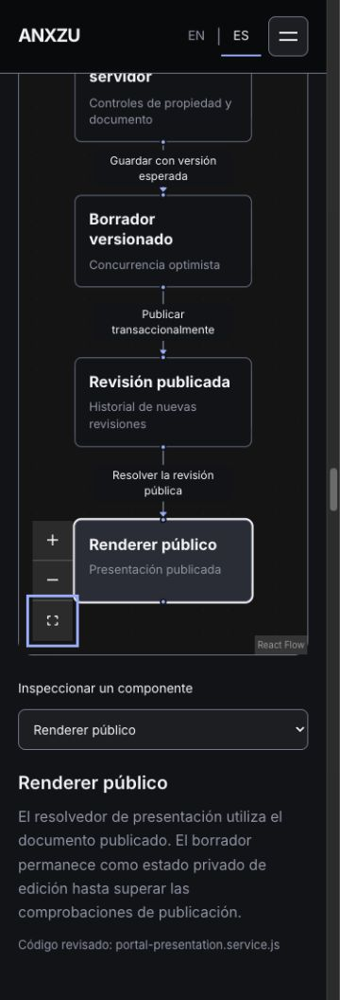

# ANX-013.1 — Diagram validation

Fecha: 2026-10-25. El resultado valida la representación y los controles del portafolio. La evidencia de producto tiene otro alcance: [runtime y código](anx-013-1-runtime-evidence.md).

## Inventario preservado y ampliado

| Vista | Nodos | Conexiones | Etapas automáticas | Semántica |
| --- | ---: | ---: | ---: | --- |
| Platform overview, original | 5 | 4 | 4 | Mapa de responsabilidades; la narrativa aclara el límite SQL API/RADIUS |
| Builder concept, original | 5 | 4 | 4 | Modelo conceptual; no acredita motor general de lógica/API |
| Evolution path, original | 5 | 4 | 4 | Evaluación futura, sin topología AWS definitiva |
| Authentication & authorization, nueva | 6 | 5 | 5 | Camino admitido; contexto puede detenerlo y respuesta final depende de credenciales/política |
| Session lifecycle, nueva | 6 | 5 | 4 | Interim opcional; atajo Start→Stop estático; terminación administrativa independiente |
| Multi-tenant boundaries, nueva | 6 | 4 | 3 | Camino tenant; guard y operaciones de plataforma separados, estáticos |
| Containerized services, nueva | 7 | 6 | 4 | Cinco servicios y dos volúmenes; dependencias de disponibilidad, no paquetes reales |
| Portal editor & publication, nueva | 7 | 6 | 6 | Documento, composición, validación, borrador, revisión y renderer |

Los seis gráficos de los otros proyectos permanecen: `flow_loadbalance`, `bussiness_flow`, `logic_flow`, `highlevel_flow`, `metodologia_problem_flow`, `metodologia_solution_flow`. Conservan 46 nodos y 37 conexiones según sus fixtures AST. Los tres modelos originales Nodalume conservan bytes SHA-256 `d44b0b20b20a08891412c4101f08f58bd9df4c9c320593fc63861171bee29821`.

**14 diagramas disponibles en total**, 93 nodos y 75 conexiones. Nodalume monta una de las cinco vistas adicionales a la vez, además de sus tres figuras originales diferidas. No reproduce las cinco vistas ocultas.

## Validación del navegador

- Cinco vistas nuevas a 320, 375, 768 y 1440 px: entrada profunda y recarga, autoplay visible, cambio observado de offset/etapa, selección de etapa con Enter, pausa automática al inspeccionar, selector nativo, zoom con teclado, cambio EN/ES conservando estado, Fit View y reanudación.
- Cada vista nueva conserva su hash, selección, etapa, pausa y transformación de viewport al cambiar idioma. Cambiar de sistema es una escena nueva y reinicia su lectura.
- Los nueve diagramas originales pasan autoplay, pausa, zoom, EN/ES con estado retenido, Fit View y reanudación en escritorio. Los seis antiguos mantienen sus modelos mediante pruebas de integridad.
- Tras navegar a la filosofía del producto, todos los diagramas montados quedan `data-playing=false`. La preferencia ES y el hash sobreviven a recarga.
- Cuatro rutas × dos idiomas × seis anchos (320/375/768/1024/1440/1920): **48 vistas**, ancho real comprobado, sin overflow horizontal.
- Consola: sin warnings ni errores en la sesión final estable. Hubo un fetch fallido en una pestaña antigua después de reemplazar los assets al recompilar Preview; recargar resolvió esa incidencia local, registrada en el reporte principal.
- Reduced motion: Home y las ocho vistas Nodalume comprobadas con Chrome `--force-prefers-reduced-motion`: contenido estático, controles de reproducción deshabilitados, señales detenidas/ausentes, destino profundo presente. Accessibility 100 en los nueve recorridos. La lectura y controles manuales no dependen del movimiento.
- Las pruebas deterministas de `observeDiagramPlayback` verifican ocultar/mostrar documento, pausa manual prioritaria, ausencia de intervalos duplicados y limpieza incluso ante callbacks tardíos. El panel IAB siguió declarando `visibilityState=visible` al ocultarlo; ese intento no cuenta como hidden/visible real. La limitación se conserva en el reporte principal y el registro de visibilidad.

## Registros reproducibles

- [Receta CUA para las vistas nuevas y responsive](reports/anx-013-1/browser-qa.mjs).
- [Escritorio](reports/anx-013-1/engineering-1440.json), [móvil](reports/anx-013-1/engineering-375.json), [320/768 px](reports/anx-013-1/engineering-additional-widths.json).
- [Nueve originales y Home](reports/anx-013-1/original-nine-regression.json).
- [Matriz de 48 vistas](reports/anx-013-1/responsive.json).
- [Reduced motion: estados reales y resultados](reports/anx-013-1/motion-check/results.json).
- [47 pruebas del portafolio](reports/anx-013-1/tests.txt), [aislamiento de chunks](reports/anx-013-1/chunks.txt).

Los scripts CUA usan controles públicos y lecturas del DOM, no estado interno React. Para repetir: servir `dist` en 4173, importar la receta en cua_repl, proporcionar el tab, capacidad viewport y función de guardado de capturas. Los probes de Lighthouse incluyen sus configuraciones, auditores y gatherers; requieren una instalación local de Lighthouse indicada mediante `ANX_LH_ROOT`.

## Evidencia visual

Estas imágenes son capturas reales de ANXZU, no capturas de una instancia Nodalume ni prueba de tráfico. Los registros before/after contienen el cambio real de offset y etapa observado durante reproducción. No hay API de grabación de video en la herramienta de inspección disponible, ni medición que permita afirmar 60 FPS.
