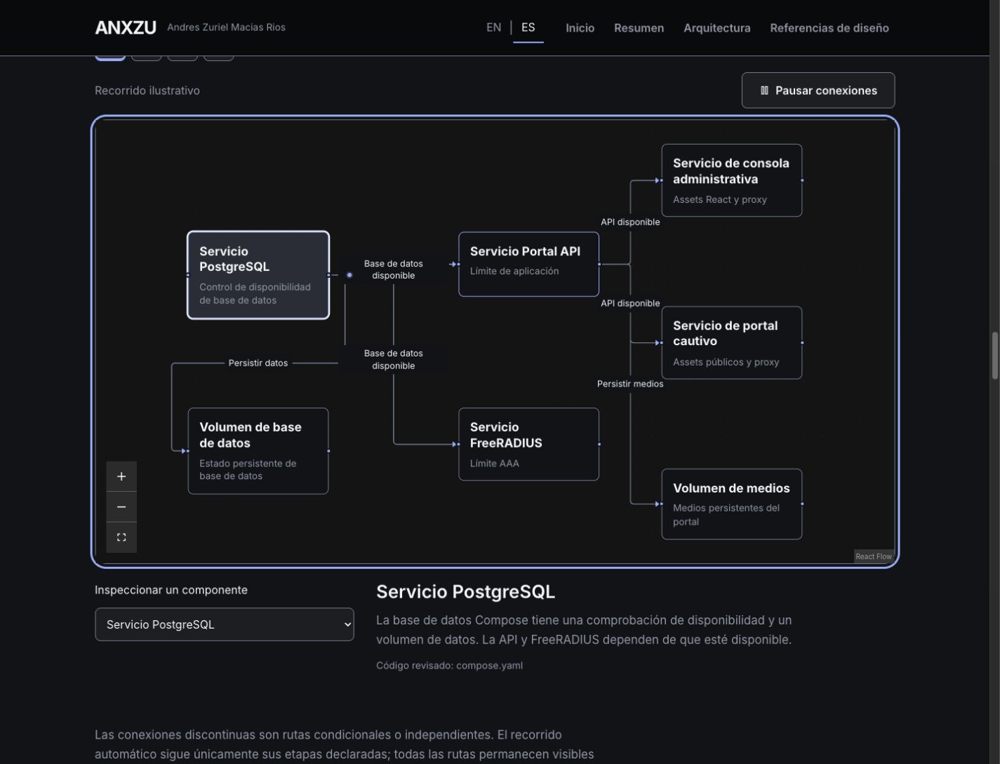
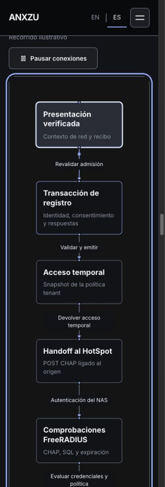
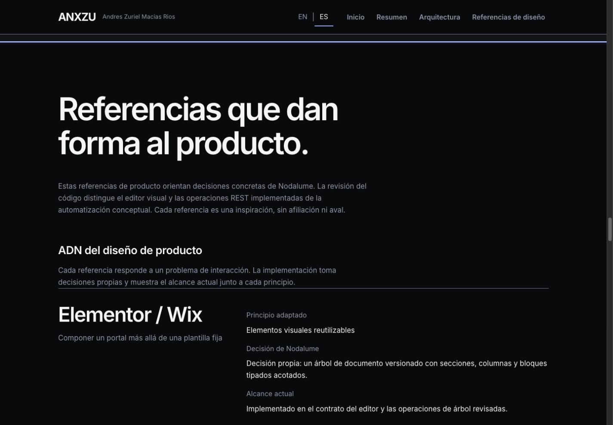

# ANX-013.1 — Nodalume Engineering Evidence & Living Systems

Fecha: 2026-10-25. Rama: `codex/anx-013-nodalume-technical`. Base comparativa ANX-013: `0796386`.

## Resultado y recomendación

**GO para revisión e integración del caso de estudio**, con el coste de contenido y límites de validación documentados abajo. Esta recomendación no acredita preparación productiva de Nodalume ni autoriza publicación: no se hizo merge, push, deploy, release ni cambios al laboratorio.

El caso pasa de evidencia principalmente declarada por el propietario a un snapshot de código trazable y ocho pruebas unitarias originales reproducidas. Se añaden cinco vistas técnicas interactivas, se profundizan Product Design DNA y operación, y se conservan los nueve diagramas anteriores, las cuatro rutas y EN/ES.

**47/47 pruebas del portafolio** y **8/8 pruebas unitarias del producto**, con alcances expresamente separados. Home conserva sus resultados Lighthouse; Nodalume paga un incremento medido de carga editorial.

## Investigación y hallazgos

Se revisó el repositorio privado disponible mediante GitHub, `Zuriel0/Nodalume`, en el commit fijo `25c6897e5bf1878c3660e19dac397bda08f31f9a`. El índice registra 37 archivos, hashes de blobs y alcance leído. No se accedió a servicios activos, secretos ni infraestructura; no se modificó el producto.

- El editor visual tiene contrato de bloques tipados, árbol, inspector contextual, control de versiones y publicación inmutable implementados. Ya puede explicarse como implementación inspeccionada, sin atribuirle aceptación integral nueva.
- API y FreeRADIUS se integran mediante SQL. El mapa original de responsabilidades se conserva con esta aclaración.
- Accounting distingue Start, Interim opcional y Stop. La solicitud administrativa de terminación es auditada: no envía Disconnect/CoA ni inventa un cierre contable.
- La autorización tenant utiliza sesión, pertenencia y contexto autorizado; repositorios y claves compuestas conservan la propiedad. No se afirma aislamiento productivo completo.
- Compose define cinco servicios y dos volúmenes, con dependencias de disponibilidad. Eso no demuestra autenticación física o Internet funcional.
- No se establece un motor general de lógica visual o builder de acciones API externas dentro del código revisado. AWS y el micrositio permanecen futuros.

La matriz completa diferencia implementada/validada en alcance unitario, implementada con validación adicional pendiente, desarrollo, concepto y futuro: [Runtime & source evidence](anx-013-1-runtime-evidence.md).

## Experiencia implementada

Las vistas nuevas cubren autenticación/autorización, ciclo de sesiones, límites multitenant, servicios contenedorizados y editor/publicación. Hay una vista adicional montada a la vez. Sus hashes permiten entrada directa y recarga.

Una señal direccional destaca una relación por etapa. El lector puede elegir una etapa o componente; la selección pausa y muestra una explicación junto al archivo inspeccionado. Se mantienen pausa/reanudación, rueda nativa, teclado, zoom, Fit View, visibilidad y composición estática con reduced motion. Una transición breve de opacidad acompaña el cambio de vista permitido por la preferencia de movimiento.

Product Design DNA relaciona cada referencia con problema, principio, decisión propia y alcance actual. La operación explica configuración, dependencias, persistencia, diagnóstico y evidencia. Los requisitos cloud cubren ejecución, estado administrado, secretos, red, medios, observabilidad, disponibilidad, escala y coste, sin inventar topología.

Técnica: React Flow existente, BaseEdge/EdgeLabelRenderer, CSS offset-path y el controlador compartido de reproducción. **Sin dependencias añadidas**, Canvas, Three.js ni bibliotecas de animación nuevas. La documentación de interacción detalla decisiones y límites: [Interaction design](anx-013-1-interaction-design.md).

## Bundle y distribución

Build base congelado antes de editar; mismo lockfile, Node v24.19.0 y Vite 7.3.7. Bytes generados y gzip local nivel 9, no bytes transferidos ni Web Vitals.

| Unidad | ANX-013 bytes / gzip9 | ANX-013.1 bytes / gzip9 | Diferencia bytes |
| --- | ---: | ---: | ---: |
| JS inicial Home | 319,727 / 100,533 | 319,735 / 100,540 | +8 |
| Chunk editorial Nodalume | 34,717 / 9,812 | 92,956 / 28,309 | +58,239 |
| Cierre JS editorial Nodalume, incluido entry compartido | 358,665 / 111,846 | 416,912 / 130,350 | +58,247 |
| Módulo diferido nodalume_flow | 2,657 / 1,355 | 5,569 / 2,542 | +2,912 |
| Runtime compartido de gráficos | 180,082 / 59,099 | 180,277 / 59,143 | +195 |
| Cierre completo hasta nodalume_flow, sin contar archivos compartidos dos veces | 541,404 / 172,300 | 602,758 / 192,035 | +61,354 |
| CSS propio Nodalume | 6,747 | 12,014 | +5,267 |

El incremento editorial contiene cinco modelos, explicaciones, traducciones y nueva narrativa. No se añade ese contenido a Home: su incremento de 8 bytes corresponde al grafo/preload de imports generado. El CSS inicial de Home conserva 44,358 bytes. Los cierres editoriales de los otros dos proyectos aumentan solo 8 bytes de entry.

El checker confirma que React Flow/d3/zustand y los modelos/catálogos Nodalume están fuera del cierre inicial y que las páginas editoriales no esperan a React Flow. Se deduplican referencias al mismo import dinámico al contar módulos: las ocho vistas Nodalume reutilizan **un único módulo gráfico diferido**, no ocho bundles de React Flow.

[Inventario y hashes](reports/anx-013-1/bundles.json), [receta de medición](reports/anx-013-1/measure-bundles.mjs), [checker](reports/anx-013-1/chunks.txt).

## Lighthouse

Lighthouse 13.5.0, Headless Chrome 155, origen local Preview. Builds base/candidato estables, sin rebuild durante las 24 mediciones; móvil y escritorio, tres repeticiones por versión/ruta/perfil, Chrome nuevo por corrida. Ejecución serial y orden de versiones invertido en la segunda repetición. Perfil móvil simulado predeterminado: CPU ×4 y red móvil simulada. Movimiento normal. Sin warnings de Lighthouse.

Medianas; LCP y TBT en ms:

| Ruta / perfil | Performance antes → después | Accessibility | LCP | CLS | TBT |
| --- | ---: | ---: | ---: | ---: | ---: |
| home / mobile | 99 → 99 | 100 → 100 | 2028 → 2027 | 0 → 0 | 2 → 0 |
| home / desktop | 100 → 100 | 100 → 100 | 442 → 444 | 0 → 0 | 0 → 0 |
| nodalume / mobile | 98 → 97 | 100 → 100 | 2278 → 2434 | 0 → 0 | 0 → 0 |
| nodalume / desktop | 100 → 100 | 100 → 100 | 490 → 529 | 0 → 0 | 0 → 0 |

Home conserva P99 móvil/P100 escritorio. Nodalume baja un punto móvil, con +156 ms de LCP mediano; escritorio suma unos 39 ms. Es un coste medido del caso ampliado, no una mejora de velocidad. No se atribuye la pequeña diferencia de Home a una optimización: permanece dentro de la dispersión local. Los otros dos proyectos se verificaron funcional y visualmente; no se repitió su Lighthouse en esta fase.

[Resumen, rangos y método](reports/anx-013-1/lighthouse/summary.json), [24 corridas](reports/anx-013-1/lighthouse/runs.json). Los JSON completos se conservan comprimidos en el mismo directorio. No son datos de producción ni Web Vitals de campo, ni un benchmark del runtime Nodalume.

## Actividad aproximada del hilo principal

Se amplió Lighthouse con un gatherer de lectura de `Performance.getMetrics`. Después de navegación y 3 s de asentamiento se midió `TaskDuration` durante 12 s. Tres muestras por estado, mismo hash de autenticación, perfil desktop sin throttling simulado. Se comprueba documento visible y exactamente un diagrama activo en el escenario animado; cero en reduced motion.

- Activo: mediana **6.604 %** de tiempo ocupado del hilo principal; rango 6.475–6.740 %.
- Estático reduced motion: mediana **0.0013 %**; rango 0.0008–0.0015 %.

No es consumo total de proceso, GPU, energía ni CPU móvil. No permite afirmar 60 FPS. Se mide una vista representativa y no se extrapola a todas. Los contadores incluyen el coste del renderer y de la instrumentación, con límites propios de headless. No hubo un perfil equivalente CPU de ANX-013, por lo que no se afirma una mejora frente al anterior.

[Seis muestras y estados](reports/anx-013-1/cpu/results.json), [gatherer](reports/anx-013-1/cpu/gatherer.mjs), [runner](reports/anx-013-1/cpu/run.mjs).

## Validaciones y accesibilidad

| Comprobación | Resultado |
| --- | --- |
| `npm ci` | PASS; mismo lockfile, sin dependencias nuevas |
| `npm run lint` | PASS |
| `npm run build -- --manifest` | PASS |
| `node --test tests/*.test.js` | 47/47 PASS |
| `node scripts/check-project-chunks.mjs` | PASS |
| `git diff --check` | PASS |
| Pruebas originales Nodalume aisladas | 8/8 PASS; no DB, red ni aceptación física |
| Nuevas vistas, EN/ES | 5 a 320/375/768/1440 px; etapas, selección, pausa, zoom y Fit View |
| Diagramas originales | 9 preservados y comprobados; modelos originales protegidos por tests |
| Responsive de las cuatro rutas | 48 vistas a 320/375/768/1024/1440/1920 px; sin overflow |
| Reduced motion | Home + ocho vistas Nodalume: estáticos, controles coherentes, A100 |
| Rueda de página | Scroll +1000 px con zoom del canvas idéntico |
| Menú móvil | Enter abre; elegir resumen cierra y enfoca el hash correcto |
| Selección | Clic en nodo y selector nativo con Space/Down/Return; pausa conservada |
| Consola final | Sin errores/warnings en sesión limpia del build final |

La revisión de EN/ES cubre títulos, resumen, etapas, controles, explicaciones, estados y narrativa nueva; los nombres de productos/protocolos y archivos fuente conservan su forma oficial. Los tests extra comprueban todas las traducciones de los modelos nuevos, hashes, secuencia, ramas opcionales y preservación exacta de los tres modelos originales. Home mantiene Hero, seis áreas profesionales y 18 credenciales.

[Validación de los 14 diagramas y evidencias detalladas](anx-013-1-diagram-validation.md). [Consola final](reports/anx-013-1/final-console.json).

## Evidencia visual

Capturas reales de ANXZU local, no de servicios Nodalume activos:

El directorio [evidence/anx-013-1](evidence/anx-013-1/) contiene movimiento/inspección de las cinco vistas a 375/1440 px, selector y Product Design DNA. Las capturas móviles muestran segmentos del canvas alto y su inspector en imágenes separadas. Los registros before/after verifican movimiento real de offset y etapas; no se ofrece video porque la herramienta no tiene API de grabación.

## Archivos modificados

- `src/pages/projects/Nodalume.jsx`: narrativa, matriz y composición de nuevas secciones.
- `src/components/ui/NodalumeEngineering.jsx`: evidencia, selector de sistemas, Product Design DNA, operación y requisitos.
- `src/data/nodalumeEngineering.js`: cinco modelos con explicaciones y trazabilidad.
- `src/utils/nodalumeWalkthrough.js`: lectura por etapas y resolución de vistas por hash.
- `src/components/ui/graphics/nodalume_flow.jsx`: soporte de modelos nuevos, conexiones, inspección y etapas; conserva la geometría original cuando no se pasa un modelo nuevo.
- `src/i18n/locales/nodalume.js` y `nodalumeEngineering.js`: catálogo local EN/ES.
- `src/style/nodalume.css`: estilo editorial, controles, etiquetas y responsive propios del caso.
- `scripts/check-project-chunks.mjs`: aislamiento de nuevos módulos y conteo de imports únicos.
- `tests/nodalume-engineering.test.js`, `tests/nodalume.test.js`, `tests/helpers/uiMessages.mjs`: nuevos casos y cobertura de copy.
- Los cuatro documentos ANX-013.1, `reports/anx-013-1/` y `evidence/anx-013-1/`.

No se modificaron Hero, perfil, credenciales, rutas de los otros proyectos, los seis gráficos originales, el controlador compartido de visibilidad, sitemap ni datos del producto Nodalume.

## Límites y pendientes

1. No se validaron PostgreSQL/FreeRADIUS activos, restauración, recepción real de accounting, aceptación de red ni estado actual del laboratorio. No publicar esas funciones como validadas end-to-end.
2. La evidencia proviene de un snapshot autorizado privado. Su trazabilidad no implica que el código sea públicamente accesible ni coincida con el despliegue actual.
3. El constructor genérico de lógica y acciones API externas queda conceptual en el alcance inspeccionado. AWS y producto público son futuros.
4. Nodalume aumenta +58.2 kB de JS editorial y su LCP móvil local crece 156 ms. Si se amplía nuevamente, evaluar separar contenido de inspección sin perder texto accesible; no hay tal optimización ni garantía de campo en esta fase.
5. El panel IAB no cambia `document.visibilityState` al ocultarlo: no pudo forzarse una transición real hidden/visible mediante esa capacidad. Se registró el intento; la lógica de pausa/reanudación y limpieza sí se valida con pruebas deterministas del controlador. No se afirma una prueba real de cambio de pestaña que la herramienta no produjo.
6. Durante trabajo local, una pestaña abierta conservó el URL de un chunk reemplazado al recompilar Preview. Mostró la recuperación del diagrama y recargar resolvió el estado. Se documenta el error transitorio; la sesión final con build estable pasa con consola vacía. No es una observación de producción.
7. No hay video ni medición de fluidez/FPS. Las muestras de hilo principal no sustituyen una traza completa de scroll ni medición en dispositivos físicos.

[Intento de visibilidad](reports/anx-013-1/visibility-attempt.json), [incidencia local de rebuild](reports/anx-013-1/preview-rebuild-note.json), [rueda y menú](reports/anx-013-1/native-interactions.json), [selección nativa](reports/anx-013-1/direct-selection.json).

## Estado de entrega

Cambios locales para revisión del propietario, en la misma rama ANX-013. `main` y `v1.1.0` se conservan; no se ha iniciado ANX-014. La siguiente decisión corresponde al propietario: revisar el alcance de afirmaciones y el coste de contenido antes de integrar. No se ejecuta integración ni publicación automáticamente.
