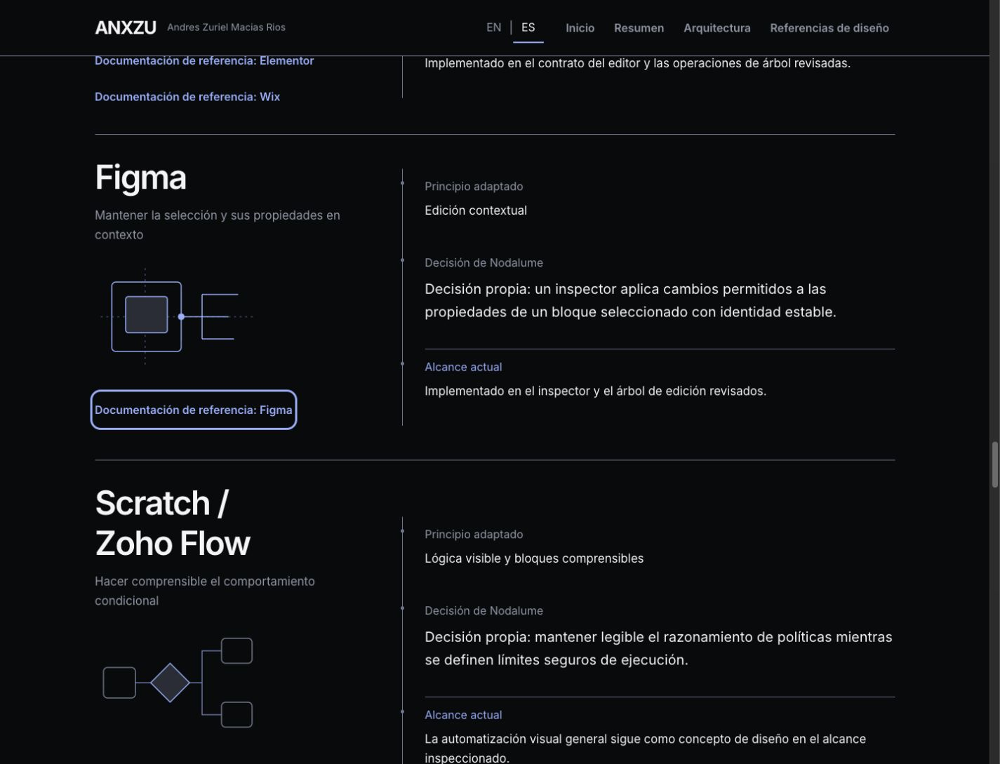
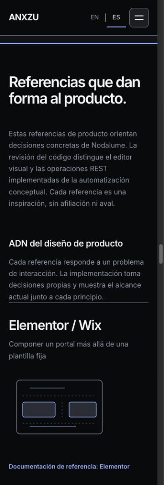
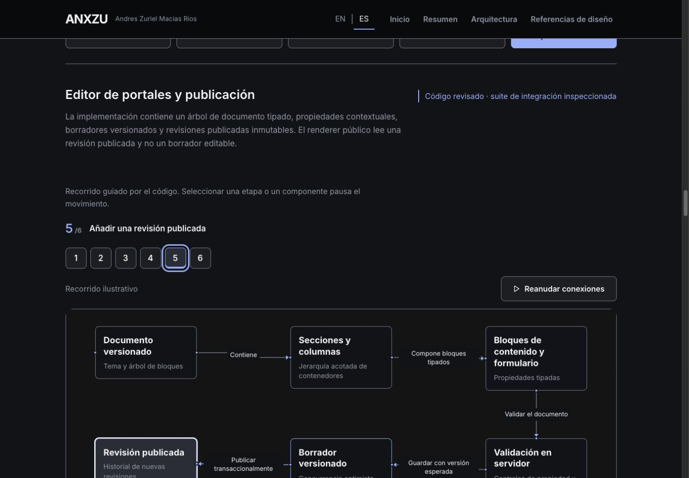

# ANX-013.2 — Nodalume Performance & Cinematic Engineering Experience

Fecha: 2026-10-26. Rama: `codex/anx-013-nodalume-technical`. Base ANX-013.1: `85e81e5`. Implementación: `82a1be4`.

## Recomendación

**GO como candidata a la primera publicación del caso, tras revisión del propietario e integración autorizada.** La entrega permanece local: sin merge, push, tag, GitHub Release, deployment o cambios en `nodalume.anxzu.com`. No se modificó ni accedió al repositorio privado del producto en esta fase, ni se inició ANX-014.

Se cumple el objetivo de optimización: LCP móvil mediano de **2,119 ms**, Performance **98**, Accessibility **100**, CLS **0** y TBT **0** para Nodalume. Home conserva P99 móvil/P100 escritorio. Son mediciones locales comparables, no garantías de producción.

El chunk editorial baja de **92,956 a 51,676 bytes (−44.4 %)**, conservando narrativa, traducciones y alternativas textuales. Las catorce vistas permanecen disponibles: ocho Nodalume y seis de proyectos anteriores. Las 51 pruebas pasan.

## Diagnóstico

ANX-013 tenía un chunk editorial de 34,717 bytes. ANX-013.1 lo elevó a 92,956 al combinar narrativa, los cinco modelos técnicos completos, explicaciones de inspección y todos sus mensajes EN/ES. El catálogo también conservaba copy reemplazado que ya no se presentaba.

Además, una entrada directa a Nodalume esperaba a que el entry React se evaluara antes de solicitar el módulo editorial y sus estilos. Había dos problemas distintos: carga anticipada de datos interactivos y una cascada de descubrimiento evitable. La comparación final mide el efecto combinado de las correcciones; no atribuye un porcentaje aislado a cada una.

## Arquitectura de contenido

```text
HTML de /projects/nodalume
  ├─ Entry existente
  ├─ Precarga del módulo editorial y dependencias estáticas
  └─ Estilos editoriales existentes + propios de Nodalume

Ruta React — disponible sin React Flow
  ├─ Narrativa, evidencia, Product Design DNA, operación y futuro
  ├─ Catálogo editorial EN/ES
  └─ Lecturas semánticas EN/ES de los ocho diagramas

Canvas — solo cerca del viewport o por hash directo
  ├─ Modelos originales, geometría y datos de inspección
  ├─ Catálogo específico de gráficos
  └─ React Flow y controles existentes
```

1. `nodalumeReadings.js` es una proyección semántica generada desde los modelos originales y su catálogo: título, alcance, resumen y relaciones en ambos idiomas. No contiene posiciones, handles ni explicaciones internas del inspector. Se renderizan las ocho versiones textuales mediante HTML nativo `details/summary`, fuera de las fronteras de carga y error del canvas.
2. Los modelos completos y `nodalumeDiagrams.js` se importan dentro del módulo gráfico diferido. Se conserva un único módulo para las ocho vistas, amortizando la carga al cambiar de sistema.
3. El catálogo editorial conserva 131 mensajes activos. La prosa extensa usa identificadores y se almacena una sola vez por idioma, evitando repetir el párrafo inglés en el componente y como clave. Un fixture comprueba los valores EN/ES, independientemente de sus identificadores. Se retiraron claves obsoletas, no información visible.
4. El generador tiene modo de comprobación en `prebuild`. Los tests comparan las lecturas con sus fuentes y rechazan traducciones incompletas; no hay dos fuentes manuales para mantener la misma relación.
5. Solo el HTML directo de Nodalume precarga su cierre editorial estático y estilos, en el mismo orden de dependencias. No sigue imports dinámicos ni precarga React Flow, modelos o inspectores. Home y las otras dos entradas conservan su política de carga.

La narrativa continúa siendo una ruta React del sitio CSR existente. No se añadió SSR/prerender de producción: el HTML HTTP inicial conserva metadatos, y el contenido editorial aparece al montar la ruta, antes del canvas. Las pruebas de render estático verifican ese árbol React; no deben confundirse con HTML prerenderizado desplegado. La optimización no oculta contenido al crawler ni requiere interactuar con los diagramas para obtener la narrativa y las relaciones textuales.

## Bundles

Bytes generados y gzip local nivel 9. Base y candidato construidos con el mismo lockfile, Node v24.19.0 y Vite 7.3.7. No equivalen a bytes transferidos ni a Web Vitals.

| Unidad | ANX-013.1 bytes / gzip9 | ANX-013.2 bytes / gzip9 |
| --- | ---: | ---: |
| JS inicial Home | 319,735 / 100,540 | 319,735 / 100,539 |
| Chunk editorial Nodalume | 92,956 / 28,309 | 51,676 / 16,214 |
| Cierre editorial Nodalume, incluido entry compartido | 416,912 / 130,350 | 375,632 / 118,254 |
| Módulo diferido Nodalume, ahora con modelos y catálogo | 5,569 / 2,542 | 45,736 / 12,668 |
| Runtime gráfico compartido | 180,277 / 59,143 | 180,277 / 59,142 |
| Cierre JS completo hasta el canvas, sin duplicar archivos compartidos | 602,758 / 192,035 | 601,645 / 190,064 |
| CSS propio Nodalume | 12,014 / 2,500 | 14,517 / 2,965 |
| CSS inicial Home | 44,358 / 8,482 | 44,358 / 8,482 |

La reducción del chunk editorial es 44.4 %; su gzip disminuye 42.7 %. El cierre crítico completo de Nodalume baja aproximadamente 9.9 % en bytes. El caso completo cambia poco: el beneficio principal consiste en diferir trabajo y eliminar la cascada, conservando su contenido. El CSS propio aumenta 2,503 bytes, o 465 bytes gzip, para las nuevas ilustraciones y respuestas visuales. Las diferencias mínimas en gzip del entry/runtime derivan de referencias generadas; no son una optimización independiente.

[Inventario, cierres y hashes](reports/anx-013-2/bundles.json), [receta](reports/anx-013-2/measure-bundles.mjs), [aislamiento de chunks](reports/anx-013-2/chunks.txt). El checker ahora exige que el cierre editorial Nodalume excluya los dos modelos completos y su catálogo técnico, además de React Flow.

## Lighthouse comparable

24 mediciones: Home y Nodalume, móvil/escritorio, tres repeticiones por versión/ruta/perfil. Builds base y candidato estables, Chrome nuevo por corrida, ejecución serial y orden de versiones alternado. Lighthouse 13.5.0 / Chrome headless 155; perfiles predeterminados simulados y movimiento normal. Idioma EN. Los registros conservan ajustes, tiempos, rangos y user agent.

Medianas; LCP y TBT en ms:

| Ruta / perfil | Performance | Accessibility | LCP antes → después | CLS | TBT |
| --- | ---: | ---: | ---: | ---: | ---: |
| home / mobile | 99 → 99 | 100 → 100 | 2028 → 2033 | 0 → 0 | 0 → 0 |
| home / desktop | 100 → 100 | 100 → 100 | 442 → 443 | 0 → 0 | 0 → 0 |
| nodalume / mobile | 97 → 98 | 100 → 100 | 2426 → 2119 | 0 → 0 | 0 → 0 |
| nodalume / desktop | 100 → 100 | 100 → 100 | 529 → 488 | 0 → 0 | 0 → 0 |

El objetivo móvil ≤2,300 ms se cumple en estas condiciones. La referencia histórica del brief era 2,434 ms; al repetir la base equivalente se obtienen 2,426 ms. La diferencia mediana comparable es **−308 ms, aproximadamente 12.7 %**. Desktop pasa de 529 a 488 ms. Home varía unos 5 ms en móvil dentro de los rangos observados, manteniendo las puntuaciones; no se declara una mejora para Home.

No se alteró artificialmente el LCP: en las doce corridas Nodalume, cada perfil conserva el mismo selector, texto resumido y rectángulo entre versiones. En móvil corresponde al párrafo `.nodalume-hero-copy > p`, 372 × 106 px, en la misma posición. Las capturas comparativas conservan viewport e idioma.

El trace de recursos confirma que el candidato descubre el módulo editorial y sus estilos en paralelo con el entry. Ninguna corrida inicial carga `nodalume_flow` ni el runtime React Flow. Los tiempos observados de requests son del trace local sin throttling aplicado; las métricas Performance usan la simulación de Lighthouse. No se mezclan ambas medidas ni se presentan como latencia de producción.

[Resumen y rangos](reports/anx-013-2/lighthouse/summary.json), [24 corridas](reports/anx-013-2/lighthouse/runs.json), [elemento LCP y recursos críticos](reports/anx-013-2/critical-resources.json). Los informes completos están comprimidos junto a los resúmenes. El último rebuild conserva todos los JS/CSS medidos byte por byte: [comprobación SHA-256](reports/anx-013-2/build-stability.json).

## Refinamiento visual y movimiento

Se aplicaron `frontend-design` y `ui-ux-pro-max`, respetando Inter, Obsidian, Pearl e Ice Blue. El [plan previo](reports/anx-013-2/design-plan.md) concentra la intervención en dos relaciones: referencia→decisión y etapa→componente.

### Product Design DNA

Cada referencia recibe una ilustración SVG propia del principio de interacción, no una captura ni interfaz ficticia del producto:

- Elementor/Wix: composición de elementos dentro de un contenedor.
- Figma: selección, contexto y propiedades vinculadas.
- Scratch/Zoho Flow: relaciones entre bloques y decisiones conceptuales.
- Postman: estructura explícita de solicitud y resultado.

Hover y foco iluminan los conectores; una traslación máxima de 3 px responde al lector. La columna de decisiones conecta principio, adaptación propia y alcance real. Se conservan las cuatro explicaciones, los enlaces oficiales y la distinción entre editor implementado y motor general de lógica/acciones externas conceptual.

### Vistas técnicas

El indicador de etapa añade posición dentro de la secuencia. Cambiar de etapa conserva la selección sincronizada con su explicación; título e inspector responden con 200 ms de opacidad y desplazamiento máximo de 3 px. La región accesible del inspector permanece estable. El cambio EN/ES conserva etapa, componente, pausa y zoom.

Los recorridos automáticos, direcciones, ramas condicionales y posiciones no se modifican. Continúan una relación activa por recorrido y el controlador compartido de pausa/visibilidad. No hay nuevos loops ambientales, requestAnimationFrame por conexión ni dependencias de animación.

Reduced motion retira las transiciones nuevas y mantiene una composición estática completa. Las ocho vistas Nodalume y Home pasan el probe real de preferencia reducida: controles coherentes, señales detenidas y animaciones de contexto ausentes. El foco conserva una respuesta visual instantánea.

[Estados de foco reales](reports/anx-013-2/dna-focus.json), [cambios de etapa e inspector](reports/anx-013-2/stage-transitions.json), [reduced motion](reports/anx-013-2/motion-check/results.json). No se midieron FPS ni CPU total en esta fase. Las muestras CPU de ANX-013.1 permanecen históricas y no se atribuyen automáticamente a este build.

## QA EN/ES y preservación

| Comprobación | Resultado |
| --- | --- |
| Ocho vistas Nodalume, cinco anchos | 40 combinaciones de diagrama/ancho: 320/375/768/1440/1920; controles y cambio EN/ES comprobados |
| Entrada directa y recarga de los ocho hashes | PASS |
| Etapa elegida, selección, pausa y zoom tras cambiar idioma | PASS |
| Reanudación y Fit View | PASS |
| Seis diagramas de Concurrencia/Metodología | PASS; modelos intactos, controles y EN/ES conservados |
| Cuatro rutas × dos idiomas × seis anchos | 48 vistas, incluyendo 1024 px adicional; sin overflow horizontal |
| Rueda sobre canvas | Scroll +1000 px; transformación de zoom idéntica |
| Menú móvil con teclado | Abre, navega a resumen, cierra y enfoca el hash |
| Preferencia de idioma y hashes tras recarga | PASS |
| Fuera del viewport | Todos los diagramas montados quedan detenidos |
| Hidden/visible y limpieza | Pruebas deterministas del controlador compartido; no se fuerza un estado real que IAB no proporciona |
| Contraste y accesibilidad automática | A100 en Lighthouse normal y en los nueve probes reduced motion; foco visible comprobado |
| Consola del build estable | Sin warnings/errores |
| Hero, credenciales, capacidades, AWS y evidencia previa | Preservados; tests y comparación de archivos |

Se compararon 120 archivos protegidos byte por byte con `85e81e5`, incluidos los dos modelos fuente Nodalume, seis gráficos originales, proyectos anteriores, datos de capacidades/credenciales y evidencia ANX-013.1. Los tests de fundamentos y preservación mantienen las 18 credenciales y la preparación AWS sin convertirla en certificación obtenida. Las ocho pruebas unitarias de producto citadas en ANX-013.1 no se repitieron: su evidencia y sus límites se conservan sin elevar afirmaciones sobre DB, AAA o laboratorio activo.

[Preservación](reports/anx-013-2/preservation.json), [cinco vistas técnicas a 375/1440](reports/anx-013-2/engineering.json), [320/768/1920](reports/anx-013-2/engineering-widths.json), [tres vistas originales y seis previas](reports/anx-013-2/regression.json), [anchos restantes de las originales](reports/anx-013-2/original-nodalume-widths.json), [48 vistas](reports/anx-013-2/responsive.json), [rueda/menú](reports/anx-013-2/native-interactions.json), [consola final](reports/anx-013-2/final-console.json).

## Fallo real de carga diferida

Se sirvió una copia aislada del build en localhost con el módulo Nodalume temporalmente no disponible. El error queda dentro de la frontera del diagrama: la página conserva título, navegación, idioma, recuperación y las ocho lecturas HTML. Se expandió la lectura de autenticación en ES con el canvas fallido.

Después se restauró el recurso de esa copia y se activó `Recargar diagrama`: vuelve el mismo hash, idioma ES, seis nodos y reproducción visible. Los errores de consola en el servidor de fallo son esperados y se registran separados de la sesión limpia. No se interrumpió el Preview principal ni se contactó infraestructura del producto.

[Montaje del fallo](reports/anx-013-2/fault-setup.json), [estado y errores esperados](reports/anx-013-2/fault-result.json), [recuperación](reports/anx-013-2/fault-recovered.json).

## Validaciones ejecutadas

- `npm ci`: PASS, dependencias fijadas por lockfile.
- `npm run lint`: PASS.
- `npm run build -- --manifest`: PASS, incluido `prebuild` de lecturas.
- `node --test tests/*.test.js`: **51/51 PASS**.
- `node scripts/check-project-chunks.mjs`: PASS.
- `git diff --check` y revisión del diff preparado: PASS.
- `npm audit`: **0 vulnerabilidades** en la consulta realizada.

[Instalación](reports/anx-013-2/npm-ci.txt), [lint](reports/anx-013-2/lint.txt), [build](reports/anx-013-2/build.txt), [tests](reports/anx-013-2/tests.txt), [audit](reports/anx-013-2/npm-audit.json). No se añadieron dependencias; `package.json` incorpora solo la comprobación `prebuild`.

Las pruebas nuevas protegen generación/equivalencia semántica, ausencia de traducciones incompletas, conservación del copy activo y precarga exclusiva del cierre estático. El render inicial se comprueba completo en EN/ES con las ocho relaciones textuales, antes de montar React Flow.

## Evidencia visual







[Portada base EN/1440](evidence/anx-013-2/baseline-hero-1440.jpg), [portada candidata equivalente](evidence/anx-013-2/candidate-hero-1440.jpg), [portada ES/375](evidence/anx-013-2/candidate-hero-es-375.jpg), [recuperación y texto en móvil](evidence/anx-013-2/load-failure-es-375.jpg).

Son capturas reales del portafolio local. Los registros before/after comprueban el cambio real de offset de las señales, foco y selección. La herramienta disponible no expone grabación de video; no se inventó un registro audiovisual ni se infirió fluidez a partir de una imagen estática.

## Archivos de implementación

- `src/components/ui/NodalumeEngineering.jsx`, `NodalumePrinciple.jsx`: lecturas independientes, referencias y decisiones visuales.
- `src/pages/projects/Nodalume.jsx`: narrativa con identificadores y descriptores semánticos.
- `src/components/ui/graphics/nodalume_flow.jsx`: modelos/catálogo diferidos y feedback de etapas/inspección.
- `src/data/nodalumeReadings.js`: proyección EN/ES generada; modelos originales sin cambios.
- `src/i18n/locales/nodalume.js`, `nodalumeDiagrams.js`: separación editorial/técnica; este último sustituye el catálogo monolítico `nodalumeEngineering.js`.
- `src/style/nodalume.css`: relaciones SVG, foco y transiciones respetuosas de reduced motion.
- `scripts/page-head.mjs`, `check-project-chunks.mjs`: precarga por ruta y contratos de aislamiento.
- `scripts/generate-nodalume-readings.mjs`, `scripts/lib/nodalume-readings.mjs`, `package.json`: generación/comprobación de lecturas.
- Tests Nodalume, i18n, helper de copy y fixture editorial; reporte y evidencias de esta fase.

No cambian el Hero ANXZU, los modelos originales, perfil, formación, certificaciones, datos del producto privado ni arquitectura técnica representada. Compose sigue como implementación inspeccionada; AWS, observabilidad ampliada, escalabilidad y el motor general de acciones permanecen en el alcance futuro/conceptual documentado.

## Límites de la candidata

1. Lighthouse es un laboratorio local EN con simulación, tres corridas por perfil/versión. No acredita Web Vitals de producción, dispositivos físicos ni el LCP ES, aunque la QA funcional y visual cubre ambos idiomas.
2. La precarga HTML beneficia entradas directas y recargas. Navegar desde Home mediante React Router se beneficia del chunk menor, pero no se midió un LCP equivalente de transición SPA.
3. Se conserva CSR; no se añadió un pipeline de prerender de contenido ni cambió la política de indexación existente.
4. No hay nuevas pruebas de runtime Nodalume ni garantía de aislamiento, recuperación, disponibilidad o cloud productivos. Se conserva la matriz de ANX-013.1.
5. IAB no proporciona aquí una transición real de `document.visibilityState` al ocultar el panel; hidden/visible y limpieza se validan con los tests del controlador, además de pausa real fuera del viewport y reduced motion en Chrome.
6. No hay medición de FPS/CPU/energía ni video en esta fase. El movimiento añadido es finito y por estado/interacción, sin nuevos loops o listeners continuos.
7. Una publicación futura debe servir el build de forma coherente con sus hashes. La prueba de fallo verifica recuperación, pero esta fase no modifica hosting ni políticas de caché/despliegue.

La candidata cumple los objetivos medidos y queda para revisión del propietario. No se realizan publicación, integración o ampliaciones de fase automáticamente.
