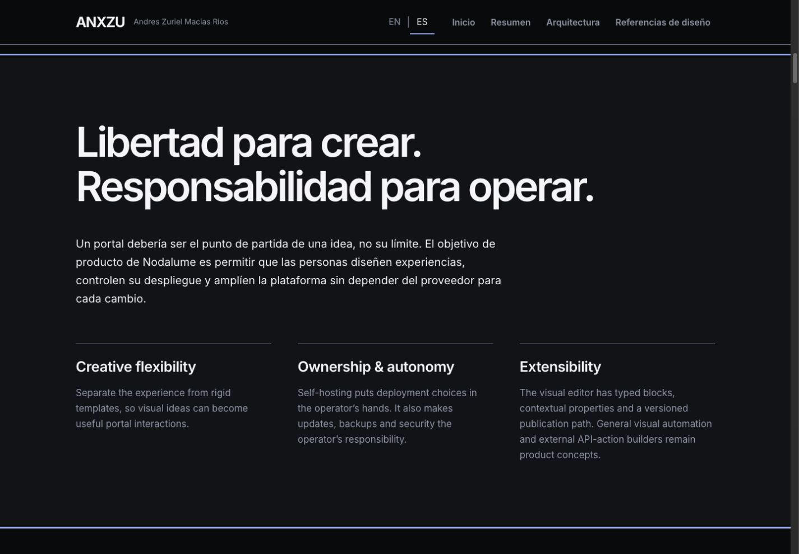
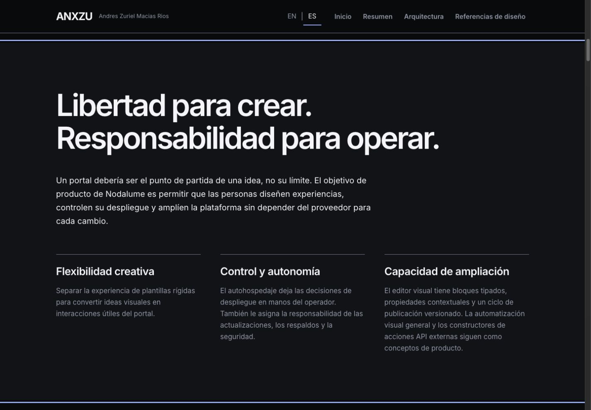
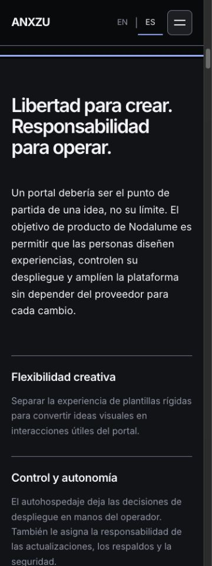
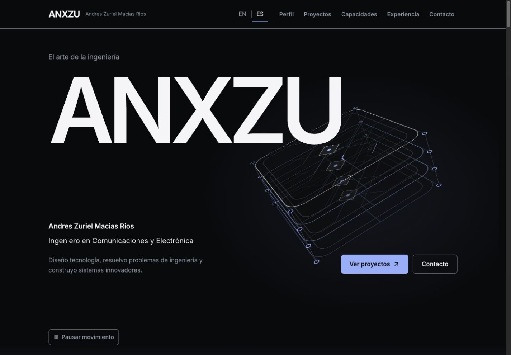

# ANX-013.3 — Nodalume Engineering Release & Production Deployment

Fecha: 26 de octubre de 2026. **Resultado: NO-GO para v1.2.0. Producción restaurada y verificada en v1.1.0.**

La publicación del código y el despliegue de Pages se completaron, pero la inspección pública en español detectó una regresión editorial. Se ejecutó el rollback autorizado antes de continuar con mediciones de rendimiento. No se presenta esta versión como una entrega aprobada. La corrección está validada en la rama ANX-013; una publicación sustituta necesita una decisión de versión porque el tag ya publicado permanece inmutable.

## Referencias y trazabilidad

| Referencia | SHA / estado |
| --- | --- |
| Fuente inicial ANX-013 | `7958d3790bf17edaea6fbab3d8bfbe87a2a260e0` |
| main inicial / v1.1.0 fuente | `d4b92df0c28415098862333e491d2552efe594d0` |
| main integrado / commit del tag v1.2.0 / Release | `e1235dc29a030e4bbdc1bc4919bc3b876e353fce` |
| Objeto de tag anotado v1.2.0 | `b1fc9ce8634f1631ab974e0333f833f4c6ac0cea` |
| Producción anterior v1.1.0 | `76138c5b1d8e82b651c1369ef468f023b58f67a6` |
| Respaldo remoto nuevo | `Zuriel0/page:backup/anxzu-v1.1.0-before-v1.2.0-20261026` → `76138c5b1d8e82b651c1369ef468f023b58f67a6` |
| Despliegue v1.2.0 retirado | `90cb00bb6ea9ac2ae6545d96d61afbd91a41cb56` |
| Rollback / producción actual | `bd41427bdac1d7572120b54414b5171ea0a95129` |
| Árbol restaurado, idéntico al respaldo | `b53e1632efc7fcbc5e17c24e92c4d129582d2cc2` |
| Corrección local, rama ANX-013 | `90e905871f2654f624e0b3bb1ef90424f6a1536c` |

[Release v1.2.0](https://github.com/Zuriel0/communications-electronics-portfolio/releases/tag/v1.2.0): marcado **prerelease, NO-GO y no latest**. El tag y sus assets originales no se sobrescribieron. La rama main fuente continúa en el commit etiquetado; el código corregido se conserva aparte para revisión.

[Pages del intento](https://github.com/Zuriel0/page/actions/runs/40355864892) y [Pages del rollback](https://github.com/Zuriel0/page/actions/runs/40357085590) terminaron correctamente. Un workflow exitoso no equivale a aceptación funcional o editorial.

## Preflight e integración

Se consultaron refs remotas, permisos, protección de main, rulesets, releases, configuración Pages, dominio y marcador público. No había PR ni verificaciones obligatorias configuradas. Se integró mediante fast-forward y se utilizaron pushes normales. No hubo force push ni reescritura de tags.

Los siete commits integrados fueron `63221c6` (reporte del despliegue anterior), `70e128a` (caso Nodalume), `0796386` (localización de controles), `85e81e5` (evidencia técnica), `82a1be4` (rendimiento e interacción), `7958d37` (reporte ANX-013.2) y `e1235dc` (preparación del Release). La lista completa está en [git-preflight.json](reports/anx-013-3/git-preflight.json).

Se preservó el respaldo ANX-012.4 `backup/anxzu-pre-v1.1.0-20261024` en `efed3f2434b2ad184a864bd8b0d5d6ce87d42fdd`. El nuevo respaldo es independiente.

## Contenido y alcance

El caso mantiene su condición de proyecto personal en laboratorio. Distingue implementación inspeccionada, ocho pruebas unitarias reproducidas en ANX-013.1, desarrollo, conceptos y evolución futura; esas pruebas no acreditan aceptación del laboratorio físico, base activa ni RADIUS. AWS continúa como requisitos de evolución, no despliegue actual. Elementor/Wix, Figma, Scratch/Zoho Flow y Postman son referencias de interacción, sin afiliación.

Las ocho vistas conservan sus alternativas textuales EN/ES y sus modelos. Se preservaron Confluence, los seis diagramas anteriores, las seis áreas profesionales, las 18 credenciales, el contacto y AWS SAA-C03 como preparación. No se consultó ni modificó el repositorio privado, servicios o arquitectura funcional del producto Nodalume en esta fase. No se configuró ningún subdominio ni se inició ANX-014.

## Artefacto y publicación retirada

Se compiló desde un archivo Git del tag inmutable y se comprobó el SHA. Los 19 assets JS/CSS reprodujeron los hashes de ANX-013.2. El artefacto contenía 67 archivos, incluyendo 12 assets anteriores conservados para compatibilidad de caché. El diff lógico fue 18 adiciones, cinco modificaciones y cero eliminaciones; CNAME y .nojekyll se conservaron, junto con fuentes/licencias, robots, sitemap y documentos de las cuatro rutas.

El marcador v1.2.0 usaba entry `/assets/index-C8kQlsRn.js` y digest `d98ce8fd990bf5ef2c6061a23e6c9797bc485e5b59630241702e52a766ab32b2`. La verificación HTTPS contrastó 65 archivos públicamente servibles y siete formas de ruta con sus bytes esperados. Esto confirmó integridad de entrega, pero no la traducción del contenido.

## Fallo detectado y recuperación

La inspección real de `/projects/nodalume` con ES seleccionado mostró 25 mensajes editoriales en inglés: navegación interna y arrays de principios, implementación y decisiones. La optimización de ANX-013.2 había omitido esos arrays al extraer mensajes; la cobertura permitía coincidencias en catálogos ajenos y la prueba de renderizado comprobaba solo parte del texto. El fallo pertenece al código publicado, no a una caché ni a Pages. El GO anterior de ANX-013.2 queda invalidado para publicación bilingüe.

Se comprobó nuevamente el HEAD remoto y se revirtió el despliegue conservando el historial. El árbol del rollback coincide exactamente con el respaldo v1.1.0. Pages confirmó el nuevo commit; 47 archivos públicos y cinco formas de ruta recuperaron los bytes esperados. El navegador confirmó Home y los seis diagramas: pausa/reanudación, zoom/Fit View, cambio EN/ES, persistencia, Hero pausado, seis áreas, 18 credenciales y contacto, sin errores/warnings de consola. El entry activo volvió a `/assets/index-BTWOikn6.js` y deployment.json a v1.1.0.

[anxzu.com](https://anxzu.com) sirve la versión anterior. **La nueva página Nodalume no está disponible en producción tras el rollback.**

## Corrección validada, aún sin desplegar

Commit `90e9058`, en `codex/anx-013-nodalume-technical`:

- Restaurar las 25 traducciones omitidas desde el contenido original de ANX-013.1 y explicitar una entrada adicional de «Volver a proyectos» que antes usaba el catálogo común. No se inventó texto técnico.
- Incorporar los cuatro arrays al extractor y exigir que el propio catálogo de Nodalume contenga sus mensajes.
- Añadir fixture de 26 entradas con procedencia y valores originales EN/ES; comprobar las 131 entradas conservadas sin cambios y el renderizado real de las 26 restauradas en ambos idiomas.
- Mantener módulos de diagramas, posiciones, CSS, animaciones y dependencias sin cambios.

Las 53 pruebas pasan. La comprobación del texto renderizado encontró las 26 entradas en cada idioma a 320, 375, 768, 1024, 1440 y 1920 px, sin overflow horizontal. En navegador se revisaron los ocho diagramas Nodalume y los seis anteriores, reproducción visible, pausa manual, etapas, inspección de componentes, zoom/Fit View y conservación de estado al cambiar idioma. No se observaron errores/warnings. Estas comprobaciones corresponden al **candidato corregido local**, no al tag v1.2.0 retirado.

## Validaciones

| Comprobación | Tag integrado v1.2.0 | Corrección local |
| --- | --- | --- |
| npm ci | Correcto; árbol integrado y archivo del tag | Mismas dependencias, sin cambios |
| npm run lint | Correcto | Correcto |
| npm run build -- --manifest | Correcto | Correcto |
| node --test tests/*.test.js | 51/51, cobertura insuficiente del caso descrito | 53/53, nueva cobertura falla antes de la corrección |
| node scripts/check-project-chunks.mjs | Correcto | Correcto; React Flow fuera de Home y narrativa inicial |
| git diff --check | Correcto | Correcto |
| npm audit | Cero vulnerabilidades | Sin cambios de manifiesto/lockfile |
| UI 14 diagramas | Controles correctos; texto editorial incompleto | Correcto; EN/ES completo para las entradas restauradas |
| QA público | **Falla editorial ES → NO-GO** | No publicado |
| Rollback público | Pages + hashes + UI confirmados | No aplica |

## Dominio y rendimiento

Se verificaron certificado y hostname con validación TLS, registros A de GitHub Pages y CNAME de www. No hubo cambios DNS. La API Pages conserva su ajuste previo `https_enforced: false`; el acceso HTTPS probado usa un certificado válido. No se interpreta ese ajuste como una verificación de redirección HTTP forzada.

**No hay métricas Lighthouse públicas nuevas para v1.2.0.** La serie Home/Nodalume móvil/escritorio se detuvo antes de ejecutarse al fallar el QA funcional. Medir una ruta retirada o una versión corregida sin desplegar no cumpliría la solicitud de medición pública del Release.

Los resultados 98/100 y LCP móvil 2119 ms pertenecen al laboratorio local histórico ANX-013.2, con tres mediciones por perfil. No son métricas de producción ni validación del texto bilingüe. No se declaran mejoras de Web Vitals de campo, FPS ni consumo de CPU de esta publicación.

La corrección restaura contenido necesario: el chunk editorial Nodalume pasa de 51,676 bytes del tag a 55961 bytes en el build local. Esto no es una regresión aceptable de contenido que deba eliminarse para favorecer métricas. La separación del runtime de React Flow permanece validada.

## Archivos de la corrección y documentación

- `src/i18n/locales/nodalume.js`: mensajes restaurados.
- `src/pages/projects/Nodalume.jsx`: referencias de catálogo para los párrafos editoriales.
- `tests/helpers/uiMessages.mjs`: extracción de arrays.
- `tests/nodalume-loading.test.js`, `tests/nodalume.test.js` y `tests/fixtures/nodalume-restored-editorial.json`: cobertura de catálogo propio, conservación de valores y renderizado.
- `CHANGELOG.md`: aviso de retirada, sin modificar retrospectivamente el tag.
- Este reporte y `docs/redesign/reports/anx-013-3/`: recibos y capturas.

## Evidencia visual

Fallo público antes de revertir (ES seleccionado y tarjetas en inglés):

Corrección local en escritorio y móvil, todavía sin publicar:

La portada pública restaurada también quedó capturada:

Los recibos verificables y su interpretación están en [evidencia ANX-013.3](reports/anx-013-3/README.md). Los archivos iniciales conservan el estado anterior al hallazgo; no deben leerse como aprobación final.

## Decisión y pendientes

**NO-GO v1.2.0. Rollback completado y verificado.** La corrección está lista para revisión, no publicada. El tag v1.2.0 se conserva inmutable tal como exige el brief. Se solicitó autorización para una versión sustituta v1.2.1; no se crea automáticamente un nuevo tag, Release ni despliegue por silencio del propietario.

Si se autoriza: repetir preflight remoto, validar el árbol/tag corregido, respaldar producción actual, publicar con push normal y verificar nuevamente las cuatro rutas, ambas lenguas, 14 diagramas, reduced motion y Lighthouse público Home/Nodalume (tres mediciones por perfil). La validación pública de la versión corregida y esa serie de rendimiento permanecen pendientes. No se declara finalizado el objetivo de publicar Nodalume.
