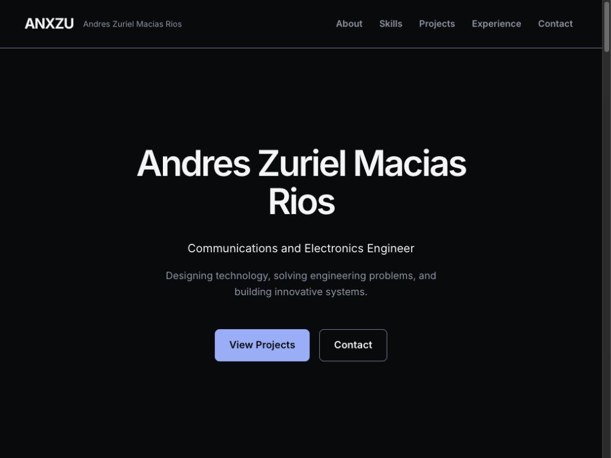
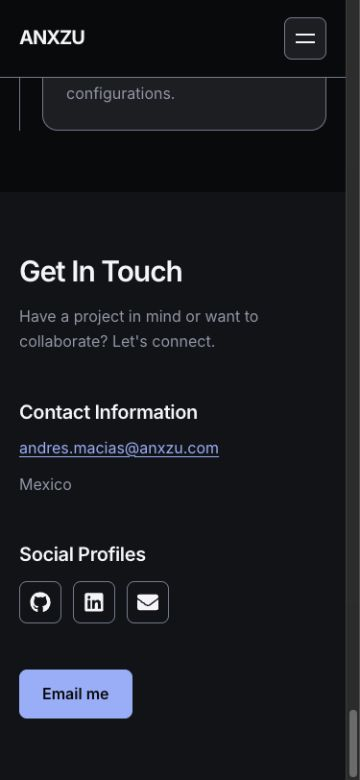

# ANX-002 — Design System & UI Foundations

## Decisiones antes de implementar

Se conserva React/JSX, Vite e Inter, sin nuevas dependencias. La fase construye fundamentos sobre las secciones actuales: no incorpora el hero cinematográfico, conexión narrativa ni nuevos diseños de casos de estudio. Los datos y assets existentes permanecen como fuentes de contenido.

Dirección de `frontend-design`: tipografía y espacio como jerarquía, superficies opacas contenidas, prosa alineada a la izquierda y ausencia de animaciones decorativas permanentes. No se genera una plantilla desde la skill. Las sugerencias de `ui-ux-pro-max` sobre foco no oculto y reduced motion respaldan el header disclosure, el scroll con margen y los estados estáticos. La búsqueda `fluid responsive layout --stack react` no devolvió coincidencias; el reintento explícito en UX y las causas medidas en ANX-001 guían el layout, no una supuesta recomendación del stack.

## Contratos

- Paleta primitiva: Obsidian, Graphite, Pearl, Silver e Ice Blue. Alias semánticos por contexto oscuro/claro; Silver e Ice Blue solo son texto/acento sobre oscuro. En Pearl se usan secundarios y azules oscuros.
- Inter en 400/600/700, únicos pesos usados por los fundamentos. Display XL/L, H1/H2/H3, body large/body/caption/label con `clamp()`; ancho de lectura de 68ch.
- Contenedores fluidos con gutters; el box model y el ancho de cada hijo corrigen overflow, sin ocultarlo globalmente. Los media queries usan literales equivalentes a los tokens de breakpoint porque CSS `var()` no es válido en condiciones de media queries.
- ActionLink representa navegación; Button representa acciones y es `type="button"` por defecto. Los enlaces deshabilitados no tienen destino y comunican `aria-disabled`.
- Container, SectionHeading y Surface se consumen en varias secciones; Surface es una herramienta puntual para unidades existentes, no un requisito de envolver cada sección en una tarjeta.
- Navigation comparte estructura y comportamiento con configuración de enlaces para home y cada proyecto. Patrón disclosure sin trampa de foco: Escape/cierre explícito restaura el disparador; selección navega y lleva foco al destino. Al salir del header con teclado se cierra el desplegable para no cubrir el contenido.
- Se conservan todos los IDs actuales. Metodología enlaza `#metodologia`; `#introduce` se conserva además como alias compatible.
- El formulario sin backend se retira de la interfaz montada y se conserva su módulo para una decisión posterior. Se presenta correo directo real; no se recopilan datos ni se simula envío.
- Motion: hover 200 ms, menú 300 ms, tarjeta 400 ms, editorial 650 ms. En esta fase no se añaden revelados. Capacidades/proyectos se renderizan visibles sin IntersectionObserver. Reduced motion desactiva animación CSS y detiene la rotación JS del balanceador; al ocultar la pestaña también se pausa ese intervalo.
- Se conserva el idioma de cada contenido; detalles con `lang="es"`, home en inglés con “Habilidades” marcado en español. No se reescribe la biografía ni se inventa copy profesional.
- La independencia de animaciones no equivale a renderizado sin JS: la SPA sigue necesitando React en cliente. Prerender y carga diferida de casos permanecen fuera de esta fase.

## Implementación

ANX-002 implementada sobre `codex/anx-001-redesign-audit`. No se han iniciado ANX-003/004 ni publicado cambios. No se añadieron paquetes, fuentes ni servicios externos.

### Tokens y consumo

`src/index.css` importa una sola vez `src/styles/tokens.css` y `src/styles/base.css`. Los estilos de sección consumen esos tokens. Los seis diagramas conservan su diseño técnico y estilos inline existentes; su normalización visual completa corresponde a otra fase. En esta fase se corrigen el contexto de posicionamiento de sus títulos, dimensiones de controles y movimiento reducido.

| Token semántico | Oscuro | Claro |
| --- | --- | --- |
| `--background-primary` | Obsidian `#090A0C` | Pearl `#F5F5F7` |
| `--background-secondary` | `#111318` | `#E9EBEF` |
| `--surface` | Graphite `#1C1E23` | `#FFFFFF` |
| `--text-primary` | Pearl | Obsidian |
| `--text-secondary` | Silver `#8C96A6` | Slate `#525B6B` |
| `--accent`, `--focus` | Ice Blue `#81AFFF` | `#2458A6` |
| `--border` | `#6C7A90` | `#69768A` |
| `--selection` / `--selection-text` | Ice Blue / Obsidian | Azul oscuro / blanco |
| `--interactive-hover` | `#22262E` | `#E3E7ED` |
| `--interactive-active` | `#282D36` | `#D4DBE5` |
| `--on-accent` | Obsidian | Blanco |
| `--accent-hover` / `--accent-active` | `#ADCAFF` / `#C9DCFF` | `#1D4A8D` / `#163B72` |

El tema se hereda desde `:root` o un contenedor con `data-theme="light"`/`"dark"`; `Surface` admite `theme`. La fase define y prueba ambos contextos, pero conserva las secciones actuales oscuras: la escena Pearl narrativa pertenece a ANX-005. Los aliases `--bg-color*`, `--surface-color`, `--surface-hover`, `--accent-color` y `--border-color` resuelven al tema más cercano para compatibilidad.

Las nueve escalas están disponibles como tokens `--text-*` y clases `.type-*`: display-xl, display-l, h1, h2, h3, body-lg, body, caption, label. Los estilos por defecto de headings/cuerpo y el hero consumen la escala correspondiente. Inter carga 400/600/700; los fundamentos no solicitan pesos sintéticos 500/800.

Espacio: `.25/.5/.75/1/1.5/2/3/4/6/8rem`; máximo 72rem, estrecho 48rem, lectura 68ch. Gutters `clamp(1.25rem, 4vw, 3rem)`, sección `clamp(4rem, 8vw, 7rem)`, header 5rem, tacto 2.75rem. Breakpoints documentados: 40/60/75rem; solo se usan los necesarios. Radios .5/1/1.5rem y pill para puntos existentes; borde 1px, foco 3px con offset 4px. Capas: contenido 0, header 20, skip link 30. Motion: 200/300/400/650ms, easing principal `cubic-bezier(.2,.7,.2,1)`.

### Componentes base

| Componente | Archivo y contrato | Uso real |
| --- | --- | --- |
| ActionLink | `src/components/ui/ActionLink.jsx`; `href`, children, disabled, target, rel y atributos de enlace. Rutas locales con Router Link, hashes/correo/externos con anchor; `noopener noreferrer` para nuevas pestañas | Header, hero, proyectos, contacto, skip link |
| Button | `src/components/ui/button.jsx`; botón nativo, tipo button por defecto, ref/disabled/eventos estándar | Disparador del menú; React 19 permite pasar ref como prop |
| Container | `src/components/ui/Container.jsx`; `as`, `narrow`, clases y atributos | Header, hero, perfil, capacidades, proyectos, experiencia y contacto |
| SectionHeading | `src/components/ui/SectionHeading.jsx`; `as` semántico (h2 por defecto), title, children para apoyo; atributos sobre heading | Cinco secciones de home |
| Surface | `src/components/ui/Surface.jsx`; `as`, `theme`, clases y atributos | Unidades de capacidad, proyecto y experiencia, sin envolver todas las secciones |
| Navigation | `src/components/layout/Navigation.jsx`; links y home | Los dos navbars existentes son adaptadores mínimos; evitan cambiar todos sus imports |
| AccessibleIconLink | `src/components/ui/AccessibleIconLink.jsx`; name, href e icon | Tres perfiles sociales, con icono decorativo y nombre accesible |

Ejemplo de uso en una futura superficie clara, sin añadir una nueva sección ahora:

```jsx
<Surface theme="light">
  <SectionHeading as="h3" title={title} />
  <ActionLink href={project.link}>View Project</ActionLink>
</Surface>
```

No se añadieron footer, proveedor de tema, store global, motor de animación ni abstracción de formulario: no aportaban funcionalidad necesaria en esta fase.

### Correcciones realizadas

- Header fijo opaco, altura estable y contenedor con ancho útil; se retiraron listeners de scroll y temporizadores de rebote duplicados.
- Menú responde a Enter, Tab y Escape; `aria-controls` apunta al ID generado con `useId`, etiqueta y `aria-expanded` se actualizan; el foco se restaura al cierre explícito y se mueve al destino cuando se elige una sección. Al salir por Tab, el menú se cierra.
- Un `<main>` enfocable y un solo h1 por ruta; skip link como primer Tab en carga inicial. La entrada sin hash no roba foco; cambios de ruta/hash llevan al contenido. Se conserva scroll nativo y hay espacio para el header.
- Headings de habilidades/proyectos corregidos; puestos h3, organización como texto. Los títulos decorativos del logo ya no contaminan la jerarquía.
- Anclas existentes conservadas, incluido `#highLevel` y `#flowSystem`. Metodología añade alias `#introduce` y su navegación apunta al ID original `#metodologia`.
- Import `TimelineCard` con mayúsculas exactas. Labels de iconos sociales corregidos y correo accionable.
- Contenido de capacidades/proyectos visible directamente: ya no hay observer ni `opacity: 0` de tarjetas. Se retiraron gradientes animados permanentes, blur de tarjetas y transiciones decorativas de gran amplitud.
- Se corrigieron `width: 100%` más padding, anchos rígidos, márgenes enormes del hero y dimensiones de cronología. No hay `overflow-x: hidden` global.
- El retrato conserva asset y recorte, añade dimensiones intrínsecas y carga diferida; no se generó otra imagen. Biografía, dos proyectos, ocho capacidades y cuatro experiencias conservan texto/datos.
- Reduced motion desactiva animaciones/transiciones CSS, incluidas conexiones React Flow, y el hook React responde a cambios de preferencia. El balanceador no programa intervalo con la preferencia reducida y lo pausa en pestaña oculta; cleanup evita duplicación al volver o desmontar.

## Contrastes calculados

Cálculo sRGB de colores opacos, no una certificación de toda la interfaz. Las pruebas comprueban texto ≥4,5:1 y foco/bordes ≥3:1 sobre fondo primario/secundario, surface, hover y active. También comprueban texto de CTA en estados normal/hover/active y selección. Los colores inline de los diagramas requieren su auditoría específica posterior.

| Par | Fondo primario | Surface |
| --- | --- | --- |
| Texto primario oscuro | 18,19:1 | 15,31:1 |
| Texto secundario oscuro | 6,63:1 | 5,58:1 |
| Acento/foco oscuro | 8,97:1 | 7,55:1 |
| Borde oscuro | 4,55:1 | 3,83:1 |
| Texto primario claro | 18,19:1 | 19,80:1 |
| Texto secundario claro | 6,29:1 | 6,85:1 |
| Acento/foco claro | 6,38:1 | 6,95:1 |
| Borde claro | 4,23:1 | 4,61:1 |

Se oscurecieron los estados interactivos oscuros respecto a la primera propuesta para mantener contraste de Silver también al activar controles. Silver y Ice Blue sobre Pearl siguen siendo combinaciones desaconsejadas para texto normal.

## Validación ejecutada

Entorno: Node 24.19.0, npm 11.17.0, Vite 7.3.7; navegador integrado sobre build de producción local con Vite Preview. Rama de rediseño existente, sin commits ni publicación en esta entrega.

```sh
npm run lint
npm run build
node --test tests/foundations.test.js
git diff --check
```

Todos pasan. Las cuatro pruebas de Node comprueban los presupuestos de contraste de ambos temas, ausencia de reproducción con reduced motion y pausa/reanudación/cleanup sin temporizadores duplicados con visibilidad de pestaña. No se instaló un runner adicional.

Build final: 258 módulos; JS 485,85 kB (151,12 kB gzip), CSS 31,76 kB (6,15 kB gzip), retrato 1653,47 kB. ANX-001: JS 486,09 kB (150,42 gzip), CSS 36,78 kB (6,21 gzip). El gzip JS crece 0,70 kB; no se presenta esto como una mejora de Performance. La separación de rutas y el coste de imágenes se abordarán después.

### Matriz responsive comprobada

Medición de `clientWidth / scrollWidth` del documento, en las tres rutas, tras fijar cada viewport. Scrollbar de 15 px en este navegador.

| Ancho solicitado | Home | Concurrencia | Metodología |
| --- | --- | --- | --- |
| 320 | 305 / 305 | 305 / 305 | 305 / 305 |
| 375 | 360 / 360 | 360 / 360 | 360 / 360 |
| 768 | 753 / 753 | 753 / 753 | 753 / 753 |
| 1024 | 1009 / 1009 | 1009 / 1009 | 1009 / 1009 |
| 1440 | 1425 / 1425 | 1425 / 1425 | 1425 / 1425 |

Sin overflow horizontal en las quince combinaciones probadas. La portada expone un main, un h1 y diez tarjetas con opacity 1 desde el render inicial. Concurrencia conserva cuatro React Flow y Metodología dos. No sustituye validación en dispositivos físicos ni garantiza todos los anchos intermedios.

### Navegación y controles comprobados

- Menú móvil abre con Enter; Tab llega a About con outline sólido; Escape cierra, cambia label/expanded y restaura el botón. Tab desde el último enlace sale al CTA y cierra el menú.
- About por Enter lleva foco al ID `about`; skip link como primer Tab, y Enter lleva a `main-content`. Hash inicial `metodologia#introduce` enfoca el alias; todos los hashes del menú de Metodología tienen destino.
- Entrada directa y recarga en ambos casos correctas en Preview; Home desde Concurrencia y back/forward vuelven a rutas esperadas.
- Zoom In del primer diagrama de Concurrencia cambió escala de 0,827 a 0,992; Fit View también se activó. No se ensayaron manualmente todos los controles de los seis gráficos.
- Controles medidos: menú y enlaces sociales 44×44; enlaces de navbar 44px de alto y al menos 44px de ancho; CTA hero 54px de alto; botones React Flow con regla 44×44. El correo inline conserva estilo de texto enlazado.
- Contacto expone Github/Linkedin/Email con nombre; tres enlaces mailto correctos; no hay formulario montado ni botón de falso envío. No se abrió el cliente ni se envió un correo como parte de las pruebas.
- Consulta de consola tras recarga de Concurrencia sin errores/warnings observados.
- Comparación SHA-256: los 16 archivos protegidos de datos originales, assets, dependencias, configuración, README, reglas de hosting y formulario retirado siguen idénticos al inicio de ANX-002. Imports relativos verificados contra nombres exactos del filesystem.

### Evidencia visual





## Límites y pendientes

No se ejecutó Lighthouse, ni medición LCP/CLS/INP, perfil de FPS, lector de pantalla o prueba en hardware físico. No hay puntuaciones inventadas. La preferencia de reduced motion no se emuló en el navegador: se probó la lógica de reproducción con temporizadores simulados y se revisó la regla CSS; falta validación integrada con la preferencia del sistema. El tema claro tiene pruebas de contraste y API de scope, pero no una escena clara nueva ni pruebas de todos sus componentes montados. El build se ejecutó en macOS y se comprobó casing de imports, sin afirmar build Linux ejecutado. No se verificaron rewrites en producción.

La SPA continúa requiriendo JS para renderizar; el contenido ya no depende adicionalmente de un revelado. Casos de estudio, animación narrativa, optimización de bundle e imágenes, tratamiento completo de diagramas y la composición final de Capacidades/Experiencia quedan para sus fases. ANX-003 no está iniciada.
