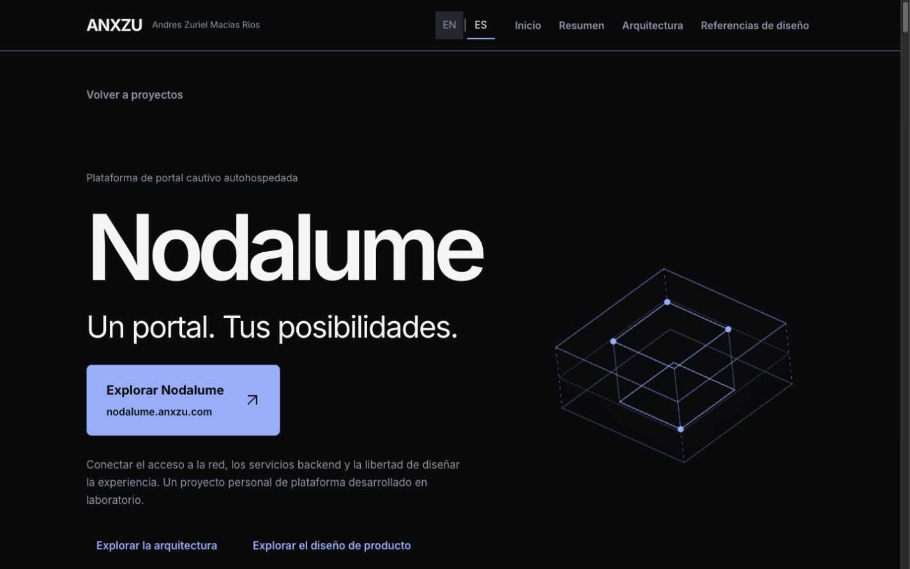
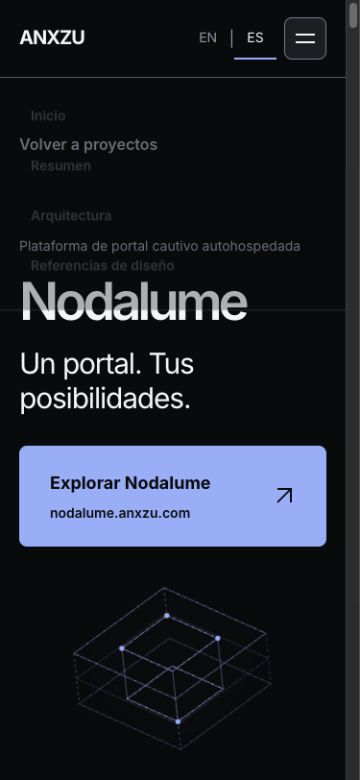

# ANXZU — Revisión editorial y acceso al producto Nodalume

2026-11-07. Solicitud del propietario: retirar comentarios de auditoría de la presentación pública y destacar el acceso a nodalume.anxzu.com. Base fuente main `1ccd9e8`, rama `codex/anxzu-editorial-product-links`.

## Cambios

- Nodalume: retirados de la interfaz los badges de revisión de código, el bloque de límites de validación, el inventario de evidencia y los nombres de archivos fuente. La documentación histórica y los modelos técnicos se conservan.
- Narrativa EN/ES centrada en el proyecto: responsabilidades, decisiones, arquitectura, diseño visual y evolución. Se elimina la referencia obsoleta al micrositio como una posibilidad futura.
- Botón Ice Blue «Explorar Nodalume», con dominio visible y flecha, antes del cuerpo del caso y repetido al cierre. Enlace principal adicional en la entrada de Nodalume de la sección Proyectos. Todos apuntan a `https://nodalume.anxzu.com/`; se conservan los accesos al caso técnico.
- Concurrencia y Metodología: comentarios repetidos sobre las ilustraciones o la revisión de evidencias sustituidos por explicaciones breves del flujo. La contribución personal se expresa directamente.
- Credenciales: introducción y preparación AWS en lenguaje natural. Se mantienen las 18 credenciales, los enlaces de verificación y AWS SAA-C03 como preparación.

Se conservan los límites relevantes: entorno de laboratorio, cloud como evaluación futura, automatización/integraciones en desarrollo y cifras de metodología como experiencia personal. No se cambian identidad, profesión, empleos, fechas, logros ni métricas. «Auditoría» como función técnica del registro de una operación sigue formando parte de su descripción; no se confunde con las notas de auditoría del portafolio.

## Integridad y validación

- lint, build con manifest, 53/53 tests, separación de chunks y diff check correctos.
- Seis modelos React Flow originales conservan sus 46 nodos y 37 conexiones; tres modelos originales de Nodalume mantienen el hash anterior. Sin cambios en geometría ni reproducción.
- Un párrafo del inspector de autenticación deja de describir pruebas ejecutadas; se regeneran las lecturas semánticas. Los ocho diagramas mantienen sus relaciones y alternativas textuales.
- El test de render comprueba dos accesos de producto en el caso Nodalume y ausencia del bloque de evidencia. Se actualiza la referencia editorial a los textos solicitados; la referencia ANX-013.1 original queda archivada.
- Inspección real en 320, 375, 768, 1024, 1440 y 1920 px: sin overflow. CTA legible y operable.
- EN/ES y enlace externo activado con Enter: abre el sitio real. Regreso a Proyectos correcto. Sin errores ni avisos de consola observados.
- Hero, controladores de movimiento, navegación, rutas, hashes y carga diferida conservados. Tests de reduced motion y limpieza pasan; no se cambia la preferencia del sistema.

No se añade ninguna dependencia, video ni recurso de marca de terceros. No se modifica Nodalume Web, la aplicación administrativa ni la infraestructura. No se ejecuta Lighthouse: no se atribuyen mejoras de Web Vitals a esta edición.

## Evidencia

[Comprobación de anchos](evidence/editorial-review-2026-11-07/layouts.json).

## Publicación

Se prepara el build validado para el repositorio de publicación existente `Zuriel0/page`, preservando CNAME, .nojekyll y assets anteriores por compatibilidad de caché. La publicación debe contrastarse con el éxito de Pages y el JavaScript servido por anxzu.com. No se crea un tag ni un Release oficial nuevo.
