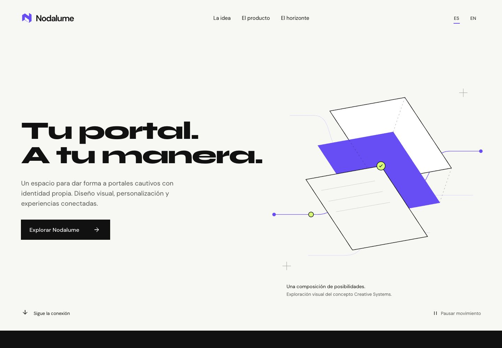
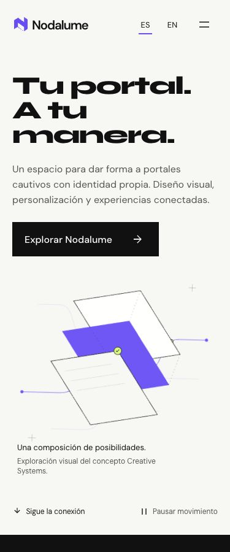

# NDL-WEB-001 — Creative Systems

27 de octubre de 2026. Implementación funcional entregada para revisión local en la rama `codex/ndl-web-001-creative-systems`.

## Resultado

Micrositio React aislado en `microsites/nodalume`, con package.json, lockfile, Vite, lint, tests y build propios. Se revisa en **http://127.0.0.1:4186/**. No se conecta al build, rutas o API del portafolio ni al panel administrativo de Nodalume. La carpeta puede extraerse a un repositorio independiente.

La dirección Creative Systems combina Syne monumental, DM Sans, blanco cálido, negro, violeta eléctrico y lima puntual. El pliegue del isotipo real se convierte en geometría original con una señal que conecta planos. La narrativa alterna composición, una escena oscura de filosofía, un frame audiovisual explícitamente pendiente y un mapa editorial de alcance. EN/ES funciona desde el primer build.

## Inspección y decisiones

Se revisó el repositorio autorizado de Nodalume solo en lectura, incluida su guía AGENTS y su índice graphify. El frontend administrativo declara React/React DOM 19.3.0, Vite 8.3.0, plugin React 6.1.1, React Router 7.18.4 y React Flow 12.12.0; no declara una biblioteca de animación. El portal cautivo usa Vite con JavaScript sin dependencias de UI. Se identificó el isotipo real y no se encontró un micrositio de producto existente.

El editor visual, propiedades, vistas responsive y espacio de lógica tienen evidencia de interfaz en el producto. No se deduce de ello que un motor general, acciones externas, despliegue comercial o infraestructura cloud estén finalizados. El mapa publica estados de implementación actual, parcial, concepto y visión futura.

La nueva landing usa versiones consultadas y fijadas independientemente: React 19.3.1, Vite 8.3.5 y GSAP 3.15.0. SVG y CSS resuelven la composición; GSAP Core, Timeline y ScrollTrigger resuelven la coreografía y el scrub. No hay justificación para un motor 3D, scroll alternativo ni una segunda librería de animación.

Fuentes, revisión de licencias, disponibilidad y aplicación de las cuatro skills solicitadas: [skills-review.md](skills-review.md). Sistema de diseño: [DESIGN.md](../DESIGN.md). Contexto de producto y límites: [PRODUCT.md](../PRODUCT.md).

## Implementación

- Navegación con marca, anclas, menú móvil, Escape y foco; idioma EN/ES con persistencia local opcional.
- Hero con entrada coordinada, movimiento ambiental, señal sobre trayectoria, respuesta interpolada al cursor y transformación de scroll.
- Filosofía con revelado tipográfico progresivo, texto seleccionable y desplazamiento nativo.
- Frame de producto 16:9 en escritorio y composición 4:5 en móvil, identificado como conceptual y con video pendiente. Sin capturas ni reproductor inventados.
- Mapa con cuatro niveles de alcance, details nativo e información expandible por teclado.
- Control manual que desmonta la capa GSAP; reduced motion estático y completo; fallback ante fallo del chunk.

Detalles y limpieza: [motion-catalog.md](motion-catalog.md). Estructura futura sin páginas ficticias: [experience-map.md](experience-map.md). Procedencia, licencias y hashes: [asset-inventory.md](asset-inventory.md).

## Archivos

Dentro de `microsites/nodalume`:

- `package.json`, `package-lock.json`, `.gitignore`, `index.html`, `vite.config.js`, `eslint.config.js`.
- `src/App.jsx`, `src/content.js`, `src/main.jsx`, `src/styles.css`, `src/motion.js`.
- `public/brand/` y `public/fonts/`, con isotipo original/derivado y licencias OFL.
- `tests/content.test.js`, `scripts/audit.mjs`.
- `README.md`, `PRODUCT.md`, `DESIGN.md`, esta documentación y `docs/evidence/`.

Fuera de la carpeta: **solo `eslint.config.js` de la raíz**, para excluir `microsites/**` del lint de ANXZU y evitar que analice el segundo paquete con otra configuración o su dist. No se modifica su código, dependencias, build o navegación. El micrositio se analiza con su propio lint.

## Evidencia visual

Capturas reales del build local; no mockups ni imágenes generadas. Los JPEG recortados desde la captura completa conservan la resolución del viewport solicitado.

[Landing completa de escritorio](evidence/desktop-full-es.jpg), [landing completa móvil](evidence/mobile-full-es.jpg), [menú móvil](evidence/mobile-menu-es.jpg), [fallback sin motor](evidence/static-fallback.jpg), [composición reduced motion](evidence/reduced-motion.jpg).

Hay capturas EN/ES de los seis anchos en `docs/evidence/{es,en}-{320,375,768,1024,1440,1920}.jpg`. [Mediciones de responsive](evidence/responsive.json), [pruebas funcionales](evidence/functional.json), [teclado](evidence/keyboard.json) y [idioma/cursor/señal](evidence/locale-and-motion.json).

## Pruebas y resultados

| Validación                         | Resultado observado                                                                                                                |
| ---------------------------------- | ---------------------------------------------------------------------------------------------------------------------------------- |
| `npm ci` del micrositio            | Correcto, cero vulnerabilidades reportadas por npm; aviso sobre install script opcional de fsevents no aprobado, sin afectar build |
| `npm run lint` del micrositio      | Correcto                                                                                                                           |
| `npm test`                         | 2/2: paridad estructural EN/ES/estados/hashes y contraste AA de los pares de texto                                                 |
| `npm run build`                    | Correcto, genera manifest y dos chunks JS separados                                                                                |
| `npm run lint` desde la raíz ANXZU | Correcto                                                                                                                           |
| `git diff --check`                 | Correcto                                                                                                                           |
| 12 combinaciones de idioma/ancho   | Sin texto fuera del viewport, IDs duplicados o desplazamiento horizontal                                                           |
| Teclado                            | Tab, Enter, Space, Escape, foco visible y devolución al botón del menú correctos                                                   |
| Idioma                             | EN persiste tras recarga; cambio sin recarga conserva hash y pausa                                                                 |
| Movimiento y cleanup               | Cursor y señal observados; 3 ciclos 4 → 0 → 4 triggers; ambiental pausado fuera del Hero                                           |
| Reduced motion                     | Cero triggers, control deshabilitado y ningún request del chunk de movimiento                                                      |
| Fallo de animación                 | 503 exclusivo del chunk produjo fallback estático; CTA llegó a `#product`                                                          |
| Consola normal                     | Sin warnings ni errores durante la revisión funcional                                                                              |

## Rendimiento

Lighthouse 13.6.0, Chrome 156, tres navegaciones por perfil con configuración oficial y build estable: **Performance 100 y Accessibility 100 en las seis ejecuciones**, LCP mediana móvil **753 ms**, escritorio **202 ms**, CLS **0** y TBT **0 ms**. [Método, rangos y limitaciones](performance.md). [Evidencia resumida](evidence/performance-summary.json).

Entry JS: **238,308 bytes**. Chunk diferido de movimiento: **116,097 bytes**. CSS: **13,787 bytes**. Las animaciones normales sí descargan ese módulo después del montaje; el JS total solicitado es **354,405 bytes**. Reduced motion lo evita. Los tamaños son archivos de build, no Web Vitals. No hay comparación anterior equivalente ni afirmación de 60 FPS.

## Límites y riesgos

- El video real está pendiente por diseño. Su incorporación modificará la composición y el presupuesto de carga; requiere medio autorizado y revisión separada.
- No se verificaron móviles físicos, todos los navegadores, lector de pantalla real ni métricas de campo. No se midieron CPU/FPS ni movimiento a 10 % de velocidad.
- La suspensión al ocultar pestaña está implementada y revisada en código. IAB mantuvo `document.hidden = false` al abrir otra pestaña, así que la transición real hidden/visible queda pendiente de prueba manual convencional; no se declara verificada.
- Los tamaños móviles se probaron como viewports, no como hardware táctil. El cursor está condicionado a puntero fino con hover.
- La aplicación React necesita JavaScript; el fallback validado es para fallo de **animaciones**, no para desactivar todo JavaScript.
- `private: true`, noindex y ausencia de scripts de deploy son valores para revisión; no son controles de acceso ni una autorización de publicación.

La revisión de acabado entrega **Approve para revisión local**, con estos límites explícitos: [interface-review.md](interface-review.md).

## Propuesta NDL-WEB-002

Validar esta dirección con el propietario; definir audiencia y acción de conversión real; preparar el storyboard sobre la composición ya renderizada; seleccionar y autorizar una demostración limpia del producto, poster y transcripción; precisar el alcance verificable del relato de conexiones; probar visibilidad de pestaña y dispositivos reales; volver a medir con el medio final. No implementar esa fase ni iniciar grabaciones automáticamente.

No se ha publicado, hecho push, creado un release, cambiado DNS, modificado la consola/backend/tenants o reutilizado material privado de demostración.
